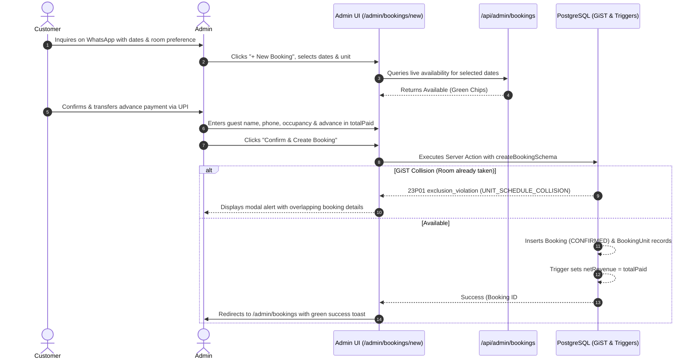
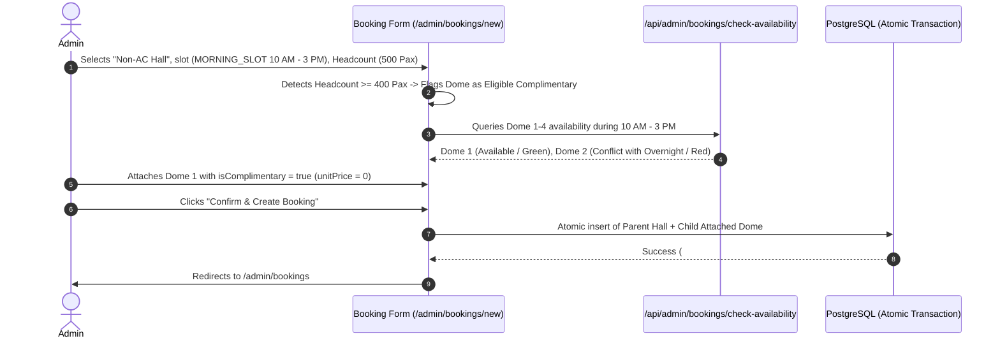

# Admin Panel - Frontend Architecture & Route Specification

This document details the frontend implementation architecture for the **Parlak Resort Admin Panel**, strictly adhering to the technical standards, performance guardrails, and $0 cost tier limits outlined in [stack_list.md](file:///Users/thasbeeh/Projects/parlak_resort/docs/stack_list.md), [rooms.md](file:///Users/thasbeeh/Projects/parlak_resort/docs/admin_panel/rooms.md), [event_hall.md](file:///Users/thasbeeh/Projects/parlak_resort/docs/admin_panel/event_hall.md), and [parlak-domain/SKILL.md](file:///Users/thasbeeh/Projects/parlak_resort/.agents/skills/parlak-domain/SKILL.md).

---

## 1. Architectural Principles & Stack Compatibility

> **Design System Authority:** All UI tokens, colors, typography, tactile micro-physics, and component implementations are authoritatively specified in [admin-front-end-2.md](file:///Users/thasbeeh/Projects/parlak_resort/docs/admin_panel/admin-front-end-2.md).

| Component / Layer | Technology Choice | Stack Compatibility & Domain Rules |
| :--- | :--- | :--- |
| **Framework** | **Next.js 16 (React 19.2)** | App Router with React Server Components (RSC) for initial loads and Server Actions for data mutations. Uses `<ViewTransition>` for seamless page transitions. |
| **Styling & Design** | **Tailwind CSS v4 + shadcn/ui (`base-nova`)** | OKLCH color space (`oklch(0.22 0.02 140)`, `oklch(0.32 0.07 148)`). Grounded in riverside flora and wet slate; zero AI slop defaults. |
| **Micro-Interactions** | **Emil Kowalski Tactile Physics** | Tactile button compression (`active:scale-[0.98]` in 150ms with `cubic-bezier(0.23, 1, 0.32, 1)`). Surfaces enter from `scale-96` (never `scale-0`). Zero animation on keyboard navigation. |
| **Icons & Primitives** | **Lucide React + Base UI (`@base-ui/react`)** | Lightweight SVG icons (`size-4`, `size-5`) and accessible headless dialogs, drawers, and popovers. Explicit titles (`DialogTitle`, `SheetTitle`) on all overlays. |
| **State & Data Sync** | **RSC Initial Load + SWR Client Polling** | **Zero WebSockets.** RSC passes `fallbackData` to SWR with a **30-second background polling interval** and `revalidateOnFocus: true`. Preserves Neon Postgres compute hours (scale-to-zero operational). |
| **Media Pipeline** | **Direct Cloudinary Client Upload** | Sequential upload queue directly from browser to Cloudinary via signed/unsigned REST presets with a client-side 3MB file check. Zero memory overhead on Vercel Serverless Functions. |
| **Receipt / Invoice** | **Native `@media print` CSS** | **Zero external PDF libraries.** Pure CSS print stylesheets formatting for 80mm thermal and A4 printers via browser `window.print()`, saving ~450 kB bundle. |
| **Mobile Experience** | **Mobile-Native Standards** | Dynamic viewport heights (`min-h-[100svh]`, `h-[100dvh]`), iOS safe areas (`env(safe-area-inset-*)`), iOS 16px zoom guard (`text-base md:text-sm`), and `-webkit-tap-highlight-color: transparent`. |
| **Concurrency & Integrity** | **OCC + GiST Collision Traps** | Form mutations strictly enforce `expectedUpdatedAt` (handling `BOOKING_STALE_RECORD`) and trap PostgreSQL GiST overlaps (`UNIT_SCHEDULE_COLLISION`). |
| **Financial Tracking** | **Flat Numeric Model** | Zero separate payment tables. Financial tracking is strictly numeric (`rentCharge`, `totalPaid`, `receiptLineItems` JSONB, and trigger-maintained `netRevenue`). Formatted with `tabular-nums font-mono` and `₹&nbsp;X,XXX`. |

---

## 2. All Pages & File Locations

All admin views are isolated under the Next.js `app/admin/` route group:

| Route | File Path | Rendering Mode | Purpose |
| :--- | :--- | :--- | :--- |
| `/admin/login` | `app/admin/login/page.tsx` | Client + Server Action | Admin authentication entry point; verifies credentials and issues signed HTTP-only JWT. |
| `/admin` | `app/admin/page.tsx` | Server Component | Root admin route; performs instant server-side redirect to `/admin/dashboard`. |
| `/admin/dashboard` | `app/admin/dashboard/page.tsx` | RSC + Client SWR | Main operational cockpit: denormalized revenue, today's check-ins/outs, and overnight guests. |
| `/admin/units` | `app/admin/units/page.tsx` | Server Component | Inventory list of Domes, A-Frames, and Event Halls with status toggles and maintenance blocks. |
| `/admin/units/[id]` | `app/admin/units/[id]/page.tsx` | RSC + Client Form | Unit editor: capacity, features, and Cloudinary image gallery management. |
| `/admin/pricing` | `app/admin/pricing/page.tsx` | Server Component | Table and overview of all dynamic Price Lists and assigned seasons. |
| `/admin/pricing/new` | `app/admin/pricing/new/page.tsx` | Client Form | Headcount slab creation wizard for overnight stays, day slots, and gathering shifts. |
| `/admin/pricing/[id]` | `app/admin/pricing/[id]/page.tsx` | Client Form | Edit existing Price List slabs with contiguous range validation. |
| `/admin/pricing/modifiers` | `app/admin/pricing/modifiers/page.tsx` | Client Form | Dynamic weekend and seasonal percentage modifier manager (`WEEKEND` and `SEASONAL`). |
| `/admin/bookings` | `app/admin/bookings/page.tsx` | RSC + Client SWR | Bookings data table with live filters, status badges, and search. |
| `/admin/bookings/new` | `app/admin/bookings/new/page.tsx` | Client Form | Manual booking entry form with slot presets, multi-unit bundling, and availability checks. |
| `/admin/bookings/[id]/print` | `app/admin/bookings/[id]/print/page.tsx` | Static / Printable RSC | Dedicated printable tax invoice / thermal receipt view. |
| `/admin/settings` | `app/admin/settings/page.tsx` | Server / Client Form | Resort profile, contact details, and platform settings. |

---

## 3. Sub-Routes & Dynamic Routing

Sub-routes are grouped by operational domain with nested dynamic segments:

```text
app/admin/
├── login/
│   └── page.tsx                      # Public admin auth
├── page.tsx                          # Redirect -> /admin/dashboard
├── layout.tsx                        # Admin root shell (Sidebar + Header + SafeViewport)
│
├── dashboard/
│   └── page.tsx                      # Operations dashboard
│
├── units/
│   ├── page.tsx                      # Inventory list & maintenance blocks
│   └── [id]/
│       └── page.tsx                  # Sub-route: Unit detail & Cloudinary media manager
│
├── pricing/
│   ├── page.tsx                      # Price lists table
│   ├── new/
│   │   └── page.tsx                  # Sub-route: Create price list & slabs
│   ├── [id]/
│   │   └── page.tsx                  # Sub-route: Edit price list & slabs
│   └── modifiers/
│       └── page.tsx                  # Sub-route: Weekend & seasonal percentage rules
│
├── bookings/
│   ├── page.tsx                      # Bookings table & filter manager
│   ├── new/
│   │   └── page.tsx                  # Sub-route: Manual booking creation wizard
│   └── [id]/
│       └── print/
│           └── page.tsx              # Sub-route: Pure CSS thermal / A4 print view
│
└── settings/
    └── page.tsx                      # Resort profile & system configuration
```

> **Note on In-Place Dialogs:** Fast lifecycle mutations (editing booking dates/times, recording payments, cancellations/refunds, adding line items, and setting maintenance blocks) are implemented as **Slide-overs / Modals** inside `/admin/bookings` and `/admin/units` rather than separate pages, preventing disruptive full-page navigation.

---

## 4. Public vs. Authenticated Boundaries

Security and route protection are enforced at the edge via [middleware.ts](file:///Users/thasbeeh/Projects/parlak_resort/middleware.ts) using the Web Crypto API (`jose`):

```
                        Incoming Request
                               │
               ┌───────────────┴───────────────┐
               ▼                               ▼
       Does path start with             Public Website Route
          `/admin/*`?                     (`/`, `/stays`, etc.)
               │                               │
        ┌──────┴──────┐                        ▼
        │             │                   Allow Request
        ▼             ▼
   Is path        All other
`/admin/login`?  `/admin/*`
        │             │
        ▼             ▼
  Allow Access   Check HTTP-only
  (Public Admin) `admin_token` Cookie
                      │
               ┌──────┴──────┐
               ▼             ▼
         Valid JWT?     Missing/Invalid
               │             │
               ▼             ▼
         Allow Request   Redirect 307 to
         to Admin Panel  `/admin/login`
```

### Boundary Matrix

| Route Category | Paths | Auth Required | Enforcement Mechanism |
| :--- | :--- | :--- | :--- |
| **Public Customer Website** | `/`, `/stays`, `/stays/[slug]`, `/contact`, `/gallery` | **No** | Publicly accessible static/cached pages. Customers explore amenities and generate WhatsApp inquiry links. |
| **Public Inquiry API** | `/api/inquiries` | **No** | Rate-limited public endpoint for logging customer WhatsApp inquiries. |
| **Public Admin Auth** | `/admin/login` | **No** | Explicitly bypassed in `middleware.ts`. |
| **Authenticated Admin Pages** | `/admin`, `/admin/dashboard`, `/admin/units/*`, `/admin/pricing/*`, `/admin/bookings/*`, `/admin/settings` | **Yes** | Validates signed JWT from `admin_token` cookie. Unauthorized traffic redirects to `/admin/login`. |
| **Protected Admin APIs** | `/api/admin/*` (`/api/admin/dashboard`, `/api/admin/bookings/check-availability`) | **Yes** | Returns `401 Unauthorized` JSON if JWT is missing or invalid. |

---

## 5. Navigation Structure & UI Shell

The administrative shell provides responsive navigation tailored across three distinct device profiles, adhering strictly to [`admin-front-end-2.md`](file:///Users/thasbeeh/Projects/parlak_resort/docs/admin_panel/admin-front-end-2.md#L785) and [`emil-design-eng`](file:///Users/thasbeeh/Projects/parlak_resort/.agents/skills/emil-design-eng/SKILL.md):

```
┌────────────────────────────────────────────────────────────────────────┐
│                        RESPONSIVE NAVIGATION SHELL                     │
├────────────────────┬────────────────────┬──────────────────────────────┤
│ DESKTOP (≥ 1024px) │ TABLET (768–1023px)│ MOBILE (< 768px)             │
├────────────────────┼────────────────────┼──────────────────────────────┤
│ Persistent 260px   │ 68px Icon Rail     │ Top Header (56px) + Sheet    │
│ left sidebar       │ with hover/tap     │ Drawer + Thumb-zone Bottom   │
│ with full labels   │ tooltips           │ Navigation Bar for top tabs  │
└────────────────────┴────────────────────┴──────────────────────────────┘
```

### 5.1 Root Shell (`app/admin/layout.tsx`)

```text
┌────────────────────────────────────────────────────────────────────────┐
│ Top Bar: Brand Crest | Live Status (🟢 Online) | Admin Profile | Logout│
├────────────────────┬───────────────────────────────────────────────────┤
│ Responsive Sidebar │ Main Content Viewport                             │
│ • Desktop: 260px   │ Wrapped in <main className="min-h-[100dvh] p-6">  │
│ • Tablet: 68px     │                                                   │
│ • Mobile: Drawer   │  [RSC / Client Component Container]               │
│                    │                                                   │
│ • Dashboard (⌘1)   │                                                   │
│ • Bookings  (⌘2)   │                                                   │
│ • Units     (⌘3)   │                                                   │
│ • Pricing   (⌘4)   │                                                   │
│ • Settings  (⌘5)   │                                                   │
└────────────────────┴───────────────────────────────────────────────────┘
```

### 5.2 Primary Navigation Matrix

Constructed in `components/admin/AdminSidebar.tsx` with responsive drawer support and accessible semantic links:

| Nav Item | Destination Route | Icon (`lucide-react`) | Shortcut | Purpose |
| :--- | :--- | :--- | :--- | :--- |
| **Dashboard** | `/admin/dashboard` | `LayoutDashboard` | `⌘1` | High-level resort metrics, occupancy, and net revenue. |
| **Bookings** | `/admin/bookings` | `CalendarCheck` | `⌘2` | Reservations, payments, and calendar data table. |
| **Units** | `/admin/units` | `Home` | `⌘3` | Dome, A-Frame, and Event Hall inventory management. |
| **Pricing** | `/admin/pricing` | `Tag` | `⌘4` | Dynamic tariffs, headcount slabs, and seasonal rules. |
| **Settings** | `/admin/settings` | `Settings` | `⌘5` | Resort profile and admin account information. |

### 5.3 Contextual Secondary Navigation & Button Clarifications

> **Standardized Action Label:** In Parlak Resort, **all bookings are manual WhatsApp reservations** created by the Admin after collecting the advance payment via WhatsApp. We standardize the primary booking creation button label throughout the application as **`+ New Booking`** (navigating to `/admin/bookings/new`).

1. **Bookings Flow:**
   - **Primary CTA:** Header button `+ New Booking` &rarr; Navigates to `/admin/bookings/new`.
   - **Row Actions:** `Print Invoice` &rarr; Navigates to `/admin/bookings/[id]/print` (Pure CSS `@media print`).
   - **Row Slide-Over Drawers:** `Manage Folio` (combines Edit Booking, Record Payment, Add Line Item, and Checkout Guard into a single compound `FolioDrawer`).
   - **Row Modal:** `Cancel & Refund` (`CancelBookingDialog`).
2. **Pricing Flow:**
   - **Primary CTA:** Header button `+ Create Price List` &rarr; Navigates to `/admin/pricing/new`.
   - **Sub-View Tab:** Header link `Seasonal & Weekend Modifiers` &rarr; Navigates to `/admin/pricing/modifiers`.
   - **Row Action:** `Edit Slabs` &rarr; Navigates to `/admin/pricing/[id]`.
3. **Units Flow:**
   - **Primary CTA:** `+ Add Maintenance Block` (opens dialog).
   - **Row Action:** `Manage Unit` &rarr; Navigates to `/admin/units/[id]`.

---

## 6. Page-by-Page Detailed Component & Feature Specifications

Every page in the admin panel is specified below across all 9 UI dimensions:
1. **Sections**
2. **Forms**
3. **Tables/Lists**
4. **Cards/Summary Widgets**
5. **Detail Views**
6. **Modals/Dialogs**
7. **Drawers**
8. **Tabs**
9. **Primary and Secondary Actions**

---

### Page 1: Admin Login (`/admin/login`)
- **File:** `app/admin/login/page.tsx`
- **Sections:**
  - Full-screen centered authentication viewport with ambient gradient background.
  - Brand identity header (Parlak Resort crest logo + "Admin Portal" subhead).
  - Main credentials card container with subtle border and glassmorphism styling.
  - Footer compliance and security note ("Authorized Resort Personnel Only").
- **Forms:**
  - **Admin Login Form (`adminLoginSchema`):**
    - `usernameOrEmail` (Text input, auto-focus, trimmed).
    - `password` (Password input with toggle eye button for visibility).
    - Inline error alert banner on failed validation or invalid credentials.
- **Tables/Lists:** None.
- **Cards/Summary Widgets:**
  - Center Auth Card (`max-w-md`) with subtle shadow and border.
  - Security reassurance badge ("End-to-End Encrypted Session").
- **Detail Views:** None.
- **Modals/Dialogs:** None.
- **Drawers:** None.
- **Tabs:** None.
- **Primary & Secondary Actions:**
  - **Primary Action:** `Sign In` button (triggers `actions/auth.ts -> loginAdmin`, sets HTTP-only `admin_token` cookie, redirects to `/admin/dashboard`).
  - **Secondary Action:** `Back to Public Website` (link pointing to `/`).

---

### Page 2: Operations Dashboard (`/admin/dashboard`)
- **File:** `app/admin/dashboard/page.tsx`
- **Sections:**
  - **Dashboard Header:** Greeting, last sync timestamp, pulsing "Live Sync" badge, and date range indicator.
  - **Financial & Occupancy KPI Strip:** 4 high-level summary cards.
  - **Event Hall Shift Operations Section:** Distinct headcount monitors for Non-AC and AC halls across morning and evening slots.
  - **Operational Alerts Section:** Critical alerts highlighting underpaid arrivals arriving today (`totalPaid < requiredAdvance`).
  - **Today's Roster Section:** Arrival and departure schedule lists.
- **Forms:**
  - Quick date period selector (Dropdown: "Today", "Last 7 Days", "Last 30 Days").
- **Tables/Lists:**
  - **Today's Check-ins & Check-outs Table:**
    - Columns: Booking Ref (#B001), Guest Name, Phone, Unit(s) Assigned, Stay Type badge, Arrival/Departure Time, Status, Balance Due.
  - **Underpaid Arrivals Alert List:**
    - List item: Guest Name, Unit, Required Advance vs Collected Advance, Shortfall amount in red, "Collect Payment" trigger.
- **Cards/Summary Widgets:**
  - **Total 30-Day Net Revenue Card:** Calculates active stay rent plus non-refundable retained fees from cancellations per [rooms.md](file:///Users/thasbeeh/Projects/parlak_resort/docs/admin_panel/rooms.md):
    $$\text{Total 30-Day Revenue} = \sum_{\text{Active}} \text{rent\_charge} + \sum_{\text{Cancelled}} (\text{total\_paid} - \text{refund\_amount})$$
    *(Extra charges / receipt line items are strictly for receipt generation and excluded from dashboard rent analytics).*
  - **Today's Check-ins Card:** Count of arriving guest groups.
  - **Today's Check-outs Card:** Count of departing guest groups.
  - **Resident Overnight Guests Card:** Total active checked-in guests, strictly filtered by `stayType = 'OVERNIGHT'` across Domes and A-Frames (excludes day-slot attendees and resting dome guests).
  - **Non-AC Hall Headcount Tile:** Morning Slot (10 AM – 3 PM) Headcount & Evening Slot (5 PM – 10 PM) Headcount.
  - **AC Hall Headcount Tile:** Morning Slot (10 AM – 3 PM) Headcount & Evening Slot (5 PM – 10 PM) Headcount.
- **Detail Views:**
  - Expandable row peek on the Today's Roster table showing notes and attached Domes.
- **Modals/Dialogs:**
  - Quick Payment Record Dialog (if clicking "Collect Payment" from an alert item).
- **Drawers:**
  - Mobile Sidebar Drawer (inherited from layout).
  - Quick Guest Roster Slide-Over for full guest details peek.
- **Tabs:**
  - Schedule Filter Tabs: `All Arrivals/Departures`, `Overnight Rooms`, `Event Halls`.
- **Primary & Secondary Actions:**
  - **Primary Action:** `+ New Booking` &rarr; Navigates to `/admin/bookings/new`.
  - **Secondary Actions:** `Refresh Data` (manual SWR trigger), `View Full Bookings` &rarr; `/admin/bookings`.

---

### Page 3: Units & Inventory List (`/admin/units`)
- **File:** `app/admin/units/page.tsx`
- **Sections:**
  - **Header & Metrics Section:** Page title, inventory counts (Total Domes, A-Frames, Halls).
  - **Filter & Search Toolbar:** Unit category filters and search by unit name.
  - **Unit Inventory Grid/List:** Visual cards or table rows for all resort inventory.
- **Forms:**
  - Filter and search input controls.
- **Tables/Lists:**
  - **Unit Inventory List:**
    - Columns / Card Data: Cover Photo thumbnail, Unit Name (e.g. Dome 1), Category badge, Max Physical Capacity, Assigned Active Price List, Active/Inactive switch, Actions menu.
- **Cards/Summary Widgets:**
  - Total Active Domes counter pill.
  - Total Active A-Frames counter pill.
  - Total Event Halls (Active Non-AC Hall / Inactive AC Hall) counter pill.
- **Detail Views:**
  - Quick amenity list chip group under each unit card.
- **Modals/Dialogs:**
  - **Pre-Deactivation Future Booking Guard Dialog:**
    - Triggered when Admin attempts to switch a unit from "Active" to "Inactive".
    - Validates against active future bookings (`endDatetime >= NOW()` AND `status NOT IN ('CANCELLED')`).
    - If the backend throws `UNIT_HAS_FUTURE_BOOKINGS`, this dialog displays the count of future bookings, conflicting dates, and booking reference IDs.
    - Prevents deactivation until all bookings are rescheduled or cancelled.
  - **Confirm Deactivation Dialog:** Simple confirmation prompt for units without future bookings.
  - **Add Maintenance Block Dialog (`maintenanceBlockSchema`):**
    - Fields: `unitId`, `startDatetime`, `endDatetime`, `notes`.
    - Creates a `BookingUnit` with `status: MAINTENANCE_BLOCKED` to reserve maintenance periods directly in PostgreSQL without requiring dummy guest bookings. Protected by the GiST exclusion constraint.
- **Drawers:**
  - Mobile Navigation Drawer.
- **Tabs:**
  - Unit Category Tabs: `All Units`, `Domes`, `A-Frames`, `Event Halls`.
- **Primary & Secondary Actions:**
  - **Primary Action:** `Manage Unit` &rarr; Navigates to `/admin/units/[id]`.
  - **Secondary Actions:** `+ Add Maintenance Block` (opens dialog), `Toggle Active/Inactive` switch.

---

### Page 4: Unit Editor & Media Management (`/admin/units/[id]`)
- **File:** `app/admin/units/[id]/page.tsx`
- **Sections:**
  - **Breadcrumb Navigation:** `< Units / Edit [Unit Name]`.
  - **General Metadata Section:** Name, Slug, Description, Physical Capacity.
  - **Price List Association Section:** Dropdown selector strictly filtered to Price Lists matching the unit's category.
  - **Capacity Safeguard Section:** Visual validation verifying `PriceList.MaxGuestCapacity <= Unit.PhysicalCapacity`.
  - **Cloudinary Photo Gallery Section:** Sequential drag-and-drop upload zone and sortable photo grid.
- **Forms:**
  - **Unit Details Form (`unitUpdateSchema`):**
    - `name` (string)
    - `description` (multiline text)
    - `physicalCapacity` (number)
    - `priceListId` (UUID select)
    - `isActive` (boolean toggle)
  - **Photo Metadata Inline Form:** Caption, Alt Text, and Description for each photo.
- **Tables/Lists:** None.
- **Cards/Summary Widgets:**
  - **Featured Cover Photo Card:** Highlights the single photo currently assigned `isFeatured: true`.
  - **Photo Count Quota Widget:** `Uploaded: N photos | Max 3MB per file`.
- **Detail Views:**
  - **Sortable Photo Gallery Grid (`SortableGallery.tsx`):** Drag-and-drop grid displaying thumbnail, order index, "Featured" badge, and delete icon.
- **Modals/Dialogs:**
  - **Delete Photo Confirmation Dialog:**
    - Warns the user. Explains that if the featured photo is deleted, the photo with the lowest `orderIndex` is automatically promoted to featured inside an atomic transaction.
- **Drawers:** None.
- **Tabs:**
  - Edit Sections Tabs: `Basic Information`, `Media Gallery`, `Linked Price Plan`.
- **Primary & Secondary Actions:**
  - **Primary Action:** `Save Unit Changes` (Invokes `actions/units.ts -> updateUnit`).
  - **Secondary Actions:** `Upload Photos` (Triggers sequential Cloudinary REST pipeline), `Set as Featured` radio button, `Cancel & Go Back`.

---

### Page 5: Price Lists Overview (`/admin/pricing`)
- **File:** `app/admin/pricing/page.tsx`
- **Sections:**
  - **Header Section:** Title, summary of active price lists, and link to Modifiers.
  - **Category Filter Bar:** Filter by unit category.
  - **Price Lists Table Section:** Tabular display of all configured rate profiles.
- **Forms:**
  - Search and filter controls.
- **Tables/Lists:**
  - **Price Lists Table:**
    - Columns: Profile Name (e.g. "Non-AC Hall Grand Plan"), Target Unit Type, Headcount Range Coverage (e.g. "25 - 1200 Pax"), Total Slabs, Linked Units Count, Last Modified, Actions menu (`...`).
- **Cards/Summary Widgets:**
  - Total Active Price Lists count tile.
  - Units Covered vs Uncovered inventory count tile.
  - Active Modifiers indicator pill.
- **Detail Views:**
  - Expandable row showing quick preview of Overnight and Day Slot slab tables.
- **Modals/Dialogs:**
  - **Delete Price List Guard Dialog:** Blocks deletion if any active unit is currently linked to this price list.
  - **Duplicate Price List Dialog:** Clones an existing profile for rapid seasonal configuration.
- **Drawers:** None.
- **Tabs:**
  - Category Filter Tabs: `All Plans`, `Domes`, `A-Frames`, `Non-AC Hall`, `AC Hall`.
- **Primary & Secondary Actions:**
  - **Primary Action:** `+ Create Price List` &rarr; Navigates to `/admin/pricing/new`.
  - **Secondary Actions:** `Seasonal & Weekend Modifiers` &rarr; Navigates to `/admin/pricing/modifiers`, `Edit Slabs` &rarr; `/admin/pricing/[id]`, `Duplicate Plan`.

---

### Page 6: Price List & Slab Builder (`/admin/pricing/new` & `/admin/pricing/[id]`)
- **Files:** `app/admin/pricing/new/page.tsx` and `app/admin/pricing/[id]/page.tsx`
- **Sections:**
  - **Breadcrumb Header:** `< Pricing / [Create New | Edit] Price List`.
  - **Profile Information Section:** Profile Name, Target Unit Type.
  - **Dynamic Headcount Slab Builder Section:**
    - For Rooms: Overnight Stay Slabs & Day Slot Slabs.
    - For Halls: Morning Slot (10 AM - 3 PM) Slabs & Evening Slot (5 PM - 10 PM) Slabs.
  - **Contiguous Bounds Validation Callout:** Visual banner displaying validation state.
- **Forms:**
  - **Price List Form (`priceListSchema`):**
    - `profileName` (string, unique slug generated)
    - `unitType` (DOME | A_FRAME | NON_AC_HALL | AC_HALL)
    - Dynamic Array Slabs (`useFieldArray`):
      - `minHeadcount` (integer, starts at `1`)
      - `maxHeadcount` (integer, upper bound $\le \text{MaxGuestCapacity}$)
      - `basePrice` (number in ₹, positive)
      - `defaultAdvanceAmount` (number in ₹, $0 \le \text{deposit} \le \text{basePrice}$)
- **Tables/Lists:**
  - **Dynamic Slabs Editable Table:**
    - Rows contain inputs for min headcount, max headcount, base price, and advance amount.
    - Actions per row: `+ Add Slab Below`, `Delete Row`.
    - **Visual Gap Indicator:** Displays a red warning icon between rows if Slab $N+1$ min does not equal Slab $N$ max $+ 1$.
- **Cards/Summary Widgets:**
  - **Headcount Span Coverage Card:** Shows total range coverage (e.g., 25 to 1200 pax) and highlights any missing gaps.
  - **Interactive Price Calculator Widget:** Admin can input an arbitrary headcount (e.g. 150 guests) to test which slab and base rate is resolved.
- **Detail Views:** None.
- **Modals/Dialogs:**
  - **Discard Unsaved Changes Dialog.**
- **Drawers:** None.
- **Tabs:**
  - Slot Sections Tabs:
    - Rooms: `Overnight Slabs (12 PM - 11 AM)` | `Day Slot Slabs (10 AM - 3 PM)`.
    - Halls: `Morning Slot Slabs (10 AM - 3 PM)` | `Evening Slot Slabs (5 PM - 10 PM)`.
- **Primary & Secondary Actions:**
  - **Primary Action:** `Save Price List` (Calls `actions/price-lists.ts -> createPriceList` or `updatePriceList`).
  - **Secondary Actions:** `+ Add New Slab Row`, `Reset Slabs`, `Cancel & Return`.

---

### Page 7: Weekend & Seasonal Modifiers (`/admin/pricing/modifiers`)
- **File:** `app/admin/pricing/modifiers/page.tsx`
- **Sections:**
  - **Header Section:** Title, timezone indicator (IST), active rules counter.
  - **Active & Upcoming Modifiers Section:** Table of live and scheduled percentage rules.
  - **Expired Modifiers Section:** Collapsible historical archive (read-only per domain rules).
- **Forms:**
  - **Modifier Form (`createPriceModifierSchema`):**
    - `priceListId` (Dropdown selector: target Price List that this modifier modifies; in Prisma, `PriceModifier` directly belongs to a `PriceList`).
    - `name` (e.g., "Peak Summer Season 2026")
    - `type` (`WEEKEND` | `SEASONAL` strictly — **no `HOLIDAY` type exists in domain/schema; holiday surcharges are configured as `SEASONAL` date ranges**).
    - `startDate` (Date picker, IST midnight, mandatory).
    - `endDate` (Date picker, IST 23:59:59, mandatory, $endDate \ge startDate$).
    - `percentage` (Number input, constrained between `-80%` and `+200%`).
    - `isActive` (boolean toggle).
- **Tables/Lists:**
  - **Modifiers Table:**
    - Columns: Rule Name, Type badge (`WEEKEND` or `SEASONAL`), Target Price List name, Effective Date Range, Rate Multiplier (+25% / -10%), Status badge (Active Now / Upcoming / Expired), Actions.
- **Cards/Summary Widgets:**
  - **Today's Active Rate Multiplier Widget:** Displays any seasonal modifier applying to bookings today.
- **Detail Views:**
  - Calendar preview highlighting active modifier date ranges.
- **Modals/Dialogs:**
  - **Create / Edit Modifier Dialog:** Modal containing the modifier form.
  - **Delete Modifier Confirmation Dialog:** Prompts Admin to delete an active or upcoming modifier. (Note: Expired modifiers are permanently locked for audit and cannot be deleted).
- **Drawers:**
  - Mobile Modifier Creation Slide-Over.
- **Tabs:**
  - Filter Tabs: `All Rules`, `Active Now`, `Upcoming`, `Expired`.
- **Primary & Secondary Actions:**
  - **Primary Action:** `+ Create Modifier` (Opens modal/drawer).
  - **Secondary Actions:** `Toggle Active/Inactive`, `Edit Rule`, `Delete Rule`.

---

### Page 8: Bookings Master Table (`/admin/bookings`)
- **File:** `app/admin/bookings/page.tsx`
- **Sections:**
  - **Header Section:** Title, SWR live sync indicator, "+ New Booking" button.
  - **Filter & Search Bar:** Keyword search, Date range selector, Status filter, Unit filter.
  - **Bookings Data Table Section:** Main tabular list.
  - **Pagination & Footer:** Items per page selector and page navigation.
- **Forms:**
  - Filter and search bar input controls (debounced).
- **Tables/Lists:**
  - **Bookings Master Table (`BookingsDataTable.tsx` / `ResponsiveBookingsList.tsx`):**
    - **Desktop / Tablet (`md` and up):** 7-column high-density tabular grid: Booking Ref (#B001), Guest Name & Phone (with click-to-WhatsApp link), Units Assigned (badges), Stay Dates & Slot, Rent Charge, Total Paid, Balance Due (with green/amber indicator in `font-mono tabular-nums`), Status Badge (`Confirmed`, `Checked-In`, `Checked-Out`, `Cancelled`), Actions dropdown (`...`). Cell padding strictly clamped to `py-2.5 px-3` (~44px height).
    - **Mobile (`< 768px` Table-to-Tile Reflow):** Automatically reflows from table into **Stacked Record Tiles** (per [admin-front-end-2.md#D](file:///Users/thasbeeh/Projects/parlak_resort/docs/admin_panel/admin-front-end-2.md#D)) displaying `#ID` + status pill, guest name + click-to-call link, assigned units & dates, balance due, and full-width tactile `Manage Folio` button.
- **Cards/Summary Widgets:**
  - Summary KPI Strip: Total Bookings, Currently In-House, Arriving Today, Outstanding Receivables.
  - Zero Balance Due Status Pill per row (`Settled: ₹0` in green vs `Due: ₹X,XXX` in amber). Formatted with `tabular-nums font-mono` and `₹&nbsp;X,XXX`.
- **Detail Views:**
  - **Compound Folio Drawer (`FolioDrawer.tsx`):** Slide-over drawer (`w-full sm:max-w-md h-[100dvh]`) displaying guest details, itemized line items list, payment transaction history, snapshot tariffs, and zero-balance checkout settlement.
- **Modals/Dialogs & Drawers:**
  - **BookingEditDialog (OCC Protected via `updateBookingSchema`):**
    - Base UI / Radix Dialog entering with `scale-96` to `scale-100` deceleration.
    - Allows changing dates, times, units, and capacity.
    - Sends `expectedUpdatedAt`. Traps `BOOKING_STALE_RECORD` (409) if concurrently edited.
    - Prompts Admin with Scope-Based Recalculation breakdown:
      - *"Baseline Stay: ₹X,XXX (Agreed tariff preserved)"*
      - *"Extension: +₹Y,YYY (Calculated at current active tariff)"*
      - Choices: *"Apply Recalculated Rent"* OR *"Keep Custom Rent"*.
  - **Folio Line Items Drawer (`ReceiptLineItemsDrawer`):** Slide-over with dynamic line item adder (`useFieldArray`) and browser-based printable receipt action (`window.print()`).
  - **Cancellation & Refund Modal (`CancelBookingDialog`):** Accessible dialog with refund calculator and cascading release confirmation.
  - **PaymentRecordDialog (`recordPaymentSchema`):**
    - Records newly collected payments (`amount` in ₹, finite, positive).
    - Sends `expectedUpdatedAt` timestamp to prevent "Last Write Wins" race conditions.
    - **No paymentMethod field:** Updates `totalPaid` directly on the `Booking` record.
  - **RefundCancelDialog (`cancelBookingSchema`):**
    - Soft-deletes booking (`status: CANCELLED`), records `refundAmount` ($0 \le refundAmount \le totalPaid$) and `cancelReason`.
    - Automatically executes **Cascading Release**: releases the PostgreSQL GiST calendar block and cancels attached complimentary domes.
  - **AddLineItemDialog (`addReceiptLineItemSchema`):**
    - Adds positive/negative line item charges (barbecue, extra bedding, courtesy waiver) to `receiptLineItems` JSONB array.
  - **Checkout Guard Dialog (`checkoutBookingSchema`):**
    - Enforces **Zero Balance Due Invariant**: The "Check Out" button is disabled if `(rentCharge + sum(receiptLineItems)) - totalPaid != 0`.
    - Evaluated with integer rounding and epsilon check `Math.abs(balance) < 1`. If balance is outstanding, displays alert: *"Cannot check out: Outstanding balance of ₹X,XXX must be collected or adjusted to ₹0 first."*
- **Drawers:**
  - Mobile Filters Drawer (full-screen filter options on mobile).
  - Booking Detail Slide-Over (quick view of audit history).
- **Tabs:**
  - Status Filter Tabs: `All`, `Confirmed`, `Checked-In`, `Checked-Out`, `Cancelled`.
- **Primary & Secondary Actions:**
  - **Primary Action:** `+ New Booking` &rarr; Navigates to `/admin/bookings/new`.
  - **Row Menu Actions:**
    - `Print Receipt / Invoice` &rarr; Navigates to `/admin/bookings/[id]/print`.
    - `Check In` / `Check Out` status buttons.
    - `Record Payment` (opens modal).
    - `Edit Booking` (opens modal).
    - `Add Extra Charge / Waiver` (opens modal).
    - `Cancel & Refund` (opens modal).

---

### Page 9: Manual Booking Entry Wizard (`/admin/bookings/new`)
- **File:** `app/admin/bookings/new/page.tsx`
- **Sections:**
  - **Breadcrumb Header:** `< Bookings / Manual Booking Entry`.
  - **Guest Contact Details Section:** Flat CRM text inputs (Name, 10-digit Phone, Email, Notes).
  - **Stay Timing & Slot Configuration Section:** Preset slot buttons, date/time pickers.
  - **Unit Selection & Multi-Unit Bundling Section:** Primary unit selection and secondary attached units.
  - **Event Hall Dome Availability Sub-Panel:** Live query to `/api/admin/bookings/check-availability` showing green/red chips for attached resting Domes.
  - **Occupancy Section:** Adults and infants (rooms) or headcount (halls). **No event type field (weddings/birthdays are strictly not tracked per domain spec).**
  - **Pricing Breakdown & Advance Payment Section:** Live tariff calculation, required advance, and initial advance paid input.
- **Forms:**
  - **Booking Creation Form strictly validated with Zod (`createBookingSchema`):**
    - `guestName`: String (1 to 100 characters, trimmed).
    - `guestPhone`: String (10 to 15 digits regex `^\+?[0-9]{10,15}$`).
    - `guestEmail`: Optional valid email (empty string transforms to null).
    - `notes`: Optional string.
    - `rentCharge`: Number (finite, non-negative, calculated from slab + active modifiers).
    - `totalPaid`: Number (finite, non-negative, represents collected advance).
    - `units`: Array of `bookingUnitItemSchema` (min 1 unit):
      - `unitId`: UUID string.
      - `startDatetime` & `endDatetime`: Date objects ($endDatetime > startDatetime$).
      - `stayType`: `OVERNIGHT` | `DAY_SLOT` | `MORNING_SLOT` | `EVENING_SLOT`.
      - Preset Duration Buttons:
        - Overnight: 12:00 PM – 11:00 AM (Next Day)
        - Day Slot: 10:00 AM – 3:00 PM (Same Day)
        - Hall Morning: 10:00 AM – 3:00 PM (Same Day)
        - Hall Evening: 5:00 PM – 10:00 PM (Same Day)
      - `unitPrice`: Non-negative number (must be `0` if `isComplimentary: true`).
      - `isComplimentary`: Boolean toggle.
      - Occupancy validation: `adults >= 1` for room stays (unless complimentary); `headcount >= 1` for hall stays.
    - **Zod `superRefine` Internal Collision Check:** Prevents submitting a payload with internal self-colliding time ranges for the same physical `unitId`.
- **Tables/Lists:**
  - **Bundled Units List:** Shows selected units, complimentary flags, and individual price contributions.
- **Cards/Summary Widgets:**
  - **Live Tariff Breakdown Card:** Shows Base Slab Rate + Weekend/Seasonal Modifier + Line Items = Total Rent Charge, Required Advance, and Balance Due.
  - **Dome Availability Status Chips:** Real-time green ("Available") or red ("Booked") indicator chips for attached resting domes.
- **Detail Views:** None.
- **Modals/Dialogs & Alerts:**
  - **GiST Schedule Collision Alert (`CollisionAlert.tsx`):**
    - Inline contextual alert banner (`role="alert"`, `aria-live="polite"`) per [admin-front-end-2.md#C](file:///Users/thasbeeh/Projects/parlak_resort/docs/admin_panel/admin-front-end-2.md#C).
    - Trapped when the backend throws `UNIT_SCHEDULE_COLLISION` (PostgreSQL GiST overlap block).
    - Displays exact conflicting room name, existing booking ID, and overlapping time range.
- **Drawers:** None.
- **Tabs:**
  - Category Selection Tabs: `Overnight Stay (Domes/A-Frames)`, `Day Slot`, `Event Hall Gathering`.
- **Primary & Secondary Actions:**
  - **Primary Action:** `Confirm & Create Booking` (Calls `actions/bookings.ts -> createBooking`).
  - **Secondary Actions:** `Check Availability`, `Reset Form`, `Cancel`.

---

### Page 10: Printable Receipt & Tax Invoice (`/admin/bookings/[id]/print`)
- **File:** `app/admin/bookings/[id]/print/page.tsx`
- **Sections:**
  - **Screen Action Bar (Hidden during `@media print`):** Back button, "Print 80mm Thermal Receipt" button, "Print A4 Invoice" button.
  - **Resort Identity Header:** Parlak Resort Logo, GSTIN / Business ID, Contact Phone, Property Address.
  - **Invoice Metadata Bar:** Tax Invoice / Booking Ref (#B001), Issue Date, Booking Status.
  - **Guest Information Section:** Guest Name, Contact Number, Guest Email.
  - **Stay & Venue Particulars Section:** Booked Units, Check-In Date & Time, Check-Out Date & Time, Headcount/Occupancy.
  - **Itemized Charges & Line Items Table:** Baseline stay rent, extra services, and courtesy waivers from `receiptLineItems` JSONB.
  - **Payments Summary & Balance Settlement Section:** Total rent, total paid, and net balance due.
  - **Checkout Policy & Signature Area:** Check-out rules, guest signature line, and manager signature line.
- **Forms:** None.
- **Tables/Lists:**
  - **Itemized Charges Table:** Description, Rate, Quantity, Total Amount.
  - **Payment Summary Table:** Total Rent Charge, Extra Line Items Total, Total Amount Paid, Balance Due.
- **Cards/Summary Widgets:**
  - **"PAID IN FULL" Stamp:** Visual green watermark stamp rendered when Outstanding Balance is ₹0.
  - **Balance Due Callout:** Bold callout if balance remains unpaid.
- **Detail Views:**
  - Native print-optimized view with high-contrast text, borders, and forced page-break rules.
- **Modals/Dialogs:** None.
- **Drawers:** None.
- **Tabs:** None.
- **Primary & Secondary Actions:**
  - **Primary Action:** `Print Document` (Calls browser `window.print()`).
  - **Secondary Action:** `Back to Bookings` &rarr; Navigates to `/admin/bookings`.

---

### Page 11: Resort Settings & Profile (`/admin/settings`)
- **File:** `app/admin/settings/page.tsx`
- **Sections:**
  - **Header Section:** Title and resort profile summary.
  - **Resort Profile Section:** Name, Official Phone / WhatsApp Number, Email, Address, GSTIN.
  - **Standard Operating Timings Section:** Default check-in/out hours for overnight stays, day slots, and hall shifts.
  - **Admin Accounts Section:** Read-only list of 3 seeded admin accounts (no public signup / user creation).
- **Forms:**
  - **Resort Profile Form:** Edit contact information, WhatsApp hotline, address, and default policies.
- **Tables/Lists:**
  - **Admin Accounts Table:** Name, Email, Role (`SUPER_ADMIN`), Account Status (`Active`).
- **Cards/Summary Widgets:**
  - **System Health Card:** Neon Database status, Cloudinary CDN status, Environment mode (`Production`).
- **Detail Views:** None.
- **Modals/Dialogs:**
  - **Confirm Settings Changes Dialog.**
- **Drawers:** None.
- **Tabs:**
  - Settings Tabs: `Resort Profile`, `Standard Timings`, `Admin Accounts`.
- **Primary & Secondary Actions:**
  - **Primary Action:** `Save Settings Changes`.
  - **Secondary Actions:** `Cancel`, `Test WhatsApp Link`.

---

## 7. Backend Action & Schema Mapping

| Frontend View / Component | Backend Server Action (`actions/`) | Zod Validation Schema (`schemas/`) |
| :--- | :--- | :--- |
| `/admin/login` | `actions/auth.ts` -> `loginAdmin` | `adminLoginSchema` |
| `/admin/dashboard` | `actions/dashboard.ts` -> `getDashboardMetrics` | N/A (Server Read) |
| `/admin/units/[id]` | `actions/units.ts` -> `updateUnit`, `toggleUnitStatus` | `unitUpdateSchema` |
| `/admin/units` Maintenance | `actions/units.ts` -> `createMaintenanceBlock` | `maintenanceBlockSchema` |
| Cloudinary Upload | `actions/media.ts` -> `generateUploadSignature`, `deletePhoto` | `mediaUploadSchema` |
| `/admin/pricing/new`, `[id]` | `actions/price-lists.ts` -> `createPriceList`, `updatePriceList` | `priceListSchema` |
| `/admin/pricing/modifiers` | `actions/modifiers.ts` -> `createModifier`, `toggleModifier` | `modifierSchema` (strictly `WEEKEND` and `SEASONAL`) |
| `/admin/bookings/new` | `actions/bookings.ts` -> `createBooking` | `createBookingSchema` |
| `BookingEditDialog` | `actions/bookings.ts` -> `updateBookingDates`, `swapBookingUnit` | `updateBookingSchema` (OCC Protected) |
| `PaymentRecordDialog` | `actions/bookings.ts` -> `recordPayment` | `recordPaymentSchema` (OCC Protected, Numeric `amount`) |
| `RefundCancelDialog` | `actions/bookings.ts` -> `cancelBookingWithRefund` | `cancelBookingSchema` (OCC Protected) |
| `AddLineItemDialog` | `actions/bookings.ts` -> `addLineItem` | `addReceiptLineItemSchema` |
| Checkout Action | `actions/bookings.ts` -> `checkoutBooking` | `checkoutBookingSchema` (Zero-balance invariant) |
| `/admin/bookings/[id]/print` | `actions/bookings.ts` -> `getBookingReceiptData` | N/A (Server Read) |

---

## 8. User Flows & Lifecycle State Machines (per `/parlak-domain`)

### 8.1 User Persona & Operational Authority

In the Parlak Resort platform, there is strictly **one user persona: The Resort Admin** (maximum 3 seeded accounts).
- **No Guest/Customer Accounts:** Visitors interact exclusively through the read-only public site and WhatsApp.
- **No Hierarchical Roles:** There are no staff, housekeeping, or tiered permission ladders. All 3 Admins hold universal, unconstrained read/write authority across bookings, inventory, pricing, and system settings.
- **Multi-Admin Integrity:** Because multiple Admins can coordinate reservations concurrently, data safety is governed at the data layer via **PostgreSQL GiST Exclusion Constraints** (kernel-level overlap protection) and **Optimistic Concurrency Control (OCC)** (`expectedUpdatedAt` timestamps).

---

### 8.2 CRUD Flow Matrix (Create &rarr; Edit &rarr; View &rarr; Delete)

#### 1. Bookings Management (The Core Revenue Flow)

```
[Customer WhatsApp Inquiry]
            │
            ▼
    [+ New Booking] ──(Fill Zod Form)──► [Live GiST Check] ──► [Confirmed Booking (#B001)]
                                                                           │
               ┌───────────────────────┬───────────────────────────────────┼──────────────────────────────┐
               ▼                       ▼                                   ▼                              ▼
      [View / Quick Peek]      [Post-Confirmation Edits]          [In-Stay Folio Mutations]       [Cancel & Refund]
      • SWR Live Sync          • Dates / Slot Shifts              • Add Line Items (Charges)      • Soft Delete
      • Filter by Status       • Swap Physical Units              • Record Payments               • Atomic Cascading Release
      • View Snapshot Rates    • Hybrid Recalculation Prompt      • Zero-Balance Checkout Check   • GiST Calendar Unlocked
```

- **Create Flow:**
  - **What the Admin does:** Navigates to `/admin/bookings/new` by clicking `+ New Booking`. Selects stay mode (`OVERNIGHT`, `DAY_SLOT`, `MORNING_SLOT`, `EVENING_SLOT`), inputs guest details (Name, 10-digit Phone), selects physical units, enters occupancy, and inputs the advance payment collected in `totalPaid`.
  - **What happens after:** Frontend queries `/api/admin/bookings/check-availability` for live Dome availability. On submit, backend invokes `actions/bookings.ts -> createBooking`, validating `createBookingSchema` and executing an insert covered by PostgreSQL's GiST constraint.
  - **Where the Admin goes next:**
    - *Success:* Redirected to `/admin/bookings` with an emerald toast notification (*"Booking #B001 successfully created"*). SWR table updates instantly.
    - *Collision Conflict (`UNIT_SCHEDULE_COLLISION`):* Remains on `/admin/bookings/new`. A modal highlights the exact conflicting room, existing booking ID, and overlapping dates. Admin adjusts the time or reassigns the unit.
- **View Flow:**
  - **What the Admin does:** Browses `/admin/bookings`. Filters by date, search term, or status tabs (`Confirmed`, `Checked-In`, `Checked-Out`, `Cancelled`). Clicks any booking row.
  - **What happens after:** SWR background-polls every 30 seconds and refreshes on window focus. Clicking a row opens a slide-over panel displaying the full guest details, assigned unit cards, itemized line items, and transaction history.
  - **Where the Admin goes next:** Remains on `/admin/bookings` to perform row actions or opens `/admin/bookings/[id]/print`.
- **Edit Flow (Post-Confirmation Scope & Unit Swaps):**
  - **What the Admin does:** Clicks row actions `...` &rarr; `Edit Booking`. Modifies check-in/out dates, slot hours, or swaps assigned units in `BookingEditDialog`.
  - **What happens after:** Form evaluates the **Scope-Based Recalculation Engine**:
    - Contracted baseline stay preserves historical `bookedBaseRate`.
    - Incremental extensions evaluate against the current active Price List.
    - UI prompts: *"Baseline: ₹X,XXX | Extension: +₹Y,YYY"* with choices *"Apply Recalculated Rent"* vs *"Keep Custom Rent"*.
    - Submits `expectedUpdatedAt` timestamp.
  - **Where the Admin goes next:**
    - *Success:* Dialog closes; `/admin/bookings` table mutates in-place; success toast displayed.
    - *Stale Collision (`BOOKING_STALE_RECORD`):* Prominent error banner appears: *"This booking was modified by another Admin. Please refresh to load the latest data."*
- **Delete / Cancel Flow (Soft-Delete & Cascading Release):**
  - **What the Admin does:** Clicks row actions `...` &rarr; `Cancel & Refund`. Inputs refund amount ($0 \le refund \le totalPaid$) and cancellation reason in `RefundCancelDialog`.
  - **What happens after:** Backend executes atomic transaction:
    1. Sets `Booking.status = 'CANCELLED'`.
    2. Executes **Cascading Release**: updates all child attached Domes to `status = 'CANCELLED'`.
    3. Releases the PostgreSQL GiST exclusion lock (`WHERE status NOT IN ('CANCELLED')`).
    4. Database trigger `trigger_calculate_net_revenue` automatically updates `netRevenue = totalPaid - refundAmount`.
  - **Where the Admin goes next:** Dialog closes; row badge flips to red `Cancelled`; inventory is instantly free for re-booking.

---

#### 2. Units & Inventory Management

- **Create Flow (Maintenance Date Blocking):**
  - **What the Admin does:** Clicks `+ Add Maintenance Block` on `/admin/units`. Selects unit, date/time window, and operational reason (e.g., "Deep Pool Cleaning & AC Servicing").
  - **What happens after:** Backend validates `maintenanceBlockSchema` and creates a `BookingUnit` with `status: 'MAINTENANCE_BLOCKED'`.
  - **Where the Admin goes next:** Dialog closes. Unit schedule is blocked natively by PostgreSQL GiST; public availability checks show the unit as unavailable.
- **View Flow:**
  - **What the Admin does:** Navigates to `/admin/units`. Filters by category (`Domes`, `A-Frames`, `Event Halls`).
  - **What happens after:** Displays inventory cards with physical capacity, attached price lists, and live status pills.
  - **Where the Admin goes next:** Clicks `Manage Unit` to navigate to `/admin/units/[id]`.
- **Edit Flow (Metadata, Capacity & Slabs):**
  - **What the Admin does:** On `/admin/units/[id]`, edits description, physical capacity, or assigns a matching Price List from the category-filtered dropdown.
  - **What happens after:** Client validates `PriceList.MaxGuestCapacity <= Unit.PhysicalCapacity`. Server Action `updateUnit` executes.
  - **Where the Admin goes next:** Remains on `/admin/units/[id]` with a success toast.
- **Status Toggle & Pre-Deactivation Guard (Deactivate Flow):**
  - **What the Admin does:** Flips unit toggle from "Active" to "Inactive".
  - **What happens after:** Backend checks future active reservations (`endDatetime >= NOW()` AND `status != CANCELLED`).
    - *If future bookings exist:* Action is strictly blocked with `UNIT_HAS_FUTURE_BOOKINGS`. `Pre-Deactivation Guard Dialog` renders the list of conflicting booking IDs and dates.
    - *If zero future bookings exist:* Unit is marked `Inactive` immediately and renders as "Sold Out" on the public website.
  - **Where the Admin goes next:** If blocked, Admin navigates to `/admin/bookings` to reschedule guests. If successful, switch toggles to Inactive.
- **Media Gallery Flow (Create &rarr; Reorder &rarr; Delete):**
  - *Upload (Create):* Admin drops photos into `ImageUploadArea`. Uploads sequentially directly to Cloudinary REST (max 3MB). The first photo uploaded to an empty unit is atomically assigned `isFeatured: true`.
  - *Reorder (Edit):* Drag-and-drop handles in `SortableGallery` reorder thumbnails and persist updated `orderIndex`.
  - *Delete:* Admin confirms photo deletion in dialog. If deleted photo had `isFeatured: true`, the system atomically promotes the lowest `orderIndex` photo to `isFeatured: true`.

---

#### 3. Pricing Engine & Slab Builder

- **Create Flow:**
  - **What the Admin does:** Clicks `+ Create Price List` on `/admin/pricing` &rarr; navigates to `/admin/pricing/new`. Enters profile name, selects unit category, and builds headcount slabs for both required slot types using `useFieldArray`.
  - **What happens after:** Zod `superRefine` enforces that the lowest slab starts at `minHeadcount === 1`, ranges are gapless and contiguous ($S_{i+1}.min = S_i.max + 1$), and max does not exceed price list capacity. Server Action executes `prisma.$transaction` creating the profile and slabs.
  - **Where the Admin goes next:** Redirects to `/admin/pricing` with a success toast.
- **View Flow:**
  - **What the Admin does:** Visits `/admin/pricing`. Views table of all configured tariffs, slab counts, and linked units.
  - **Where the Admin goes next:** Clicks `Edit Slabs` &rarr; `/admin/pricing/[id]` or clicks `Seasonal & Weekend Modifiers` &rarr; `/admin/pricing/modifiers`.
- **Edit Flow:**
  - **What the Admin does:** On `/admin/pricing/[id]`, edits base rates or slab tiers.
  - **What happens after:** Atomic update replaces slabs (`deleteMany` followed by `createMany`) preventing intermediate 0-slab states. Existing bookings remain unaffected due to immutable rate snapshotting (`bookedBaseRate`).
  - **Where the Admin goes next:** Redirects to `/admin/pricing`.
- **Delete Guard Flow:**
  - **What the Admin does:** Clicks `Delete Price List` on an unneeded profile.
  - **What happens after:** Database `onDelete: Restrict` checks for active attached units.
    - *If units are attached:* Deletion is blocked; toast displays: *"Cannot delete: Price list is attached to [Unit Name]. Reassign the unit first."*
    - *If zero units are attached:* Profile is permanently deleted.

---

#### 4. Weekend & Seasonal Modifiers

- **Create Flow:**
  - **What the Admin does:** Clicks `+ Create Modifier` on `/admin/pricing/modifiers`. Selects target `priceListId` from dropdown, chooses type (`WEEKEND` or `SEASONAL`), sets IST date range, and inputs percentage adjustment (`-80%` to `+200%`).
  - **What happens after:** Server Action validates `createPriceModifierSchema` (ensures `startDate >= today (IST)` and `endDate >= startDate`) and saves the modifier directly attached to the target Price List.
  - **Where the Admin goes next:** Dialog closes; modifier appears in the Active/Upcoming table.
- **View Flow:**
  - **What the Admin does:** Filters modifiers using tabs: `All Rules`, `Active Now`, `Upcoming`, `Expired`.
- **Edit Flow:**
  - **What the Admin does:** Edits active modifiers. Past start dates are immutable, but future end dates and percentages can be updated.
- **Delete / Archive Flow:**
  - **Active & Upcoming Modifiers:** Admin can delete an active or upcoming modifier via `deleteModifier`. System verifies OCC, removes the record, and writes an `AuditLog` entry.
  - **Expired Modifiers:** When `endDate < today`, the modifier is permanently locked in the read-only Expired Archive. Deletion is strictly blocked (`EXPIRED_MODIFIER_LOCKED`) to preserve historical audit and accounting integrity.

---

### 8.3 Detailed Multi-Step Workflows

#### Workflow A: The WhatsApp Inquiry-to-Confirmed-Booking Flow (The Core Business Cycle)



1. **Step 1: WhatsApp Coordination:** Customer negotiates stay dates and unit choice on WhatsApp. Admin checks calendar on `/admin/dashboard`.
2. **Step 2: Advance Verification:** Customer sends advance payment via UPI/Bank transfer. Admin confirms receipt on banking app.
3. **Step 3: Admin Entry:** Admin opens `/admin/bookings/new`, inputs guest contact info, clicks timing preset (e.g. Overnight 12 PM – 11 AM), selects unit, and enters the collected advance directly into `totalPaid`.
4. **Step 4: Availability & GiST Validation:** Client sends payload to `createBooking`. PostgreSQL evaluates the GiST exclusion constraint on active time ranges.
5. **Step 5: Completion & Sync:** Record is created as `CONFIRMED`. Admin is routed to `/admin/bookings`. SWR notifies all admin tabs in the background.

---

#### Workflow B: Event Hall Booking with Attached Complimentary/Discounted Domes



1. **Step 1: Venue & Slot Configuration:** Admin selects Non-AC Hall, chooses `MORNING_SLOT` (10:00 AM – 3:00 PM), and inputs attendee headcount.
2. **Step 2: Complimentary Eligibility Check:**
   - If `headcount >= 400 Pax`: UI marks attached resting Domes as **Complimentary** (`isComplimentary: true`, `unitPrice: 0`).
   - If `headcount < 400 Pax`: Admin manually inputs custom bundled rent.
3. **Step 3: Dome Availability Inspection:** Admin inspects the Dome sub-panel. Live API query evaluates if any Dome has an overlapping overnight stay (12 PM check-in or 11 AM checkout). Available Domes display green chips; colliding Domes display red conflict chips.
4. **Step 4: Attachment & Atomic Booking:** Admin attaches Dome 1. Form validates `bookingUnitItemSchema`. Server Action inserts the Parent Hall and Child Dome bundled together under `parentBookingId`.
5. **Step 5: Overlap Trapping:** If an overlap occurs during concurrent booking, PostgreSQL returns `UNIT_SCHEDULE_COLLISION`. UI prompts Admin: *"Cannot book: Attached Dome 1 is booked by #B018 during this time."*

---

#### Workflow C: Post-Confirmation Scope Modification (Scope-Based Recalculation Flow)

```
[Guest Requests Stay Extension on WhatsApp]
                     │
                     ▼
       [Admin Opens BookingEditDialog]
                     │
                     ▼
      [Admin Extends Dates or Hours]
                     │
                     ▼
  [Automated Scope-Based Recalculation Engine]
  • Baseline Scope: Original nights locked to bookedBaseRate
  • Extension Scope: Extra nights calculated at current active Price List
  • Hybrid Rent = Baseline + Incremental Expansion
                     │
                     ▼
         [Transparent UI Choice Prompt]
         ┌────────────────────────────────────────────────────────┐
         │ "Baseline Stay: ₹14,000 (Agreed tariff preserved)"     │
         │ "Extension (+1 Night): +₹7,500 (Current active tariff)" │
         │                                                        │
         │  [Apply Recalculated Rent: ₹21,500]                    │
         │  [Keep Custom / Negotiated Rent: ₹X,XXX]               │
         └────────────────────────────────────────────────────────┘
                     │
                     ▼
    [Admin Submits with expectedUpdatedAt]
                     │
         ┌───────────┴───────────┐
         ▼                       ▼
 [OCC Validated]        [OCC Stale Conflict]
 • Database updates     • HTTP 409 BOOKING_STALE_RECORD
 • SWR mutates UI       • UI forces Admin to reload page
```

1. **Step 1: Modification Trigger:** Confirmed guest requests an additional night or extended checkout hours on WhatsApp.
2. **Step 2: Open Editor:** Admin locates the booking on `/admin/bookings` and opens `BookingEditDialog`.
3. **Step 3: Automatic Tariff Resolution:**
   - Contracted dates remain locked to `bookedBaseRate`.
   - The extra night evaluates against today's active Price List and active seasonal/weekend modifiers.
   - For Hall headcount increases, the algebraic floor rule applies:
     $$\text{Incremental Charge} = \max(0, \text{ActiveRate}(\text{New Slab}) - \text{ActiveRate}(\text{Original Booked Capacity}))$$
4. **Step 4: Admin Choice:** The dialog displays the transparent breakdown and lets the Admin choose whether to apply the newly calculated tariff or preserve a courtesy custom rent.
5. **Step 5: OCC Submission:** Form submits with `expectedUpdatedAt`. If another Admin modified the reservation concurrently, the edit is safely rejected with `BOOKING_STALE_RECORD`, preventing accidental data overwrites.

---

#### Workflow D: In-Stay Guest Folio, Extra Charges & Zero-Balance Checkout Flow

```
[Guest Arrives] ──► [Admin Clicks "Check In"] ──► [Status: CHECKED_IN]
                                                         │
                                                         ▼
                                       [Guest Orders Barbecue / Extra Bedding]
                                                         │
                                                         ▼
                                          [Admin Opens AddLineItemDialog]
                                          • Description: "BBQ Setup & Charcoal"
                                          • Amount: ₹1,200
                                          • Stored in receiptLineItems JSONB
                                                         │
                                                         ▼
                                          [Guest Departs: Settlement Time]
                                          • Total Billed = Rent (₹14,000) + Extra (₹1,200) = ₹15,200
                                          • Total Paid So Far = ₹14,000
                                          • Outstanding Balance Due = ₹1,200 (RED BADGE)
                                                         │
                                                         ▼
                                           [Admin Clicks "Check Out"]
                                                         │
                                                         ▼
                                      [SYSTEM BLOCKS CHECKOUT INVARIANT]
                                      "Cannot check out: Outstanding balance of ₹1,200
                                       must be collected or adjusted to ₹0 first."
                                                         │
                                                         ▼
                                         [Admin Opens PaymentRecordDialog]
                                         • Records ₹1,200 collected
                                         • totalPaid becomes ₹15,200
                                         • Balance Due becomes ₹0 (GREEN BADGE)
                                                         │
                                                         ▼
                                          [Admin Clicks "Check Out"]
                                          • Status transitions to CHECKED_OUT
                                                         │
                                                         ▼
                                         [Admin Clicks "Print Receipt"]
                                         • Navigates to /admin/bookings/[id]/print
                                         • "PAID IN FULL" watermark stamp rendered
                                         • Native window.print() prints Thermal / A4
```

1. **Step 1: Check-in:** Guest arrives at resort. Admin clicks `Check In` on the booking row; status flips to `CHECKED_IN`.
2. **Step 2: In-Stay Add-ons:** Guest requests barbecue kits or extra mattresses. Admin opens `AddLineItemDialog`, inputs description and amount. It appends to `receiptLineItems` JSONB array without affecting 30-day rent analytics.
3. **Step 3: Departure Invariant Check:** At checkout, the system computes:
   $$\text{Balance Due} = \text{Math.round}(\text{rentCharge} + \sum \text{receiptLineItems}) - \text{Math.round}(\text{totalPaid})$$
   The `Check Out` button is hard-disabled if `Math.abs(Balance Due) >= 1`.
4. **Step 4: Final Settlement:** Admin collects the outstanding balance, opens `PaymentRecordDialog`, and records the payment. Balance Due updates to `Settled: ₹0`.
5. **Step 5: Checkout & Printing:** Admin marks the booking `CHECKED_OUT`, then clicks `Print Receipt`. The printable view displays itemized charges and a prominent "PAID IN FULL" watermark stamp, formatted natively for thermal or A4 printing.

---

#### Workflow E: Cancellation with Cascading Release Flow

```
[Guest Requests Cancellation on WhatsApp]
                    │
                    ▼
     [Admin Opens RefundCancelDialog]
                    │
                    ▼
     [Admin Enters Refund Details]
     • Refund Amount: ₹2,000 (0 <= refund <= totalPaid)
     • Cancellation Reason: "Emergency Medical Cancellation"
                    │
                    ▼
       [Atomic Database Transaction]
       1. Booking.status = 'CANCELLED'
       2. Child BookingUnit records (attached Domes) -> status = 'CANCELLED'
       3. PostgreSQL GiST exclusion lock lifted instantly
       4. DB trigger sets netRevenue = totalPaid - refundAmount
                    │
                    ▼
             [UI Updated]
       • Bookings table row flips to red 'Cancelled'
       • Units immediately show as Available on Dashboard & Public Stays
```

1. **Step 1: Cancellation Request:** Guest informs Admin of cancellation on WhatsApp.
2. **Step 2: Cancellation Folio:** Admin opens `RefundCancelDialog` from row actions. Admin enters the agreed refund amount ($0 \le refundAmount \le totalPaid$) and the operational reason.
3. **Step 3: Atomic Cascading Execution:** Server Action `cancelBookingWithRefund` executes inside `prisma.$transaction`:
   - Parent booking is marked `CANCELLED`.
   - Any attached child Domes (`parentBookingId == id`) are automatically marked `CANCELLED`.
   - The PostgreSQL GiST exclusion lock is instantly lifted.
   - PostgreSQL trigger updates `netRevenue = totalPaid - refundAmount`, guaranteeing that non-refundable retained income is preserved in 30-day analytics.
4. **Step 4: UI Reflection:** Dialog closes; bookings table updates; units become immediately bookable for other guests.

---

## 9. Comprehensive Business Rules Engine (Rooms & Event Halls)

This section consolidates the domain rules from [rooms.md](file:///Users/thasbeeh/Projects/parlak_resort/docs/admin_panel/rooms.md) and [event_hall.md](file:///Users/thasbeeh/Projects/parlak_resort/docs/admin_panel/event_hall.md) into concrete UI, schema, and database behaviors.

---

### 9.1 Validation Rules Matrix

| Domain Area | Target Entity / Field | Rule / Constraint | Enforcement Layer | Failure Behavior / UI Feedback |
| :--- | :--- | :--- | :--- | :--- |
| **Room Occupancy** | Geodesic Domes (`DOME`) | **Hard Cap:** Max 3 Adults, Max 2 Infants. **Strictly 0 extra beds.** At least 1 adult required. | Zod (`bookingUnitItemSchema`) + Server Action (`actions/bookings.ts`) | Blocks submit; Toast: *"Hard cap exceeded: Domes allow a maximum of 3 adults and 2 infants with no extra beds."* |
| **Room Occupancy** | A-Frames (`A_FRAME`) | **Hard Cap:** Max 5 Adults, Max 4 Infants. **Strictly 0 extra beds.** At least 1 adult required. | Zod (`bookingUnitItemSchema`) + Server Action (`actions/bookings.ts`) | Blocks submit; Toast: *"Hard cap exceeded: A-Frames allow a maximum of 5 adults and 4 infants with no extra beds."* |
| **Hall Occupancy** | Event Halls (`NON_AC_HALL`, `AC_HALL`) | Headcount must be $\ge 1$ and strictly $\le \text{Unit.maxCapacity}$ (1,200 for Non-AC, 2,000 for AC). | Zod + Server Action (`actions/bookings.ts`) | Error: `CAPACITY_EXCEEDED` &rarr; *"Attendee headcount (N) exceeds venue physical capacity (M pax) for [Venue Name]."* |
| **CRM Contact** | `guestPhone` | Valid phone number with 10 to 15 digits (optional leading `+`). | Zod (`bookingBaseSchema`) | Field error: *"Phone number must contain 10 to 15 digits."* |
| **CRM Contact** | `guestName` | Non-empty string, 1 to 100 characters (trimmed). | Zod (`bookingBaseSchema`) | Field error: *"Guest name is required."* |
| **Schedule Overlap** | `BookingUnit` schedule | No overlapping active bookings for the same physical unit ($status \ne \text{'CANCELLED'}$). | PostgreSQL GiST (`no_overlapping_unit_bookings`) | Returns HTTP 409 `UNIT_SCHEDULE_COLLISION` &rarr; Modal alerts conflicting room, booking ID, and dates. |
| **Multi-Unit Payload** | `units` array in Booking | The same payload cannot book conflicting overlapping times for the same `unitId`. | Zod `superRefine` in `createBookingSchema` | Inline error on conflicting unit row: *"Booking contains conflicting overlapping time windows for the same unit."* |
| **Slab Completeness** | `PriceList.slabs` | Price List must define slabs for **both mandatory slot types** (`OVERNIGHT` + `DAY_SLOT` for rooms; `MORNING_SLOT` + `EVENING_SLOT` for halls). | Zod `superRefine` in `priceListSchema` | Blocks save; Banner: *"Price list must define at least one slab for [Slot Type]."* |
| **Slab Contiguity** | `PriceSlab` headcount | Lowest slab must start at `minHeadcount = 1`. Contiguous with no gaps or overlaps ($S_{i+1}.min = S_i.max + 1$). | Zod `superRefine` in `priceListSchema` | Visual red gap icon; Banner: *"Slabs must be contiguous. Expected slab starting at X, found Y."* |
| **Slab Ceiling** | `PriceSlab.maxHeadcount` | Highest slab's `maxHeadcount` cannot exceed `PriceList.maxGuestCapacity`. | Zod `superRefine` in `priceListSchema` | Banner: *"Highest slab maxHeadcount exceeds Price List maxGuestCapacity."* |
| **Unit Attachment** | `Unit.priceListId` | `PriceList.maxGuestCapacity <= Unit.maxCapacity` and category must match. | Server Action (`actions/units.ts`) | Select dropdown filtered by category; error on submit if capacity exceeds physical room limit. |
| **Modifier Dates** | `PriceModifier` dates | `startDate` and `endDate` are mandatory. Must satisfy $endDate \ge startDate$. Start date cannot be in the past (IST). | DB constraint `chk_pricemodifier_dates` + Action | Error `PAST_START_DATE` &rarr; *"Cannot create a price modifier with a start date in the past."* |
| **Modifier Variance** | `PriceModifier.percentage` | Constrained between **-80%** (max discount) and **+200%** (max surge). | Zod (`priceModifierBaseSchema`) | Form validation error: *"Percentage must be between -80% and +200%."* |
| **Unit Tariffs** | `BookingUnit.unitPrice` | Must be $\ge 0$. Complimentary units strictly require `unitPrice == 0`. | DB constraint `chk_booking_unit_price` + Zod | Rejects negative tariffs; forces complimentary resting domes to ₹0. |
| **Refund Bounds** | `refundAmount` on cancellation | Must satisfy $0 \le \text{refundAmount} \le \text{totalPaid}$. | Zod (`cancelBookingSchema`) | Field error: *"Refund amount cannot exceed total amount paid."* |
| **Media File Size** | `UnitPhoto` upload | File size strictly $\le 3\text{MB}$. JPEG, PNG, or WebP only. | Client file validator (`ImageUploadArea.tsx`) | File rejected before upload; Toast: *"File exceeds 3MB limit."* |
| **Featured Media** | `UnitPhoto.isFeatured` | Exactly one photo marked as featured cover per unit. | Application transaction (`actions/media.ts`) | First upload auto-featured; switching deactivates others; deleting featured auto-promotes lowest index photo. |

---

### 9.2 Conditional Behaviour & Business Logic

#### 1. Complimentary Dome Eligibility Rule (Event Halls)
- **Condition:** When an Admin creates/edits an Event Hall booking:
  - If `headcount >= 400 Pax`: Attached resting Domes during event hours are **Complimentary** (`isComplimentary = true`, `unitPrice = 0`). The UI displays a green badge: *"Eligible for 1 Complimentary Attached Dome"*.
  - If `headcount < 400 Pax`: Attached resting Domes require custom rent or bundled tariffs.
- **Availability Guard:** Even if eligible, the attached Dome must be free from conflicting overnight bookings (checked via `GET /api/admin/bookings/check-availability`).

#### 2. Minimum Slab Floor Rule (Event Halls)
- **Condition:** If an attendee headcount is below the lowest configured slab's `minHeadcount` (e.g., 5 guests when the lowest slab is 10–25 Pax):
- **Behavior:** The system **automatically applies the lowest slab as the minimum baseline venue opening fee** rather than throwing a validation error.

#### 3. Apples-to-Apples Algebraic Floor Rule for Headcount Upgrades (Halls)
- **Condition:** An existing confirmed Hall booking upgrades its attendee headcount to a higher slab.
- **Behavior:** To prevent negative-discounts if overall active catalogue prices have dropped since booking creation, the system enforces the algebraic floor:
  $$\text{Incremental Charge} = \max(0, \text{ActiveRate}(\text{New Higher Slab}) - \text{ActiveRate}(\text{Original Booked Capacity}))$$
  *(Note: `ActiveRate(Original Booked Capacity)` evaluates `bookedMaxHeadcount` against the current active Price List).*

#### 4. Scope-Based Recalculation Engine (Rooms & Halls)
- **Baseline Scope Preservation:** The contracted stay dates and preset hours remain permanently locked to `bookedBaseRate`. Confirmed nights never suffer retroactive price hikes.
- **Incremental Expansion:** Extra nights, extended hours, or additional day slots are calculated strictly against the **currently active Price List**.
- **Admin Recalculation Prompt:** The UI displays:
  - *"Baseline Stay: ₹X,XXX (Agreed tariff preserved)"*
  - *"Extension: +₹Y,YYY (Calculated at current active tariff)"*
  - Choices: **"Apply Recalculated Rent"** OR **"Keep Custom Rent"** (allowing negotiated admin overrides).

#### 5. Shortened Fractional Hours vs. Dropped Slots (Partial Cancellations)
- **Shortened Fractional Hours:** Standard preset packages (Overnight 12 PM–11 AM, Day Slot 10 AM–3 PM, Hall shifts) are **flat baseline blocks**. Shortening check-in/out hours (e.g., 4:00 PM check-in or 9:00 AM check-out to clear timeline overlaps) does *not* reduce baseline rent.
- **Dropped Slots / Fewer Nights:** Dropping a discrete night or slot acts strictly as a **Partial Cancellation**. The system does *not* auto-refund reductions; the Admin manually overrides rent or records adjustment line items to enforce resort cancellation penalties.

#### 6. Price Modifier Hierarchy & Priority Resolution
- **Hierarchy:** On weekend dates (Friday/Saturday night for overnight stays; Saturday/Sunday day for day slots/halls), the **Weekend Rate strictly overrides the Seasonal Promotion**.
- **Algebraic Maximum Priority:** If multiple modifiers of the same type overlap, the system resolves them by applying the **Algebraic Maximum**:
  $$\text{Applied Modifier} = \max(\text{modifier}_1, \text{modifier}_2)$$
  *Example:* $\max(-10\%, -15\%) = -10\%$ (smallest discount); $\max(+10\%, +20\%) = +20\%$ (highest surge).

#### 7. Grandfathering Orphaned Capacities
- If an active Price List is downsized and its `maxGuestCapacity` is lowered below an existing confirmed booking's headcount:
  - The existing booking is **grandfathered** at its agreed rate.
  - Date shifts evaluate active modifiers against the grandfathered base rate.
  - Upward headcount mutations are **strictly blocked**.

#### 8. Cascading Cancellation & DB Trigger
- Cancelling a parent Hall booking executes an atomic transaction setting all attached child Domes (`parentBookingId == id`) to `status = 'CANCELLED'`.
- PostgreSQL database trigger `trigger_calculate_net_revenue` automatically updates `Booking.netRevenue = totalPaid - COALESCE(refundAmount, 0)`.

---

### 9.3 Role & Permission Rules

| Actor / Identity | Permitted Operations | Restricted / Prohibited Operations |
| :--- | :--- | :--- |
| **Resort Admin**<br>*(3 Seeded Accounts)* | • Full read/write access to all bookings, units, pricing, modifiers, and settings.<br>• Can create, edit, cancel, and refund any reservation.<br>• Can add line items, record payments, and print invoices.<br>• Can block units for maintenance. | • Cannot delete Price Lists actively attached to units (`PRICE_LIST_IN_USE`).<br>• Cannot delete expired Price Modifiers (`EXPIRED_MODIFIER_LOCKED`).<br>• Cannot backdate modifier start dates.<br>• Cannot check out a booking with balance $> 0$. |
| **Website Visitor**<br>*(Public / Unauthenticated)* | • Read-only browsing of active units, amenities, and gallery.<br>• Generates structured WhatsApp inquiry links (`https://wa.me/`). | • **Zero database write access.** Cannot create bookings, accounts, or payments.<br>• Blocked from `/admin/*` routes via edge middleware (redirected 307 to `/admin/login`). |
| **Staff / Housekeeping / Customer Accounts** | *N/A (Do not exist)* | No registration, guest portals, or tiered permission ladders exist in the platform. |

---

### 9.4 Status Transitions & Lifecycle State Machine

```mermaid
stateDiagram-v2
    [*] --> CONFIRMED: Admin creates booking (Advance collected via WhatsApp)
    
    CONFIRMED --> CHECKED_IN: Guest arrives (Admin clicks Check In)
    CONFIRMED --> CANCELLED: Guest cancels (Admin enters refund in RefundCancelDialog)
    
    CHECKED_IN --> CHECKED_OUT: Final settlement (Balance Due == ₹0, Admin clicks Check Out)
    CHECKED_IN --> CANCELLED: Mid-stay cancellation (Admin records early checkout refund)
    
    CHECKED_OUT --> [*]: Immutable historical record (Receipt reprints permitted)
    CANCELLED --> [*]: GiST calendar lock lifted; Retained revenue captured in netRevenue
```



#### Detailed State Transition Rules

| From State | Trigger Action | To State | Preconditions | Postconditions & Side Effects |
| :--- | :--- | :--- | :--- | :--- |
| *(New)* | `createBooking` | `CONFIRMED` | Advance payment verified; No schedule collision on GiST index; `createBookingSchema` valid. | Inserts `Booking` and `BookingUnit` rows; GiST locks calendar; `netRevenue` trigger sets initial collected advance. |
| `CONFIRMED` | `checkInBooking` | `CHECKED_IN` | Arrival date reached; OCC timestamp matches. | Status updates to `CHECKED_IN`; Dashboard updates active overnight guest count. |
| `CONFIRMED` | `cancelBookingWithRefund` | `CANCELLED` | Refund amount $\le totalPaid$; Cancel reason provided; OCC matches. | Soft-deletes booking; Cascading release cancels attached Domes; GiST calendar unlocked; `netRevenue` updated. |
| `CHECKED_IN` | `checkoutBooking` | `CHECKED_OUT` | **Zero Balance Due Invariant:** $\text{Math.round}(\text{rentCharge} + \sum \text{lineItems}) - \text{Math.round}(\text{totalPaid}) == 0$. | Status updates to `CHECKED_OUT`; Room becomes ready for turnover; Print receipt displays "PAID IN FULL" watermark. |
| `CHECKED_IN` | `cancelBookingWithRefund` | `CANCELLED` | Mid-stay cancellation; Refund amount $\le totalPaid$; OCC matches. | Status updates to `CANCELLED`; Calendar freed; Net revenue retained fees preserved. |
| `Active` (Unit) | `toggleUnitStatus` | `Inactive` | **Pre-Deactivation Guard:** Unit must have **zero future active bookings** (`endDatetime >= NOW()` & $status \ne \text{'CANCELLED'}$). | Unit marked `Inactive`; Public website shows unit as "Sold Out". |
| `Inactive` (Unit) | `toggleUnitStatus` | `Active` | None. | Unit marked `Active`; Displays on public discovery. |
| *(None)* | `createMaintenanceBlock` | `MAINTENANCE_BLOCKED` | End datetime $>$ Start datetime; No collision with confirmed bookings. | Inserts `BookingUnit` with `status: MAINTENANCE_BLOCKED`; GiST blocks future booking attempts. |

---

### 9.5 Allowed vs. Disallowed Actions by State (Action Matrix)

| Operational Action | `CONFIRMED` | `CHECKED_IN` | `CHECKED_OUT` | `CANCELLED` | `MAINTENANCE_BLOCKED` |
| :--- | :---: | :---: | :---: | :---: | :---: |
| **Check In** | ✅ Allowed | ❌ Disallowed *(Already in)* | ❌ Disallowed *(Completed)* | ❌ Disallowed *(Cancelled)* | ❌ Disallowed |
| **Check Out** | ❌ Disallowed *(Must check in first)* | ✅ **Allowed ONLY if Balance Due == ₹0** | ❌ Disallowed *(Already out)* | ❌ Disallowed | ❌ Disallowed |
| **Edit Dates / Hours** | ✅ Allowed *(Scope recalculation)* | ⚠️ Allowed *(Extensions only with OCC)* | ❌ Disallowed *(Locked)* | ❌ Disallowed *(Locked)* | ✅ Allowed *(Adjust block)* |
| **Swap Assigned Unit** | ✅ Allowed *(If target unit is free)* | ⚠️ Allowed *(Room move with OCC)* | ❌ Disallowed | ❌ Disallowed | ❌ Disallowed |
| **Add Line Item** *(Charge/Waiver)* | ✅ Allowed | ✅ Allowed *(Barbecue, extra bed)* | ❌ Disallowed *(Folio closed)* | ❌ Disallowed | ❌ Disallowed |
| **Record Payment** | ✅ Allowed | ✅ Allowed | ❌ Disallowed *(Folio settled)* | ❌ Disallowed | ❌ Disallowed |
| **Cancel & Refund** | ✅ Allowed *(Cascading release)* | ✅ Allowed *(Early termination)* | ❌ Disallowed *(Completed stay)* | ❌ Disallowed *(Already cancelled)* | ❌ Disallowed *(Use remove block)* |
| **Print Receipt / Invoice** | ✅ Allowed *(Advance Receipt)* | ✅ Allowed *(Interim Folio)* | ✅ **Allowed ("PAID IN FULL")** | ⚠️ Allowed *(Cancellation Receipt)* | ❌ Disallowed |
| **Delete Record from DB** | ❌ **Strictly Disallowed** | ❌ **Strictly Disallowed** | ❌ **Strictly Disallowed** | ❌ **Strictly Disallowed** | ✅ Allowed *(Release maintenance)* |

---

### 9.6 Error Code & Trap Matrix (Frontend Handling)

| Error Code | HTTP Status | Root Cause | Frontend Handling & Alert Text |
| :--- | :---: | :--- | :--- |
| `UNIT_SCHEDULE_COLLISION` | 409 Conflict | PostgreSQL GiST exclusion violation (`23P01`). Target room/hall is booked during this time. | Modal Alert: *"Cannot save booking: [Unit Name] is already booked during this time window by Booking #[ID]. Please select another unit or adjust hours."* |
| `BOOKING_STALE_RECORD` | 409 Conflict | Multi-Admin OCC mismatch (`updatedAt > expectedUpdatedAt`). Another Admin edited the record. | Block Alert: *"Conflict: This booking was modified by another Admin. Please refresh the page to view the latest details before continuing."* |
| `CHECKOUT_BALANCE_OUTSTANDING` | 400 Bad Request | Admin attempted checkout with balance due $\ne 0$. | Disabled CTA & Alert Banner: *"Cannot check out: Outstanding balance of ₹X,XXX must be collected or adjusted to ₹0 first."* |
| `UNIT_HAS_FUTURE_BOOKINGS` | 400 Bad Request | Attempted deactivating a unit with future active bookings. | Dialog Alert: *"Cannot deactivate venue: [Unit Name] has N future confirmed booking(s). Please reschedule or cancel these bookings before deactivating."* |
| `PRICE_LIST_IN_USE` | 400 Bad Request | Attempted deleting a Price List attached to units. | Toast Alert: *"Cannot delete price list: it is currently attached to N unit(s) ([Unit Names]). Reassign or detach all units first."* |
| `EXPIRED_MODIFIER_LOCKED` | 400 Bad Request | Attempted deleting or backdating an expired price modifier. | Toast Alert: *"Cannot delete an expired price modifier. Expired promotions are permanently locked for historical audit preservation."* |
| `CAPACITY_EXCEEDED` | 400 Bad Request | Headcount or adults exceeded unit physical capacity. | Inline Form Error: *"Attendee headcount (N) exceeds venue physical capacity (M pax) for [Unit Name]."* |

---

## 10. Data & API Contracts (Server Actions & Route Handlers)

This section defines the precise data contracts, request/response envelopes, query parameters, and integration protocols consumed by the Admin Panel, conforming to the $0 tier architecture and domain rules in [rooms.md](file:///Users/thasbeeh/Projects/parlak_resort/docs/admin_panel/rooms.md) and [event_hall.md](file:///Users/thasbeeh/Projects/parlak_resort/docs/admin_panel/event_hall.md).

---

### 10.1 API & Server Action Consumption Matrix by Page

| Page Route | Primary Server Component / Client Hook | Consumed Endpoint / Server Action | Mechanism / Frequency | Consumed Data / Mutations |
| :--- | :--- | :--- | :--- | :--- |
| **`/admin/login`** | `LoginForm` (Client) | `actions/auth.ts -> loginAdmin`<br>`actions/auth.ts -> logoutAdmin` | Server Action (On form submit) | Credentials verification, issues signed HTTP-only `admin_token` JWT cookie. |
| **`/admin/dashboard`** | `DashboardClient` (Client SWR) | `GET /api/admin/dashboard` | Initial RSC `fallbackData` + SWR polling (`refreshInterval: 30000`, `revalidateOnFocus: true`) | 30-day net revenue, today's check-ins/outs, overnight residents, shift headcounts, underpaid arrival alerts. |
| **`/admin/units`** | `UnitsPage` (RSC) + `UnitStatusSwitch` | `actions/units.ts -> getUnits`<br>`actions/units.ts -> toggleUnitStatus`<br>`actions/units.ts -> createMaintenanceBlock` | RSC initial load + Server Action mutations | Inventory list, physical capacities, active status toggles (with pre-deactivation future booking check), maintenance date blocks. |
| **`/admin/units/[id]`** | `UnitEditorForm` + `SortableGallery` | `actions/units.ts -> getUnitById`<br>`actions/units.ts -> updateUnit`<br>`actions/media.ts -> generateCloudinarySignature`<br>`actions/media.ts -> saveUnitPhoto`<br>`actions/media.ts -> deleteUnitPhoto`<br>`actions/media.ts -> reorderUnitPhotos`<br>`actions/media.ts -> setFeaturedPhoto` | RSC load + Direct Cloudinary REST upload + Server Actions | Unit metadata, category-filtered Price List attachment, Cloudinary signature generation, sequential photo uploads, featured photo exclusivity. |
| **`/admin/pricing`** | `PricingPage` (RSC) | `actions/price-lists.ts -> getPriceLists`<br>`actions/price-lists.ts -> deletePriceList` | RSC initial load + Server Action mutations | Configured Price Lists table, slab counts, attached unit counts, deletion guard (`PRICE_LIST_IN_USE`). |
| **`/admin/pricing/new` & `/[id]`** | `PriceListSlabBuilder` (Client) | `actions/price-lists.ts -> getPriceListById`<br>`actions/price-lists.ts -> createPriceList`<br>`actions/price-lists.ts -> updatePriceList` | RSC initial load + Server Action mutations | Headcount slabs array (`useFieldArray`), gapless contiguous validation (`superRefine`), slot completeness. |
| **`/admin/pricing/modifiers`** | `ModifiersTable` + `ModifierModal` | `actions/modifiers.ts -> getModifiers`<br>`actions/modifiers.ts -> createModifier`<br>`actions/modifiers.ts -> updateModifier`<br>`actions/modifiers.ts -> deleteModifier`<br>`actions/modifiers.ts -> toggleModifierStatus` | RSC initial load + Server Action mutations | Active, upcoming, and expired modifiers list; percentage adjustment (-80% to +200%); IST date boundaries; audit locking. |
| **`/admin/bookings`** | `BookingsDataTable` (Client SWR) | `GET /api/admin/bookings` (or `actions/bookings.ts -> getBookings`)<br>`actions/bookings.ts -> updateBooking`<br>`actions/bookings.ts -> recordPayment`<br>`actions/bookings.ts -> cancelBooking`<br>`actions/bookings.ts -> addReceiptLineItem`<br>`actions/bookings.ts -> checkoutBooking` | RSC `fallbackData` + SWR background sync + In-place modal Server Actions | Paginated booking list, status filtering, debounced search, OCC timestamps, line items, payments, cascading cancellations, zero-balance checkouts. |
| **`/admin/bookings/new`** | `BookingCreationWizard` (Client) | `GET /api/admin/bookings/check-availability`<br>`actions/bookings.ts -> createBooking` | Client fetch on slot/unit selection + Server Action on submit | Live Green/Red Dome availability chips, slot presets, multi-unit bundling, PostgreSQL GiST collision handling. |
| **`/admin/bookings/[id]/print`** | `PrintReceiptView` (RSC) | `actions/bookings.ts -> getBookingReceiptData` | Static RSC load | Tax invoice data, itemized charges, payment ledger, balance due settlement, "PAID IN FULL" print watermark. |
| **`/admin/settings`** | `SettingsForm` (Client) | `actions/settings.ts -> getSettings`<br>`actions/settings.ts -> updateSettings` | RSC load + Server Action mutation | Resort contact hotline, WhatsApp inquiry phone, operating shift timings, system health indicators. |

---

### 10.2 Standard Response & Error Envelope Structure

All Server Actions and internal route handlers return a consistent, strongly typed envelope (`ActionResponse<T>`):

```typescript
export interface ActionResponse<T = unknown> {
  success: boolean;
  data?: T;
  error?: string;                                    // Human-readable error message for UI display
  errors?: Record<string, string[] | undefined>;     // Zod field-level validation errors
  code?: string;                                     // Machine-readable domain error code (e.g., 'UNIT_SCHEDULE_COLLISION')
  status?: number;                                   // Standard HTTP status code (200, 400, 401, 404, 409, 500)
}
```

#### Standard Error Response Example
```json
{
  "success": false,
  "error": "Cannot save booking: Dome 1 is already booked during this time window by Booking #B018.",
  "code": "UNIT_SCHEDULE_COLLISION",
  "status": 409,
  "details": {
    "conflictingUnitId": "8f94d934-2e91-4e78-958a-3603c4015671",
    "conflictingBookingId": "#B018",
    "overlappingStart": "2026-10-15T06:30:00.000Z",
    "overlappingEnd": "2026-10-16T05:30:00.000Z"
  }
}
```

---

### 10.3 Route Handler Contracts & Schemas

#### 1. Live Operations Dashboard (`GET /api/admin/dashboard`)
- **Headers:** `Cookie: admin_token=<JWT>`
- **Query Parameters:** None
- **Response (`200 OK`):**
```json
{
  "success": true,
  "data": {
    "summaryMetrics": {
      "total30DayRevenue": 245000,
      "todayCheckinsCount": 3,
      "todayCheckoutsCount": 2,
      "residentOvernightGuests": 8
    },
    "hallOperations": {
      "nonAcHall": {
        "morningSlotHeadcount": 450,
        "eveningSlotHeadcount": 0
      },
      "acHall": {
        "morningSlotHeadcount": 0,
        "eveningSlotHeadcount": 0
      }
    },
    "underpaidArrivals": [
      {
        "bookingId": "#B024",
        "guestName": "Rahul Sharma",
        "guestPhone": "+919876543210",
        "unitName": "Dome 2",
        "requiredAdvance": 5000,
        "totalPaid": 2000,
        "shortfall": 3000
      }
    ],
    "todayRoster": [
      {
        "id": "3a7b...",
        "bookingId": "#B022",
        "guestName": "Amina Patel",
        "guestPhone": "+919812345678",
        "units": ["Dome 1", "Dome 3"],
        "stayType": "OVERNIGHT",
        "scheduledTime": "12:00 PM Check-In",
        "status": "CONFIRMED",
        "balanceDue": 8000
      }
    ],
    "lastSyncedAt": "2026-10-08T01:15:30.000Z"
  }
}
```

---

#### 2. Live Unit & Dome Availability Check (`GET /api/admin/bookings/check-availability`)
Used dynamically by `/admin/bookings/new` when creating a reservation or bundling resting Domes with an Event Hall.
- **Query Parameters:**
  - `startDatetime`: ISO 8601 string (e.g., `2026-10-15T04:30:00.000Z`)
  - `endDatetime`: ISO 8601 string (e.g., `2026-10-15T09:30:00.000Z`)
  - `category`: Optional string (`DOME`, `A_FRAME`, `NON_AC_HALL`, `AC_HALL`)
  - `excludeBookingId`: Optional UUID (for post-confirmation edits to ignore self)
- **Response (`200 OK`):**
```json
{
  "success": true,
  "data": {
    "units": [
      {
        "id": "1111...",
        "name": "Dome 1",
        "category": "DOME",
        "isAvailable": true
      },
      {
        "id": "2222...",
        "name": "Dome 2",
        "category": "DOME",
        "isAvailable": false,
        "conflict": {
          "bookingId": "#B019",
          "guestName": "K. Nair",
          "startDatetime": "2026-10-15T06:30:00.000Z",
          "endDatetime": "2026-10-16T05:30:00.000Z"
        }
      }
    ]
  }
}
```

---

#### 3. Bookings List API (`GET /api/admin/bookings`)
- **Query Parameters (Filtering, Search, Pagination & Sorting):**
  - `page`: Integer $\ge 1$ (Default: `1`)
  - `limit`: Integer between `1` and `100` (Default: `20`)
  - `search`: String (Partial match on `bookingId`, `guestName`, or `guestPhone`)
  - `status`: Enum (`CONFIRMED`, `CHECKED_IN`, `CHECKED_OUT`, `CANCELLED`, `ALL`)
  - `unitId`: UUID string (Filter bookings containing a specific physical unit)
  - `stayType`: Enum (`OVERNIGHT`, `DAY_SLOT`, `MORNING_SLOT`, `EVENING_SLOT`)
  - `startDate`: ISO 8601 Date (Filter check-in dates $\ge startDate$)
  - `endDate`: ISO 8601 Date (Filter check-out dates $\le endDate$)
  - `sortBy`: String (`createdAt`, `startDatetime`, `rentCharge`, `totalPaid`; Default: `startDatetime`)
  - `sortOrder`: `asc` | `desc` (Default: `desc`)
- **Response (`200 OK`):**
```json
{
  "success": true,
  "data": {
    "items": [
      {
        "id": "uuid-1234",
        "bookingId": "#B001",
        "guestName": "Sarah Jenkins",
        "guestPhone": "+919876543210",
        "guestEmail": "sarah@example.com",
        "rentCharge": 14000,
        "totalPaid": 14000,
        "netRevenue": 14000,
        "balanceDue": 0,
        "status": "CONFIRMED",
        "receiptLineItems": [
          { "description": "BBQ Charcoal Kit", "amount": 1200 }
        ],
        "units": [
          {
            "id": "bu-111",
            "unitId": "u-222",
            "unitName": "Dome 1",
            "category": "DOME",
            "stayType": "OVERNIGHT",
            "startDatetime": "2026-10-15T06:30:00.000Z",
            "endDatetime": "2026-10-16T05:30:00.000Z",
            "adults": 2,
            "infants": 1,
            "unitPrice": 14000,
            "isComplimentary": false
          }
        ],
        "expectedUpdatedAt": "2026-10-08T06:00:00.000Z",
        "createdAt": "2026-10-07T12:00:00.000Z"
      }
    ],
    "pagination": {
      "page": 1,
      "limit": 20,
      "totalItems": 48,
      "totalPages": 3,
      "hasNextPage": true,
      "hasPrevPage": false
    }
  }
}
```

---

### 10.4 Server Action Mutation Contracts

#### 1. Create Booking (`createBooking`)
- **Action:** `actions/bookings.ts -> createBooking(input)`
- **Zod Schema:** `createBookingSchema`
- **Request Payload:**
```typescript
interface CreateBookingInput {
  guestName: string;           // 1-100 characters
  guestPhone: string;          // Regex: ^\+?[0-9]{10,15}$
  guestEmail?: string | null;  // Valid email or null
  notes?: string | null;
  rentCharge: number;          // Calculated sum of unit tariffs
  totalPaid: number;           // Initial advance collected (>= 0)
  units: {
    unitId: string;            // UUID
    startDatetime: Date;
    endDatetime: Date;
    stayType: "OVERNIGHT" | "DAY_SLOT" | "MORNING_SLOT" | "EVENING_SLOT";
    unitPrice: number;         // >= 0 (strictly 0 if isComplimentary)
    adults?: number | null;    // >= 1 for room stays (unless complimentary)
    infants?: number | null;
    headcount?: number | null; // >= 1 for hall stays
    isComplimentary?: boolean;
    notes?: string | null;
  }[];
}
```
- **Response (`ActionResponse<BookingWithUnits>`):**
```json
{
  "success": true,
  "data": {
    "id": "7c9e...",
    "bookingId": "#B045",
    "status": "CONFIRMED",
    "rentCharge": 15000,
    "totalPaid": 5000,
    "netRevenue": 5000,
    "expectedUpdatedAt": "2026-10-08T06:45:00.000Z"
  }
}
```

---

#### 2. Update Booking & Scope Recalculation (`updateBooking`)
- **Action:** `actions/bookings.ts -> updateBooking(input)`
- **Zod Schema:** `updateBookingSchema`
- **OCC Protection:** Strictly requires `expectedUpdatedAt`.
- **Request Payload:**
```typescript
interface UpdateBookingInput {
  id: string;                  // Booking UUID
  guestName?: string;
  guestPhone?: string;
  guestEmail?: string | null;
  notes?: string | null;
  rentCharge?: number;         // Updated tariff (or agreed custom rent)
  expectedUpdatedAt: Date;     // Mandatory OCC timestamp
  units: {
    id?: string;               // Existing BookingUnit UUID or omit for new attached unit
    unitId: string;
    startDatetime: Date;
    endDatetime: Date;
    stayType: string;
    unitPrice: number;
    adults?: number | null;
    infants?: number | null;
    headcount?: number | null;
    isComplimentary?: boolean;
  }[];
}
```

---

#### 3. Record Payment (`recordPayment`)
- **Action:** `actions/bookings.ts -> recordPayment(input)`
- **Zod Schema:** `recordPaymentSchema`
- **Request Payload:**
```typescript
interface RecordPaymentInput {
  bookingId: string;           // Booking UUID
  amount: number;              // Positive finite number in ₹
  expectedUpdatedAt: Date;     // Mandatory OCC timestamp
}
```
- **Response:** Increments `totalPaid`, triggers `netRevenue` update, and returns updated financial balances.

---

#### 4. Add Receipt Line Item (`addReceiptLineItem`)
- **Action:** `actions/bookings.ts -> addReceiptLineItem(input)`
- **Zod Schema:** `addReceiptLineItemSchema`
- **Request Payload:**
```typescript
interface AddReceiptLineItemInput {
  bookingId: string;           // Booking UUID
  description: string;         // e.g. "BBQ Charcoal Kit" or "Courtesy Waiver"
  amount: number;              // Positive (extra charge) or Negative (waiver)
  expectedUpdatedAt?: Date;
}
```

---

#### 5. Checkout Booking (`checkoutBooking`)
- **Action:** `actions/bookings.ts -> checkoutBooking(input)`
- **Zod Schema:** `checkoutBookingSchema`
- **Domain Invariant:** Evaluates `(rentCharge + sum(receiptLineItems)) - totalPaid == 0`.
- **Request Payload:**
```typescript
interface CheckoutBookingInput {
  id: string;                  // Booking UUID
  rentCharge: number;
  totalPaid: number;
  receiptLineItems?: { description: string; amount: number }[];
  expectedUpdatedAt: Date;     // Mandatory OCC timestamp
}
```
- **Error Behavior if Balance $> 0$:** Returns `400 Bad Request` with code `CHECKOUT_BALANCE_OUTSTANDING`.

---

#### 6. Cancel Booking & Refund (`cancelBooking`)
- **Action:** `actions/bookings.ts -> cancelBooking(input)`
- **Zod Schema:** `cancelBookingSchema`
- **Request Payload:**
```typescript
interface CancelBookingInput {
  id: string;                  // Booking UUID
  refundAmount: number;        // Must satisfy 0 <= refundAmount <= totalPaid
  cancelReason: string;        // 1-255 characters
  expectedUpdatedAt: Date;     // Mandatory OCC timestamp
}
```
- **Side Effect:** Atomically cancels parent booking and child attached Domes, frees PostgreSQL GiST calendar blocks, and updates `netRevenue = totalPaid - refundAmount`.

---

#### 7. Unit Inventory & Maintenance Mutations
- **Update Unit (`updateUnit`):**
  - **Action:** `actions/units.ts -> updateUnit(input)`
  - **Zod Schema:** `updateUnitSchema`
  - **Request Payload:**
  ```typescript
  interface UpdateUnitInput {
    id: string;                  // Unit UUID
    name: string;                // 1-100 characters
    category: "DOME" | "A_FRAME" | "NON_AC_HALL" | "AC_HALL";
    isActive: boolean;
    maxCapacity: number;         // Domes <= 3, A-Frames <= 5, Non-AC Hall <= 1200, AC Hall <= 2000
    maxInfants: number;          // Domes <= 2, A-Frames <= 4, Halls strictly 0
    amenities: string;           // Comma-separated amenities string
    priceListId: string;         // UUID (PriceList.maxGuestCapacity <= maxCapacity)
    expectedUpdatedAt: Date;     // OCC timestamp
  }
  ```

- **Toggle Unit Status with Pre-Deactivation Guard (`toggleUnitStatus`):**
  - **Action:** `actions/units.ts -> toggleUnitStatus(input)`
  - **Zod Schema:** `toggleUnitStatusSchema`
  - **Request Payload:** `{ unitId: string, isActive: boolean, expectedUpdatedAt?: Date }`
  - **Guard Behavior:** If toggling to `isActive: false`, queries for active future reservations (`endDatetime >= NOW()` AND `status != 'CANCELLED'`). If found, returns `400 Bad Request`:
  ```json
  {
    "success": false,
    "error": "Cannot deactivate unit: Dome 2 has 2 future confirmed booking(s). Please reassign these guests first.",
    "code": "UNIT_HAS_FUTURE_BOOKINGS",
    "status": 400,
    "details": {
      "futureBookingsCount": 2,
      "futureBookings": [
        { "bookingId": "#B029", "startDatetime": "2026-10-18T06:30:00.000Z" }
      ]
    }
  }
  ```

- **Create Maintenance Block (`createMaintenanceBlock`):**
  - **Action:** `actions/units.ts -> createMaintenanceBlock(input)`
  - **Zod Schema:** `maintenanceBlockSchema`
  - **Request Payload:**
  ```typescript
  interface MaintenanceBlockInput {
    unitId: string;
    startDatetime: Date;
    endDatetime: Date;
    notes: string;               // Reason for blockage
  }
  ```
  - **Kernel Concurrency:** Inserts directly into `BookingUnit` with `status: 'MAINTENANCE_BLOCKED'`. Protected by PostgreSQL `tstzrange` GiST exclusion constraint (`status NOT IN ('CANCELLED')`). If the window collides with an existing reservation, PostgreSQL throws `23P01` which returns `409 Conflict` (`UNIT_SCHEDULE_COLLISION`).

---

#### 8. Price List Slab Management Mutations
- **Create Price List (`createPriceList`):**
  - **Action:** `actions/price-lists.ts -> createPriceList(input)`
  - **Zod Schema:** `createPriceListSchema`
  - **Request Payload:**
  ```typescript
  interface CreatePriceListInput {
    name: string;                // e.g. "Standard Dome - 2 Pax Plan"
    slug?: string;               // Auto-derived if omitted
    unitType: "DOME" | "A_FRAME" | "NON_AC_HALL" | "AC_HALL";
    maxGuestCapacity: number;    // <= physical category limit
    slabs: {
      stayType: "OVERNIGHT" | "DAY_SLOT" | "MORNING_SLOT" | "EVENING_SLOT";
      minHeadcount: number;      // Lowest slab must start at 1 for rooms; >= 1 for halls
      maxHeadcount: number;      // Contiguous: slabs[i].minHeadcount === slabs[i-1].maxHeadcount + 1
      basePrice: number;         // > 0
      requiredDeposit: number;   // 0 <= requiredDeposit <= basePrice
    }[];
  }
  ```
  - **Validation Refinement:** Validates mandatory slot types per unit type (Rooms: `OVERNIGHT` + `DAY_SLOT`; Halls: `MORNING_SLOT` + `EVENING_SLOT`) and gapless contiguous sequences via Zod `superRefine`.

- **Update Price List (`updatePriceList`):**
  - **Action:** `actions/price-lists.ts -> updatePriceList(input)`
  - **Zod Schema:** `updatePriceListSchema`
  - **Request Payload:** `CreatePriceListInput & { id: string, expectedUpdatedAt: Date }`
  - **Capacity Safeguard:** Validates that `maxGuestCapacity` or slab `maxHeadcount` does not exceed physical capacity of any currently attached active unit.
  - **Atomic Transaction:** Slabs are replaced in an atomic `prisma.$transaction` (`deleteMany` followed by `createMany`), preventing intermediate zero-slab states. Historical bookings remain insulated via rate snapshots.

- **Delete Price List (`deletePriceList`):**
  - **Action:** `actions/price-lists.ts -> deletePriceList(id: string)`
  - **Restricted Foreign Key:** Enforced via `onDelete: Restrict`. If attached to any unit, returns `400 Bad Request` with code `PRICE_LIST_IN_USE` and lists attached units.

---

#### 9. Price Modifier Mutations (Surge & Seasonal Promotions)
- **Create Modifier (`createModifier`):**
  - **Action:** `actions/modifiers.ts -> createModifier(input)`
  - **Zod Schema:** `createPriceModifierSchema`
  - **Request Payload:**
  ```typescript
  interface CreatePriceModifierInput {
    priceListId: string;
    name: string;                // e.g. "Diwali Peak Surge" or "Monsoon Special"
    type: "WEEKEND" | "SEASONAL";
    percentage: number;          // -80 <= percentage <= +200
    startDate: Date;             // Evaluated in Asia/Kolkata (IST); startDate >= today
    endDate: Date;               // endDate >= startDate
    isActive?: boolean;
  }
  ```
  - **Guardrail:** Start date cannot be backdated prior to today in `Asia/Kolkata`.

- **Update Modifier (`updateModifier`):**
  - **Action:** `actions/modifiers.ts -> updateModifier(input)`
  - **Zod Schema:** `updatePriceModifierSchema`
  - **Request Payload:** `Partial<CreatePriceModifierInput> & { id: string, expectedUpdatedAt: Date }`
  - **Audit Locking Rules:**
    - If `endDate < today` (Expired): Returns `400 Bad Request` with code `EXPIRED_MODIFIER_LOCKED` (historical modifiers are permanently locked for tax/accounting audit).
    - If `startDate <= today <= endDate` (Active): `startDate` is permanently immutable (`ACTIVE_MODIFIER_START_DATE_LOCKED`); only future `endDate`, `percentage`, and `name` can be modified.
  - **Audit Logging:** Automatically writes an entry to `AuditLog` capturing before-and-after percentage variance and dates.

- **Delete Modifier (`deleteModifier`):**
  - **Action:** `actions/modifiers.ts -> deleteModifier(id: string)`
  - **Guardrail:** Cannot delete expired modifiers (`EXPIRED_MODIFIER_LOCKED`). Active or upcoming modifiers can be deleted, writing to `AuditLog`.

---

#### 10. Live Pricing Quote & Scope Recalculation Preview
- **Preview Booking Tariff Quote (`previewBookingQuote`):**
  - **Action:** `actions/pricing.ts -> previewBookingQuote(input)`
  - **Used By:** `/admin/bookings/new` Wizard on unit selection, slot change, or date picker update.
  - **Request Payload:**
  ```typescript
  interface PreviewBookingQuoteInput {
    unitId: string;
    startDatetime: Date;
    endDatetime: Date;
    stayType: "OVERNIGHT" | "DAY_SLOT" | "MORNING_SLOT" | "EVENING_SLOT";
    headcount?: number;          // For Event Halls
    adults?: number;             // For Domes & A-Frames
    infants?: number;
  }
  ```
  - **Response (`ActionResponse<QuoteResult>`):**
  ```json
  {
    "success": true,
    "data": {
      "basePrice": 14000,
      "matchedSlab": { "minHeadcount": 1, "maxHeadcount": 2, "basePrice": 14000 },
      "appliedModifier": {
        "name": "Weekend Surge",
        "type": "WEEKEND",
        "percentage": 20
      },
      "calculatedRent": 16800,
      "requiredDeposit": 5000,
      "nightlyBreakdown": [
        { "date": "2026-10-16", "isWeekend": true, "rate": 16800 }
      ]
    }
  }
  ```

- **Preview Scope Recalculation (`previewScopeRecalculation`):**
  - **Action:** `actions/pricing.ts -> previewScopeRecalculation(input)`
  - **Used By:** Post-confirmation edit modal on `/admin/bookings` when changing dates, hours, adding nights, or adjusting event headcount.
  - **Recalculation Logic:**
    - Baseline Scope: Preserves `BookingUnit.bookedBaseRate` for original contracted nights/hours.
    - Incremental Scope: Calculates new nights/hours/higher headcount slabs at current active `PriceList` tariff.
  - **Response:**
  ```json
  {
    "success": true,
    "data": {
      "originalRentCharge": 14000,
      "baselinePreservedCharge": 14000,
      "incrementalCharge": 16800,
      "recommendedTotalRent": 30800,
      "breakdownSummary": "Baseline Stay (1 Night): ₹14,000 | Extension (+1 Night): ₹16,800 (Current active tariff)",
      "isReduction": false
    }
  }
  ```

---

### 10.5 Direct Cloudinary REST Media Pipeline

To strictly preserve Vercel Free Tier limits (<5 GB-hours execution, zero 4.5MB serverless payload memory spikes), image uploads **never** route file binary data through Next.js server actions.

```mermaid
sequenceDiagram
    autonumber
    actor Admin
    participant Browser as Browser Client (ImageUploadArea)
    participant Action as actions/media.ts
    participant Cloudinary as Cloudinary REST API

    Admin->>Browser: Drops image file (max 3MB, JPEG/PNG/WebP)
    Browser->>Browser: Client validates file.size <= 3 * 1024 * 1024
    Browser->>Action: generateCloudinarySignature({ folder: 'parlak_resort/units' })
    Action-->>Browser: Returns { signature, timestamp, apiKey, cloudName, folder }
    
    Browser->>Cloudinary: POST https://api.cloudinary.com/v1_1/${cloudName}/image/upload (FormData)
    Note over Browser,Cloudinary: Direct REST Upload (Bypasses Vercel Serverless Function)
    Cloudinary-->>Browser: Returns 200 OK with { secure_url, public_id, width, height }
    
    Browser->>Action: saveUnitPhoto({ unitId, url, caption, altText, isFeatured })
    Action->>Action: Sets isFeatured: true if first photo; persists to DB; writes AuditLog
    Action-->>Browser: Returns ActionResponse<UnitPhoto>
```

#### Upload Execution Rules:
1. **Sequential Queue:** If an Admin selects 5 photos, the client uploads them **one-by-one sequentially** (waiting for Promise $N$ to complete before triggering $N+1$) with a visible progress bar (`Uploading 1 of 5...`).
2. **Deletion Protocol:** `actions/media.ts -> deleteUnitPhoto(id)`:
   - Destroys image asset via Cloudinary SDK (`cloudinary.v2.uploader.destroy`).
   - If the deleted photo had `isFeatured: true`, the atomic transaction auto-promotes the remaining photo with the lowest `orderIndex` to `isFeatured: true`.

---

### 10.6 Authentication & Authorisation Contract

- **Authentication Method:** Signed Stateless JWT session in an HTTP-only cookie using Web Crypto (`jose`).
- **Cookie Specification:**
  - Name: `admin_token`
  - Attributes: `HttpOnly; SameSite=Lax; Path=/admin; Max-Age=604800` (7 days); `Secure` (in production).
- **JWT Claims Payload:**
```json
{
  "sub": "admin-uuid-1234",
  "username": "admin",
  "iat": 1728370000,
  "exp": 1728974800
}
```
- **Edge Route Protection (`middleware.ts`):**
  - Matcher: `['/admin/:path*']`
  - Explicit bypass: `/admin/login`
  - Validates JWT signature at the Edge using `process.env.ADMIN_JWT_SECRET`. Unauthorized traffic receives an instant `307 Redirect` to `/admin/login`.
- **Server Action Protection:**
  - All mutating Server Actions in `actions/` read `cookies().get('admin_token')` and verify the JWT before executing database transactions. If invalid or missing, they return `{ success: false, error: 'Unauthorized', status: 401 }`.

---

## 11. UI State Engine & Screen-by-Screen Specification

This section documents the 8 exhaustive UI states for every core screen, sub-route, and interactive modal/drawer across the Admin Panel, conforming directly to the domain rules and operational workflows in [rooms.md](file:///Users/thasbeeh/Projects/parlak_resort/docs/admin_panel/rooms.md) and [event_hall.md](file:///Users/thasbeeh/Projects/parlak_resort/docs/admin_panel/event_hall.md).

```
   ┌────────────────────────────────────────────────────────────────────────┐
   │                       8 UNIVERSAL UI STATES MATRIX                     │
   ├────────────────────────────────────────────────────────────────────────┤
   │ 1. Initial State           ── Mounted default with loaded or clean schema
   │ 2. Loading State           ── Non-blocking skeleton or spinner (0 CLS) │
   │ 3. Empty State             ── Contextual zero-data graphic & action    │
   │ 4. Success State           ── Visual toast, green badge, animated tick │
   │ 5. Error State             ── Inline red borders, OCC / GiST dialogs   │
   │ 6. Disabled State          ── Invariant guardlocks, non-clickable CTA  │
   │ 7. Permission-Denied State ── 401 session expiry / Edge redirect       │
   │ 8. Unsaved-Changes State   ── Dirty form navigation guard & modal      │
   └────────────────────────────────────────────────────────────────────────┘
```

---

### 11.1 Component States Architecture & Standards

All component states strictly adhere to [`admin-front-end-2.md`](file:///Users/thasbeeh/Projects/parlak_resort/docs/admin_panel/admin-front-end-2.md), [`emil-design-eng`](file:///Users/thasbeeh/Projects/parlak_resort/.agents/skills/emil-design-eng/SKILL.md), [`shadcn`](file:///Users/thasbeeh/Projects/parlak_resort/.agents/skills/shadcn/SKILL.md), and [`web-design-guidelines`](file:///Users/thasbeeh/Projects/parlak_resort/.agents/skills/web-design-guidelines/SKILL.md):

#### A. The Emil Kowalski Micro-Interaction Standards

| Before (Generic Template) | After (Emil Kowalski Polish) | Why |
| :--- | :--- | :--- |
| `transition-all duration-300` | `transition-[transform,background-color] duration-150 ease-[var(--ease-snappy)]` | `all` triggers browser layout reflow. Specific properties keep rendering at 120fps. |
| Button without `:active` | `active:scale-[0.98]` | Real physical buttons compress under tactile pressure. |
| `scale-0 opacity-0` (Modal) | `scale-[0.96] opacity-0` entering to `scale-100 opacity-100` | Physical surfaces never emerge from a geometric singularity (`scale-0`). |
| `ease-in` on dropdowns | `ease-out` with duration `160ms` | `ease-in` pauses at the millisecond the user's eye expects motion, feeling sluggish. |
| Animate admin table row filtering | **Zero motion (instant DOM replace)** | 100+/day high-frequency actions must have 0ms motion delay. |
| Popover `origin-center` | `origin-[var(--radix-popover-content-transform-origin)]` | Popovers emerge directly from trigger button anchor. |

#### B. Component State Invariants
1. **Zero CLS Guarantee:** All skeleton loaders mirror the exact rendered height, width, and padding of the resolved component (`h-[40px]`, `w-full`, rounded corners matching `--radius: 0.5rem`).
2. **Tactile Feedback:** Interactive buttons implement tactile micro-interactions (`active:scale-[0.98] transition-transform duration-100 ease-[var(--ease-snappy)]`). Submitting states lock button width to prevent layout jump while rendering a centered Lucide `<Loader2 className="animate-spin" />` with `aria-busy="true"`.
3. **Mobile Native Ergonomics:** Tap targets maintain a minimum 44×44px bounding box. Input fields enforce `text-base md:text-sm` (16px minimum on mobile) to eliminate iOS Safari auto-zoom. Drawers use Base UI / Radix Sheets with `h-[100dvh]` and bottom safe-area insets (`pb-[calc(1rem+env(safe-area-inset-bottom))]`).
4. **Accessible Error Announcements:** Form errors render with `role="alert"` and `aria-live="polite"`. Field inputs bind to their error description via `aria-describedby` and `aria-invalid="true"`.

---

### 11.2 Authentication & App Shell States

#### 11.2.1 Admin Login Screen (`/admin/login`)

| UI State | Visual Specification & Behavioral Logic |
| :--- | :--- |
| **Initial State** | Centered clean card on dark slate canvas (`bg-background text-foreground`). Form fields for `Username` and `Password` are blank. Autofocus is set to `Username`. Password field has a toggle visibility eye icon. "Sign In" button is enabled with label `Sign In to Parlak Resort Admin`. |
| **Loading State** | On submit, "Sign In" button displays a spinning `<Loader2 className="animate-spin" />` icon and label `Authenticating…`. Form inputs are disabled with `aria-busy="true"`. |
| **Empty State** | N/A (Fixed credentials form). |
| **Success State** | Notification banner appears: *"Authentication successful. Redirecting…"*. Button transitions to a green checkmark. Edge session sets `admin_token` HTTP-only cookie and redirects to `/admin/dashboard` within 300ms. |
| **Error State** | If invalid credentials, red error banner appears above form: *"Invalid username or password. Please verify your credentials."* Input borders apply `border-destructive`. Focus returns to password field. |
| **Disabled State** | "Sign In" button is disabled if either `Username` or `Password` is empty string or only whitespace. |
| **Permission-Denied State** | If redirected from protected route due to expired session, an amber info banner renders: *"Your session has expired. Please log in again to continue."* |
| **Unsaved-Changes State** | N/A (Standard login form; no state preserved). |

---

#### 11.2.2 Admin Layout Shell (`AdminSidebar`, `AdminHeader`, `SafeViewport`)

| UI State | Visual Specification & Behavioral Logic |
| :--- | :--- |
| **Initial State** | Desktop: Left sidebar fixed (`w-64`), styled with semantic tokens (`bg-background border-r border-border`), active route highlighted with forest moss accent (`bg-primary/10 text-primary font-semibold`). Tablet: Collapses to 68px icon rail. Mobile: Collapsed into top header (`h-14`) with hamburger button. |
| **Loading State** | Next.js `<ViewTransition>` coordinates seamless cross-fade route changes. Sidebar active tab displays subtle opacity pulse while server component loads. |
| **Empty State** | N/A (Global navigation shell). |
| **Success State** | Asynchronous confirmations announce via `aria-live="polite"` with subtle inline banner or transient alert pill. |
| **Error State** | If internet connectivity drops, top sticky banner slides down: `<WifiOff /> Offline. Changes cannot be saved until connection is restored.` (`bg-warning/15 text-warning border-b border-warning/30 font-medium px-4 py-1.5 text-xs text-center`). |
| **Disabled State** | Logout button in sidebar displays a spinner and disables all navigation clicks while clearing cookie. |
| **Permission-Denied State** | If `admin_token` cookie expires during an active session, any background SWR poll or route click triggers an interceptor showing a modal: *"Session Expired. Please log in to resume your session."* with a direct "Log In" button redirecting to `/admin/login`. |
| **Unsaved-Changes State** | If user clicks a sidebar navigation link while a form has dirty unsaved fields, native or custom dialog triggers: *"You have unsaved changes. Are you sure you want to leave this page?"* (Options: "Leave Page" vs "Stay"). |

---

### 11.3 Operations Dashboard Screen (`/admin/dashboard`)

#### 11.3.1 Metric Cards & Revenue KPI Grid

| UI State | Visual Specification & Behavioral Logic |
| :--- | :--- |
| **Initial State** | 4 primary metric cards: **30-Day Net Revenue** (₹2,45,000 with subtext *"Includes retained cancellation income"*), **Today's Check-ins** (3 guests), **Today's Check-outs** (2 guests), and **Overnight Residents** (8 guests, strictly `stayType = 'OVERNIGHT'`). Sub-grid renders Hall shift headcount cards for Non-AC & AC venues across Morning (10 AM - 3 PM) and Evening (5 PM - 10 PM) shifts. |
| **Loading State** | Skeletons render matching exact card dimensions (`h-[110px] w-full rounded-xl bg-slate-800/50 animate-pulse`). SWR background revalidation (every 30s or on window focus) shows a miniature spinning sync dot in header without unmounting cards (zero CLS). |
| **Empty State** | If no bookings exist in the 30-day window, Net Revenue displays `₹0`. Resident guests displays `0 Active Guests`. Shifts show `0 Attendees (No Event Scheduled)`. |
| **Success State** | Data sync completes; mini sync dot updates to *"Updated just now"* timestamp in header. |
| **Error State** | If `/api/admin/dashboard` fails (e.g., Neon connection error), metric cards render an inline error state: `<AlertTriangle /> Unable to load live metrics. [Retry Button]` in place of numbers. Toast: *"Failed to refresh dashboard analytics."* |
| **Disabled State** | Manual refresh button is disabled and spins while background request is in flight. |
| **Permission-Denied State** | Unauthenticated fetch returns 401; user redirected to `/admin/login`. |
| **Unsaved-Changes State** | N/A (Read-only analytics view). |

---

#### 11.3.2 Underpaid Arrivals Alert Widget

| UI State | Visual Specification & Behavioral Logic |
| :--- | :--- |
| **Initial State** | Highlight card rendering bookings arriving today where `totalPaid < requiredAdvance`. Displays guest name, unit name, shortfall amount (`₹3,000 shortfall`), and quick action button: `Record Payment`. |
| **Loading State** | Skeletons render 2 alert card rows (`h-[56px] w-full bg-amber-500/10 rounded-lg animate-pulse`). |
| **Empty State** | When all arriving guests have fully paid their required advance, card displays a green container with Lucide `<CheckCircle2 />`: *"All guests arriving today have met the required advance payment."* |
| **Success State** | Upon clicking `Record Payment` and completing payment in modal, the resolved arrival row animates out with a fade-and-slide collapse transition; count badge decrements. |
| **Error State** | Inline alert: *"Failed to evaluate arrival payment balances. Check internet connection."* |
| **Disabled State** | `Record Payment` button is disabled if the booking is currently locked in checkout. |
| **Permission-Denied State** | Redirects to `/admin/login`. |
| **Unsaved-Changes State** | N/A. |

---

#### 11.3.3 Today's Operational Roster Table

| UI State | Visual Specification & Behavioral Logic |
| :--- | :--- |
| **Initial State** | Table listing all reservations checking in, checking out, or conducting an event today. Columns: `Booking ID`, `Guest / Organizer`, `Units / Venue`, `Slot / Timings`, `Status Badge`, `Balance Due`, and `Quick Actions`. |
| **Loading State** | 5 skeleton table rows with shimmering pulse bars across columns. |
| **Empty State** | Centered graphic with Lucide `<CalendarX />`: *"No arrivals, departures, or events scheduled for today."* Subtext: *"Check the Bookings calendar for upcoming reservations."* |
| **Success State** | Live updates dynamically reflect guest arrivals and payments with an emerald highlight pulse on updated row. |
| **Error State** | Error card inside table container with retry action: *"Error loading today's roster. Click to retry."* |
| **Disabled State** | Quick action buttons (Check-In / Check-Out) are disabled if prerequisites not met (e.g. Check-Out disabled if `Balance Due > ₹0`). |
| **Permission-Denied State** | Session expired; redirect to `/admin/login`. |
| **Unsaved-Changes State** | N/A. |

---

### 11.4 Inventory & Unit Management Screens (`/admin/units`)

#### 11.4.1 Units Overview & Inventory Cards (`/admin/units`)

| UI State | Visual Specification & Behavioral Logic |
| :--- | :--- |
| **Initial State** | Grid of unit cards organized by tab: **Domes (4)**, **A-Frames (3)**, and **Event Halls (2: Non-AC & AC)**. Each card displays featured thumbnail photo, unit name, max capacity badge (e.g. `Max 3 Adults · 2 Infants`), attached Price List name, active status pill, and action buttons (`Edit Unit`, `Block Maintenance`). |
| **Loading State** | 6 card skeletons (`h-[280px] w-full rounded-2xl bg-slate-800/40 animate-pulse`). |
| **Empty State** | If a category has no units configured, displays an empty illustration: *"No units configured in this category. [Create Unit Button]"*. |
| **Success State** | On successful status toggle or maintenance block creation, card highlights with emerald border for 2 seconds with toast notification. |
| **Error State** | Toast alert: *"Failed to fetch units inventory."* with a full-page reload prompt. |
| **Disabled State** | AC Hall displays a permanent muted banner: `Under Construction` with deactivated status toggle (cannot be turned active until certified). |
| **Permission-Denied State** | 401 Unauthorized; redirect to `/admin/login`. |
| **Unsaved-Changes State** | N/A (Card overview). |

---

#### 11.4.2 Unit Status Toggle (`UnitStatusSwitch`)

| UI State | Visual Specification & Behavioral Logic |
| :--- | :--- |
| **Initial State** | Green switch toggled to `ON` for active units; gray switch toggled to `OFF` for inactive units. |
| **Loading State** | When clicked, switch thumb changes into a tiny spinner `<Loader2 className="h-3 w-3 animate-spin" />` while server action runs. Switch is locked from further clicks. |
| **Empty State** | N/A. |
| **Success State** | Switch smoothly animates to new state; toast confirms: *"[Unit Name] is now Active / Inactive (Marked Sold Out on website)."* |
| **Error State (Pre-Deactivation Guard)** | If unit has active future bookings, toggle automatically springs back to `ON`. A blocking modal dialog opens: `<AlertTriangle /> Cannot deactivate [Unit Name]`<br>*"This unit has 2 future confirmed booking(s) scheduled (e.g. #B029 on Oct 18, 2026). You must reassign or reschedule these reservations before deactivating the unit."* |
| **Disabled State** | Disabled if the unit is permanently archived or locked. |
| **Permission-Denied State** | Session expired; toast: *"Unauthorized action. Please log in."* |
| **Unsaved-Changes State** | N/A (Immediate server action mutation). |

---

#### 11.4.3 Maintenance Block Modal (`MaintenanceBlockDialog`)

| UI State | Visual Specification & Behavioral Logic |
| :--- | :--- |
| **Initial State** | Modal dialog with inputs: `Unit Name` (read-only), `Start Date & Time`, `End Date & Time`, and `Maintenance Reason / Notes`. Submit button: `Confirm Maintenance Block`. |
| **Loading State** | Submit button shows `<Loader2 /> Blocking Inventory...`. Form inputs are disabled. |
| **Empty State** | Reason textarea has placeholder: *"e.g., Deep cleaning, AC repair, or private buyout"*. |
| **Success State** | Dialog closes instantly. Toast: *"Maintenance block created. Unit inventory reserved."* Unit card updates with a yellow maintenance badge. |
| **Error State (PostgreSQL 23P01 Collision)** | If chosen maintenance window overlaps an existing booking, the dialog stays open and renders a prominent red alert: `<CalendarX /> Scheduling Conflict`<br>*"Cannot block dates: Dome 1 is already booked during this time window by Booking #B018 (Oct 15 - Oct 16). Please choose a different window or reschedule the existing guest."* |
| **Disabled State** | Submit button is disabled if `End Date <= Start Date` or if `Reason` is blank. |
| **Permission-Denied State** | Toast: *"Unauthorized."* Redirects to `/admin/login`. |
| **Unsaved-Changes State** | If user entered dates/notes and clicks outside or presses ESC, confirmation prompt asks: *"Discard maintenance block details?"* |

---

#### 11.4.4 Unit Detail & Configuration Editor (`/admin/units/[id]`)

| UI State | Visual Specification & Behavioral Logic |
| :--- | :--- |
| **Initial State** | Form populated with unit data: `Unit Name`, `Category` (disabled for existing units), `Max Adult Capacity`, `Max Infant Capacity`, `Amenities Checkboxes`, and `Mandatory Attached Price List` dropdown (filtered to match unit category). `Save Changes` button is in neutral state. |
| **Loading State** | Skeleton form fields pulse while RSC resolves unit data. On save, `Save Changes` button renders `<Loader2 /> Saving Configuration...`. |
| **Empty State** | If unit ID does not exist in DB, renders 404 screen: `<SearchX /> Unit Not Found. The requested inventory unit does not exist. [Return to Units]` |
| **Success State** | Toast notification: *"Unit configuration saved successfully."* Form resets dirty state; `expectedUpdatedAt` timestamp silently updates. |
| **Error State (Capacity Safeguard)** | If Admin selects a Price List whose `maxGuestCapacity` exceeds the unit's `maxCapacity`, inline error appears under dropdown: *"Selected Price List exceeds unit physical capacity (Price List max: 5 Pax, Unit physical limit: 3 Pax). Please select a compliant Price List."* Input border flashes red. |
| **Disabled State** | `Save Changes` button is disabled if: (1) Form has no unsaved changes (`isDirty === false`), or (2) Form has validation errors (e.g. Domes adult capacity > 3). |
| **Permission-Denied State** | Session expired; toast: *"Unauthorized."* Redirects to `/admin/login`. |
| **Unsaved-Changes State** | Browser `beforeunload` event listeners trigger if navigating away while `isDirty === true`. Clicking sidebar links opens modal: *"You have unsaved changes to this unit. Discard changes?"* |

---

#### 11.4.5 Unit Media & Photo Manager (`SortableGallery` & Direct Cloudinary Upload)

| UI State | Visual Specification & Behavioral Logic |
| :--- | :--- |
| **Initial State** | Grid of photo tiles ordered by `orderIndex`. First photo displays a yellow badge: `<Star /> Featured Cover`. Each tile has a drag handle, edit metadata button (caption/alt text), and delete trash icon. Below grid: Drag-and-drop file upload dropzone. |
| **Loading State** | When Admin drops files, the dropzone displays an active progress bar with text: `Uploading 1 of 4 photos (45%)...`. Images upload **one-by-one sequentially** (bypassing Vercel serverless to Cloudinary REST). Uploading tiles display a blurred placeholder with spinner. |
| **Empty State** | When unit has 0 photos, dropzone displays a large dashed box with Lucide `<UploadCloud />`: *"No photos uploaded yet. Drag & drop images here or browse (Max 3MB per file, JPEG/PNG/WebP)."* Subtext: *"The first uploaded photo will automatically become the Featured Cover."* |
| **Success State** | Upload completes; new photo tile appears in grid; progress bar turns green and fades out. Toast: *"Photo uploaded successfully."* If reordered via drag-and-drop, subtle toast confirms: *"Gallery order updated."* |
| **Error State (Client 3MB Ceiling)** | If user selects an image > 3MB, client rejects file *before* upload begins. Red toast: *"File too large: [filename] is 4.2MB. Maximum allowed photo size is 3MB."* File is discarded from queue. |
| **Disabled State** | Upload dropzone is disabled and dimmed (`pointer-events-none opacity-50`) while a batch upload is already in flight. |
| **Permission-Denied State** | Toast: *"Unauthorized."* Redirect to `/admin/login`. |
| **Unsaved-Changes State (Metadata Modal)** | While editing photo Caption / Alt Text in metadata modal, clicking Cancel prompts to discard unsaved text if input was modified. |

---

### 11.5 Dynamic Pricing Engine Screens (`/admin/pricing`)

#### 11.5.1 Price Lists Overview Table (`/admin/pricing`)

| UI State | Visual Specification & Behavioral Logic |
| :--- | :--- |
| **Initial State** | Table listing all configured rate plans. Columns: `Profile Name`, `Unit Type Badge`, `Max Guest Capacity`, `Configured Slabs`, `Attached Units Count`, `Status`, and `Actions (Edit / Delete)`. |
| **Loading State** | 4 skeleton table rows with pulsing bars across columns. |
| **Empty State** | Centered illustration with Lucide `<ReceiptIndianRupee />`: *"No Price Lists configured yet. Create a rate plan to attach to rooms or event halls. [Create New Price List Button]"*. |
| **Success State** | On creation/update, row animates into table with an emerald highlight pulse. |
| **Error State (Delete Guardrail - `PRICE_LIST_IN_USE`)** | If Admin clicks Delete on a Price List attached to units, confirmation dialog blocks deletion with red alert: `<ShieldAlert /> Cannot Delete Rate Plan`<br>*"This Price List is currently attached to 2 unit(s) (Dome 1, Dome 2). You must reassign those units to a different Price List before deleting this profile."* (Delete button disabled; only "Cancel" available). |
| **Disabled State** | Delete button is disabled and displays a padlock icon if attached unit count > 0. |
| **Permission-Denied State** | Session expired; redirect to `/admin/login`. |
| **Unsaved-Changes State** | N/A (Table overview). |

---

#### 11.5.2 Price List & Headcount Slab Builder (`/admin/pricing/new` & `/[id]`)

| UI State | Visual Specification & Behavioral Logic |
| :--- | :--- |
| **Initial State** | Form with `Profile Name`, `Unit Type` selector, and `Max Guest Capacity`. For rooms (Domes/A-Frames), two tabbed sections appear: **Overnight Slabs (12 PM - 11 AM)** and **Day Slot Slabs (10 AM - 3 PM)**. For Event Halls, two tabbed sections appear: **Morning Slot Slabs (10 AM - 3 PM)** and **Evening Slot Slabs (5 PM - 10 PM)**. Slabs render dynamic row builders (`minHeadcount`, `maxHeadcount`, `basePrice`, `requiredDeposit`). `+ Add Slab Tier` button at bottom. |
| **Loading State** | On submit, button renders `<Loader2 /> Validating Slabs & Saving...`. Form inputs lock. |
| **Empty State** | Initial new form pre-populates default opening slab (e.g., 1–2 Pax, Base Price: ₹0, Advance: ₹0). |
| **Success State** | Toast: *"Price List saved successfully."* Redirects to `/admin/pricing` with newly created plan highlighted. |
| **Error State (Zod `superRefine` Contiguous Validation)** | If Admin configures non-contiguous slabs (e.g. Slab 1: 1–2 Pax, Slab 2: 4–5 Pax, missing 3 Pax), inline banner highlights Slab 2 in red: `<AlertCircle /> Slabs must be perfectly contiguous with zero gaps or overlaps. Expected minHeadcount = 3 following maxHeadcount = 2, but found 4.` Submit button remains blocked. |
| **Disabled State** | Save button is disabled if: (1) Any slab has `basePrice <= 0`, (2) `requiredDeposit > basePrice`, (3) Highest slab `maxHeadcount > maxGuestCapacity`, or (4) Either required slot type tab has 0 slabs configured. |
| **Permission-Denied State** | Session expired; redirect to `/admin/login`. |
| **Unsaved-Changes State** | Form dirty check: Navigating away with unsaved slab edits triggers modal: *"You have unsaved changes to this pricing plan. Discard changes?"* |

---

#### 11.5.3 Modifiers Management & Modal (`/admin/pricing/modifiers`)

| UI State | Visual Specification & Behavioral Logic |
| :--- | :--- |
| **Initial State** | Page divided into 3 collapsible sections: **Active Modifiers**, **Upcoming Modifiers**, and **Expired / Locked Modifiers**. Each card shows `Modifier Name`, `Type Badge (WEEKEND or SEASONAL)`, `Percentage Variance (+-% Pill)`, `Date Range (IST)`, and `Target Price List`. Top button: `+ New Modifier`. |
| **Loading State** | Skeletons render 3 modifier card rows (`h-[90px] w-full bg-slate-800/40 rounded-xl animate-pulse`). |
| **Empty State** | Empty section displays: *"No active promotional modifiers. Base price list rates apply standardly."* |
| **Success State** | Toast: *"Price modifier saved. Dynamic pricing updated across booking wizard."* Card appears in appropriate section. |
| **Error State (IST Date Boundary & Percentage Bounds)** | If Admin enters `percentage > 200` or `percentage < -80`, input displays red error: *"Percentage variance must be between -80% and +200%."* If `startDate < today` (IST), date picker displays: *"Start date cannot be in the past."* |
| **Disabled State (Audit Lock on Expired Modifiers)** | In the **Expired Modifiers** section (`endDate < today`), all modifier cards have disabled edit/delete buttons with a lock icon and tooltip: `Locked for tax & accounting audit preservation. Expired modifiers cannot be modified or deleted.` |
| **Permission-Denied State** | Session expired; redirect to `/admin/login`. |
| **Unsaved-Changes State (Modifier Modal)** | If modal form is dirty, clicking Close or pressing ESC opens discard prompt. |

---

### 11.6 Booking Management Cockpit (`/admin/bookings`)

#### 11.6.1 Bookings Data Table & Filter Bar (`/admin/bookings`)

| UI State | Visual Specification & Behavioral Logic |
| :--- | :--- |
| **Initial State** | Top bar with search input (debounced 300ms across Guest Name, Phone, Booking ID), Status filter pills (`All`, `Confirmed`, `Checked-In`, `Checked-Out`, `Cancelled`), Unit filter dropdown, and Date Range picker. Table displays 20 rows per page with pagination footer (`Page 1 of 3 · 48 Bookings`). |
| **Loading State** | Table body displays 10 shimmer skeleton rows. SWR background sync (every 30s) shows a non-intrusive spinning sync dot in header (zero CLS). |
| **Empty State** | If search or filter matches 0 results, table body renders centered graphic: `<SearchX className="h-10 w-10 text-slate-500" />`<br>*"No bookings match your selected filters."* Subtext: *"Try clearing search terms or date ranges. [Clear Filters Button]"* |
| **Success State** | Clicking any booking row smoothly slides open the `BookingDetailSlideOver` from the right with complete folio and guest details. |
| **Error State** | If fetch fails, table body shows error banner: `<WifiOff /> Failed to load bookings. [Retry Button]`. |
| **Disabled State** | Pagination `Previous` button is disabled on page 1; `Next` button is disabled on last page. |
| **Permission-Denied State** | 401 session expiry; redirect to `/admin/login`. |
| **Unsaved-Changes State** | N/A (Data table view). |

---

#### 11.6.2 Booking Creation Wizard (`/admin/bookings/new`)

| UI State | Visual Specification & Behavioral Logic |
| :--- | :--- |
| **Initial State** | Clean wizard layout: **Guest CRM Details** (Name, Phone with `+91` prefix, Email, Notes), **Duration Presets** (`Overnight Stay [12 PM - 11 AM]`, `Day Slot [10 AM - 3 PM]`, `Morning Hall [10 AM - 3 PM]`, `Evening Hall [5 PM - 10 PM]`, `Custom Timings`), **Unit Inventory Selector** with live Green/Red Dome chips, and **Live Pricing Summary Card**. Submit button: `+ Create Confirmed Booking`. |
| **Loading State** | Selecting dates or changing slot timings triggers non-blocking loading spinner on unit availability chips (`Checking inventory availability...`) and pricing summary card (`Calculating rate quote...`). On submit, button shows `<Loader2 /> Creating Reservation & Locking Units...`. |
| **Empty State** | Unit availability grid shows neutral gray chips until start and end dates/times are selected. |
| **Success State** | Form submits; screen transitions to booking confirmation card with green checkmark: *"Booking #B045 Created Successfully!"* Options: `View Booking Folio` or `Print Advance Receipt`. |
| **Error State (PostgreSQL 23P01 Concurrency Collision)** | If another Admin booked the unit seconds earlier, submission catches PostgreSQL GiST violation and displays an urgent red collision dialog: `<CalendarX /> Inventory Schedule Collision`<br>*"Cannot save booking: Dome 2 is already booked during this time window by Booking #B042 (Anand P). Please select an alternate Dome or adjust timings."* The colliding Dome chip turns red with conflict details. |
| **Disabled State** | Submit button is disabled if: (1) Guest Name or valid 10–15 digit Phone is missing, (2) 0 units selected, (3) Any selected unit chip is Red (Unavailable), or (4) Advance paid entered is negative. |
| **Permission-Denied State** | Session expired; redirect to `/admin/login`. |
| **Unsaved-Changes State** | Navigating away while guest details or units are entered triggers dirty form confirmation: *"You have entered booking details. Are you sure you want to abandon this booking?"* |

---

#### 11.6.3 Booking Scope Recalculation & Edit Modal (`EditBookingModal`)

| UI State | Visual Specification & Behavioral Logic |
| :--- | :--- |
| **Initial State** | Slide-over modal with current booking parameters. Allows editing: Dates, exact hours, guest CRM details, headcount/occupancy, and swapping/adding units. |
| **Loading State** | When modifying dates or adding nights, the modal displays a recalculation spinner with label: `Evaluating scope expansion against active price lists...`. On save, button shows `<Loader2 /> Updating Reservation...`. |
| **Empty State** | N/A. |
| **Success State** | Booking updates; slide-over closes; parent table updates row in-place; green toast: *"Booking updated successfully."* |
| **Scope Recalculation Prompt State** | If dates extended or slot added, an amber card surfaces the transparent scope breakdown:<br>• *Baseline Stay (1 Night): ₹14,000 (Agreed tariff preserved)*<br>• *Extension (+1 Night): +₹16,800 (Calculated at current active tariff)*<br>Admin is presented with two explicit buttons: **[Apply Recalculated Rent: ₹30,800]** OR **[Keep Custom Rent: ₹28,000]**. |
| **Error State (OCC 409 Conflict - `BOOKING_STALE_RECORD`)** | If another Admin modified the booking concurrently (`booking.updatedAt > expectedUpdatedAt`), modal displays conflict alert: `<RefreshCw /> Concurrency Conflict`<br>*"This booking was modified by another Admin while you were editing. Please refresh to load the latest changes before reapplying your edits."* [Refresh Folio Button]. |
| **Disabled State** | Save button is disabled if any selected unit has a schedule collision during the new time window. |
| **Permission-Denied State** | 401 session expiry; redirect to `/admin/login`. |
| **Unsaved-Changes State** | Closing the modal with modified dates/rates prompts: *"Discard changes to Booking #B001?"* |

---

#### 11.6.4 Payment Recording Modal (`PaymentDialog`)

| UI State | Visual Specification & Behavioral Logic |
| :--- | :--- |
| **Initial State** | Dialog with current summary: `Rent Charge`, `Receipt Line Items Total`, `Total Paid So Far`, and highlighted `Current Balance Due`. Input field: `Payment Amount to Collect (₹)`. Quick fill button: `Pay Full Balance (₹X,XXX)`. |
| **Loading State** | On submit, button renders `<Loader2 /> Recording Payment...`. Amount input is disabled. |
| **Empty State** | Amount input defaults to remaining balance due. |
| **Success State** | Dialog closes; folio balances instantly update; toast: *"Payment of ₹X,XXX recorded successfully. Net revenue updated."* |
| **Error State** | If payment fails, red alert: *"Failed to record payment. Please check your network connection."* |
| **Disabled State** | Submit button is disabled if amount entered is `0`, negative, or non-numeric. |
| **Permission-Denied State** | Toast: *"Unauthorized."* Redirect to `/admin/login`. |
| **Unsaved-Changes State** | Dismissing dialog with an entered amount prompts confirmation. |

---

#### 11.6.5 Folio Line Items Drawer (`ReceiptLineItemsDrawer`)

| UI State | Visual Specification & Behavioral Logic |
| :--- | :--- |
| **Initial State** | Drawer listing existing line items (e.g. `BBQ Charcoal Kit: ₹1,200`, `Courtesy Waiver: -₹500`). Running total badge shows: `Extra Charges Total: ₹700`. Two inputs at bottom to add a new line item: `Description` and `Amount (₹)`. Notice text: *"Line items are strictly for receipt generation and excluded from dashboard rent analytics."* |
| **Loading State** | Adding or deleting a line item displays an inline spinner on the item row. |
| **Empty State** | If no line items exist, displays: *"No extra charges or adjustments added. Click below to add receipt items (food, activities, damages, or waivers)."* |
| **Success State** | Line item appends immediately to the list; folio balance recalculates; toast: *"Line item added."* |
| **Error State** | If description is blank or amount is invalid, input highlights red: *"Description and valid amount required."* |
| **Disabled State** | Add button is disabled if description is empty or amount is non-numeric. Line items cannot be added if booking is already `CHECKED_OUT`. |
| **Permission-Denied State** | Toast: *"Unauthorized."* Redirect to `/admin/login`. |
| **Unsaved-Changes State** | N/A (Instant atomic row additions). |

---

#### 11.6.6 Checkout Settlement Guard Modal (`CheckoutDialog`)

| UI State | Visual Specification & Behavioral Logic |
| :--- | :--- |
| **Initial State (Zero Balance Verified)** | If `Balance Due == ₹0`, modal renders clean confirmation: `<CheckCircle2 className="text-emerald-500" /> Settled in Full`<br>*"Final Balance Due is ₹0. Total Paid: ₹15,200 matches Total Charges: ₹15,200. Proceed to mark Booking #B001 as Checked-Out?"* Submit button: `Complete Check-Out (Emerald)`. |
| **Loading State** | Button displays `<Loader2 /> Completing Check-Out...`. |
| **Empty State** | N/A. |
| **Success State** | Status badge turns slate-blue `CHECKED_OUT`. Modal displays: *"Booking Checked-Out Successfully. [Print Final Receipt Button]"*. |
| **Error / Blocking State (Outstanding Balance Due > ₹0)** | If `Balance Due > ₹0`, the **`Complete Check-Out` button is strictly disabled and locked**. Modal renders a prominent blocking amber alert: `<AlertTriangle /> Outstanding Balance Due`<br>*"Cannot check out: Outstanding balance of ₹3,000 must be collected or adjusted to ₹0 first. Please record the final payment or adjust charges before completing check-out."* Direct action buttons provided: `[Record Final Payment: ₹3,000]` and `[Adjust Charges]`. |
| **Disabled State** | `Complete Check-Out` button is disabled whenever `Math.abs(BalanceDue) >= 1`. |
| **Permission-Denied State** | Toast: *"Unauthorized."* Redirect to `/admin/login`. |
| **Unsaved-Changes State** | N/A. |

---

#### 11.6.7 Cancellation & Refund Modal (`CancelBookingDialog`)

| UI State | Visual Specification & Behavioral Logic |
| :--- | :--- |
| **Initial State** | Urgent red dialog header: `<AlertOctagon className="text-destructive" /> Cancel Reservation`. Displays: `Guest Name`, `Total Amount Collected (₹X,XXX)`. Inputs: `Refund Amount (₹)` (defaults to ₹0) and `Cancellation Reason` (required textarea). Notice: *"Cancelling this booking will atomically release all attached rooms back to available inventory and update net revenue analytics."* |
| **Loading State** | Submit button shows `<Loader2 /> Processing Cancellation & Releasing Units...`. Form locks. |
| **Empty State** | Reason textarea has placeholder: *"e.g., Guest emergency, weather disruption, or double booking override"*. |
| **Success State** | Dialog closes; status badge turns red `CANCELLED`; attached units are released on calendar; toast: *"Booking #B001 cancelled. Refund of ₹X,XXX recorded."* |
| **Error State (Refund Ceiling Violation)** | If Admin enters `Refund Amount > Total Paid`, input highlights red: *"Refund amount cannot exceed total amount collected (Max refund: ₹X,XXX)."* Submit button is disabled. |
| **Disabled State** | Submit button is disabled if: (1) `Reason` is blank, or (2) `Refund Amount > Total Paid`, or (3) `Refund Amount < 0`. |
| **Permission-Denied State** | Toast: *"Unauthorized."* Redirect to `/admin/login`. |
| **Unsaved-Changes State** | Closing dialog after typing a reason prompts confirmation: *"Discard cancellation form?"* |

---

### 11.7 Printable Receipt & Settings Screens

#### 11.7.1 Printable Tax Invoice & Thermal Receipt (`/admin/bookings/[id]/print`)

| UI State | Visual Specification & Behavioral Logic |
| :--- | :--- |
| **Initial State** | Dedicated clean page formatted for paper output (`@media print` CSS rules active). Header displays Parlak Resort logo, contact details, guest details, itemized stay rent, receipt line items, payment history, and a large diagonal watermark: **"PAID IN FULL"** (if settled) or **"ADVANCE RECEIPT"**. Top toolbar provides: `Print Invoice` (triggers `window.print()`), `Toggle Thermal (80mm) vs A4 Layout`, and `Back to Booking`. |
| **Loading State** | Server component resolves data; shows clean skeleton page with header, table lines, and footer. |
| **Empty State** | If booking ID is invalid, renders: `<FileX /> Booking invoice not found. [Return to Bookings]`. |
| **Success State** | On clicking `Print Invoice`, native browser print dialog opens instantly (`window.print()`). All screen-only controls (`@media print { .no-print { display: none !important; } }`) hide automatically. |
| **Error State** | If browser printing is blocked or fails, toast: *"Unable to trigger print dialog. Please use Ctrl+P / Cmd+P."* |
| **Disabled State** | Print button is temporarily disabled while print styles are binding. |
| **Permission-Denied State** | Redirects to `/admin/login`. |
| **Unsaved-Changes State** | N/A (Read-only printable view). |

---

#### 11.7.2 Resort Settings & Policy Editor (`/admin/settings`)

| UI State | Visual Specification & Behavioral Logic |
| :--- | :--- |
| **Initial State** | Settings form divided into cards: **Resort Profile** (Name, Address, Front Desk Hotline, WhatsApp Booking Phone), **Operational Timings** (Check-In: 12:00 PM, Check-Out: 11:00 AM, Pool Hours: 10:00 PM), and **Cancellation Policy Markdown Editor** with live preview tab. `Save Settings` button in bottom bar. |
| **Loading State** | On submit, `Save Settings` button shows `<Loader2 /> Saving Resort Profile...`. |
| **Empty State** | If cancellation policy is empty, placeholder renders: *"Write or paste the official cancellation policy here. This text will render on public website footers and guest printable receipts."* |
| **Success State** | Toast: *"Settings and cancellation policy updated successfully."* Form dirty state resets. |
| **Error State** | If hotline or WhatsApp phone format is invalid, input highlights red: *"Please enter a valid phone number with country code."* |
| **Disabled State** | `Save Settings` button is disabled if `isDirty === false` or phone validation fails. |
| **Permission-Denied State** | Session expired; redirect to `/admin/login`. |
| **Unsaved-Changes State** | Navigating away with unsaved settings or policy edits triggers browser warning and modal: *"Discard unsaved settings changes?"* |

---

## 12. Cross-Platform & Cross-Browser Engineering Invariants (Chrome, Safari, Mac, iPhone, Android)

To guarantee visual and operational integrity across Chromium (Google Chrome on macOS, Windows, Linux, and Android) and Apple WebKit (Safari on macOS, iPhone iOS, and iPadOS), all administrative desks, cockpits, rosters, and form views must strictly uphold the following cross-platform engineering and layout invariants:

### 12.1 The Two-Tier Clean Structural Toolbar Invariant
All operational desks and tabular cockpits (`/admin/dashboard` Today's Operational Roster, `/admin/units`, `/admin/pricing`, `/admin/bookings`) MUST implement the canonical **Two-Tier Clean Structural Toolbar** separated by a subtle 1px divider (`border-b border-border/60 pb-2` or `px-4 py-2.5 sm:px-5 border-b border-border/60`):
- **Tier 1 (Category / Status Ribbon):**
  - Full-width scroll container with horizontal kinetic touch scrolling: `<div className="flex items-center justify-between gap-2 overflow-x-auto [-webkit-overflow-scrolling:touch] overscroll-x-contain">`.
  - Inner segmented tray: `<div className="border border-border/80 bg-surface-subtle/50 inline-flex shrink-0 items-center rounded-lg border p-0.5 gap-0.5">`.
  - **Selected Tab Pill:** Deep River Moss (`bg-primary text-primary-foreground font-medium shadow-xs px-3 py-1 text-xs rounded-md`) with snappy physical compression (`active:scale-[0.98] select-none`).
  - **Inactive Tab:** `text-muted-foreground hover:text-foreground hover:bg-surface-subtle/80 px-3 py-1 text-xs font-medium rounded-md transition-colors`.
  - *Failure mode avoided:* Placing filter ribbons and search inputs in a crammed single-row flex container with `shrink-0` causes flex-item squashing and horizontal clipping on 13"/14" MacBook viewports and wraps unpredictably on Android tablets.
- **Tier 2 (Secondary Query Controls & Record Counter):**
  - Search input wrapper positioned on the left: `<div className="relative w-full min-w-0 sm:max-w-xs">`.
  - Real-time record counter or secondary view toggles on the right: `<div className="text-muted-foreground font-mono text-xs tabular-nums select-none">`.

### 12.2 Input Box Sizing & WebKit Vertical Padding Law
- **The Replaced Element Rule:** An `<input>` element is a browser-replaced element rendered with internal shadow DOM styling. It must NEVER have `display: flex`. Always use standard block or inline-block formatting.
- **The `h-8` Padding Invariant:** When an input has a fixed height of `h-8` ($32\text{px}$), vertical padding MUST be `py-1` ($4\text{px}$), NEVER `py-2` ($8\text{px}$).
  - *Failure mode in WebKit:* $16\text{px}\text{ padding} + 2\text{px}\text{ border} = 18\text{px}$, leaving only $14\text{px}$ for the glyph box. WebKit vertically displaces text downwards, clipping descenders and caret cursors at the bottom border.
  - *Dynamic enforcement:* In `components/ui/input.tsx`, `py-1` is automatically applied whenever `h-8` is passed without explicit padding overrides.
- **The `type="search"` Ban on Filter Bars:** NEVER use `type="search"` for table filters. In WebKit/Safari, `type="search"` injects browser-native search chrome (`::-webkit-search-cancel-button` and magnifying icons) that alters internal padding, misaligns text vertically, and clashes with custom clear buttons. Always use `type="text"` with `spellCheck={false}`.
- **Clear Buttons:** Interactive clear buttons (`X`) inside text inputs must use `appearance-none bg-transparent p-0 border-0 flex size-5 items-center justify-center select-none active:scale-[0.98]` to eliminate default WebKit button padding and vertical misalignments.

### 12.3 Native Form Control Decoupling (`<select>` & `<button>`)
- **Native Select Elimination:** Any `<select>` dropdown must specify `appearance-none [-webkit-appearance:none] pl-2.5 pr-7 py-1 leading-none h-8` paired with an absolute SVG `ChevronDown` (`pointer-events-none absolute right-2 size-3.5 text-muted-foreground`).
- *Failure mode avoided:* Without explicit `appearance-none`, macOS Safari and iOS inject outdated Aqua system gradients, rounded corners, and native arrows that break the Deep River Moss design system and vertical alignment.
- **Icon Buttons & Touch Targets:** Always apply `shrink-0` to SVG icons inside buttons, badges, and table rows to prevent WebKit and Chromium flexbox from squishing icons into ovals.

### 12.4 Retina & WebKit Table Hairline Law (`border-separate`)
- On Apple Retina displays (subpixel rendering in WebKit), scrollable table wrappers (`overflow-x-auto rounded-lg border border-border`) with `border-collapse` frequently suffer from subpixel border collapse anomalies (borders bleeding outside container corners, missing row dividers, or doubled 2px borders).
- Furthermore, with `border-separate border-spacing-0`, WebKit **ignores** `divide-y` on `<tbody>` (since `<tr>` elements cannot render borders in separated table models).
- **Mandatory Table Rule:** Tables inside scroll containers MUST use:
  ```html
  <table className="w-full border-separate border-spacing-0 text-left text-xs">
    <thead>
      <tr className="bg-surface-subtle/60 text-muted-foreground border-b border-border">
        <th className="border-b border-border px-3 py-2.5">...</th>
      </tr>
    </thead>
    <tbody>
      <tr>
        <td className="border-b border-border/60 px-3 py-2.5">...</td>
      </tr>
    </tbody>
  </table>
  ```
  Every `<th>` and `<td>` explicitly retains `border-b border-border` (or `border-b border-border/60`) to guarantee crisp 1px structural dividers across Retina screens in all browser engines.

### 12.5 Mobile Viewports & Native Touch Invariants (iPhone iOS & Android)
1. **Dynamic Viewport Heights:**
   - Use `h-[100dvh]` for app shells, overlays, and slide-over drawers; use `min-h-[100svh]` for hero sections.
   - Eliminates layout jumps when the address bar expands/collapses on Android Chrome, and prevents the bottom toolbar from obscuring content on iOS Safari.
2. **Safe Area Inset Handling (`env(safe-area-inset-*)`):**
   - All fixed bottom controls (sticky WhatsApp bars, mobile thumb bars, folio actions) must incorporate `pb-[calc(1rem+env(safe-area-inset-bottom))]` paired with `viewportFit: "cover"` in `app/layout.tsx` to clear the iPhone Home Indicator and Android gesture pill.
   - Sticky top headers must respect `pt-[env(safe-area-inset-top)]` on notched or Dynamic Island devices.
3. **iOS Zoom Guard on Form Inputs:**
   - Form inputs must ALWAYS compute to $\ge 16\text{px}$ on touch screens (`text-base md:text-xs` or `text-base md:text-sm`).
   - If font size is under 16px, iOS Safari automatically triggers an unrequested viewport zoom on focus that disorients the user.
4. **Tap Highlight & Selection Guard:**
   - Apply `-webkit-tap-highlight-color: transparent` and `touch-action: manipulation` globally to eliminate delay and gray tap flashes.
   - Apply `select-none [-webkit-user-select:none]` to buttons, tabs, segmented pills, and table row toggles to prevent accidental text selection callouts on repetitive tapping.

### 12.6 Touch & Sticky Hover Prevention Law (iOS, iPadOS, Android)
- Touch devices lack a persistent mouse pointer; tapping triggers `:hover` that remains stuck until another element is tapped.
- Strictly gate hover effects behind `@media (hover: hover) and (pointer: fine)`.
- NEVER apply blanket CSS resets like `*:hover { inherit }` which turn buttons and card surfaces transparent on Safari and touch devices.

### 12.7 Chromium & Android Flex/Grid Resiliency
1. **Flexbox & Grid Min-Width Zero (`min-w-0`):**
   - Flex children and CSS grid cells default to `min-width: auto` in Chrome, causing columns with long text, URLs, or monospace numbers to expand beyond screen bounds.
   - Always apply `min-w-0` to flex child containers, KPI card wrappers, and table text columns to enable proper truncation (`truncate`) and prevent horizontal blowout on Android Chrome.
2. **SVG Icon Shrink Guard (`shrink-0`):**
   - Always apply `shrink-0` to SVG icons inside buttons, badges, and table rows to prevent Chromium and WebKit flexbox from flattening icons into ovals when viewports shrink.
3. **Scroll Momentum & Kinetic Containment:**
   - Apply `[-webkit-overflow-scrolling:touch]` and `overscroll-behavior-x: contain` to horizontal tab ribbons to ensure smooth kinetic swiping without inadvertently triggering history swipe navigation on Android or Mac trackpads.
4. **Font Metrics & Numerical Stability (`font-mono tabular-nums`):**
   - Financial figures (`₹&nbsp;4,500`), counts (`12&nbsp;Pax`), times (`10:00–15:00`), and dates must always use `tabular-nums font-mono` to prevent width jitter across Chrome, Safari, and Android default fonts during live polling.


