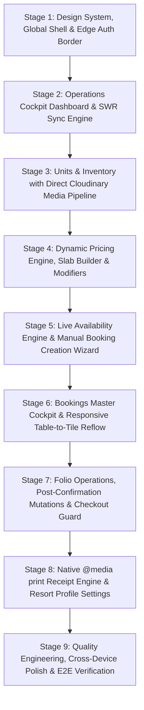

# Phase 3: Frontend Implementation Plan (Admin Panel)

This document provides a stage-by-stage, granular implementation plan for the **Parlak Resort Admin Panel**, strictly synthesizing the architectural contracts, domain rules, and design specifications defined in [admin-front-end.md](file:///Users/thasbeeh/Projects/parlak_resort/docs/admin_panel/admin-front-end.md), [admin-front-end-2.md](file:///Users/thasbeeh/Projects/parlak_resort/docs/admin_panel/admin-front-end-2.md), [rooms.md](file:///Users/thasbeeh/Projects/parlak_resort/docs/admin_panel/rooms.md), [event_hall.md](file:///Users/thasbeeh/Projects/parlak_resort/docs/admin_panel/event_hall.md), and [parlak-domain/SKILL.md](file:///Users/thasbeeh/Projects/parlak_resort/.agents/skills/parlak-domain/SKILL.md).

Rather than implementing the frontend in a single stretch, the work is partitioned into **9 sequential stages**. Each stage is self-contained with clear inputs, strict domain constraints, exact file locations, UI state matrices, designated developer skills, and a completion verification checklist.

---

## Stage Roadmap Overview



---

## Stage 1: Design System Foundations, Global Shell & Edge Auth Border

### 1. Objective
Establish the architectural design tokens, OKLCH color palettes, typography hierarchy, Emil Kowalski tactile control primitives, the responsive administrative shell (desktop sidebar, tablet icon rail, mobile drawer), and the Edge authentication boundary with `/admin/login`.

### 2. Skills to Apply in This Stage
- **`frontend-design`**: Establishes distinctive visual direction, tailored OKLCH palette (`Wet Basalt Slate`, `Deep Forest Moss`, `Alabaster Stone Canvas`, `Lantern Brass`), purposeful typography (`Fraunces` editorial display serif, `Plus Jakarta Sans`, `JetBrains Mono`), and anti-AI-slop structural linework.
- **`emil-design-eng`**: Guides tactile button micro-physics (`active:scale-[0.98]`, `--ease-snappy`), surface deceleration (`scale-96` to `scale-100`), zero layout reflows (avoiding `transition-all`), and zero gratuitous scroll motion.
- **`shadcn` / `migrate-radix-to-base`**: Governs Base UI (`@base-ui/react`) component integration, accessible headless dialogs, drawers, and compound form primitives (`FieldGroup`, `Field`, `InputGroup`).
- **`mobile-native`**: Enforces `SafeViewport` wrappers, dynamic viewport units (`100dvh`), iOS safe areas (`env(safe-area-inset-*)`), and iOS Safari 16px auto-zoom guard (`text-base md:text-sm`).
- **`web-design-guidelines`**: Audits accessible touch targets ($\ge 44\times 44\text{px}$), typographic punctuation (`…`), non-breaking currency spaces (`₹&nbsp;4,500`), and natural sentence casing.
- **`next-best-practices`**: Directs Next.js 16 App Router conventions, RSC layout nesting, and Edge authentication boundaries in `middleware.ts`.

### 3. Upstream Dependencies & Prerequisites
- Tailwind CSS v4 and Next.js 16 App Router configured.
- Existing Edge authentication middleware in [middleware.ts](file:///Users/thasbeeh/Projects/parlak_resort/middleware.ts).
- Web Crypto JWT verification via `jose`.

### 4. Files to Create / Modify
- `app/globals.css`: Update with OKLCH tokens, timing functions (`--ease-snappy: cubic-bezier(0.23, 1, 0.32, 1)`), fonts (`Fraunces`, `Plus Jakarta Sans`, `JetBrains Mono`), and dark mode variables.
- `components/ui/button.tsx`: Implement tactile Emil Kowalski button physics (`active:scale-[0.98] transition-transform duration-100 ease-[var(--ease-snappy)]`, loading spinner locking width).
- `components/ui/input.tsx`, `components/ui/textarea.tsx`, `components/ui/label.tsx`: Implement accessible form controls with mobile 16px guard (`text-base md:text-sm`).
- `components/ui/field.tsx`, `components/ui/input-group.tsx`, `components/ui/toggle-group.tsx`: Compound layout primitives per [admin-front-end-2.md#6](file:///Users/thasbeeh/Projects/parlak_resort/docs/admin_panel/admin-front-end-2.md#6).
- `components/ui/status-badge.tsx`: Domain status badge with fixed semantic colors (`CONFIRMED`, `CHECKED_IN`, `CHECKED_OUT`, `CANCELLED`, `MAINTENANCE_BLOCKED`).
- `components/admin/SafeViewport.tsx`: Mobile dynamic viewport wrapper strictly enforcing `min-h-[100dvh]` and safe-area insets (`env(safe-area-inset-*)`).
- `components/admin/AdminSidebar.tsx`: Multi-device navigation shell (260px fixed desktop sidebar, 68px tablet icon rail, accessible Base UI mobile drawer sheet).
- `components/admin/AdminHeader.tsx`: Sticky top bar with brand crest, live network sync status pill (`LiveSyncBadge.tsx`), admin profile, and logout trigger.
- `components/admin/OfflineBanner.tsx`: Sticky top banner sliding down on network disconnection (`navigator.onLine === false`).
- `app/admin/layout.tsx`: Root administrative shell wrapping authenticated views with `SafeViewport`, `AdminSidebar`, and `AdminHeader`.
- `app/admin/page.tsx`: Server Component executing instant 307 redirect to `/admin/dashboard`.
- `app/admin/login/page.tsx`: Full-screen authentication view with credentials form, password toggle, inline error banner, and `actions/auth.ts -> loginAdmin` execution.
- `actions/auth.ts`: Server Actions for `loginAdmin` (sets HTTP-only `admin_token` cookie via `jose`) and `logoutAdmin` (clears cookie and redirects).

### 5. Component Architecture & Hierarchy
```text
app/admin/layout.tsx
 ├── SafeViewport (min-h-[100dvh])
 │    ├── AdminHeader (Desktop & Mobile)
 │    │    ├── Brand Crest ("Parlak Resort Admin")
 │    │    ├── LiveSyncBadge (🟢 Online / SWR indicator)
 │    │    ├── OfflineBanner (Hidden unless navigator.onLine === false)
 │    │    └── AdminProfileDropdown (Logout button)
 │    ├── AdminSidebar (Responsive: Desktop 260px | Tablet 68px Rail | Mobile Sheet)
 │    │    └── Navigation Links (Dashboard ⌘1, Bookings ⌘2, Units ⌘3, Pricing ⌘4, Settings ⌘5)
 │    └── <main className="flex-1 p-4 md:p-6 lg:p-8"> {children} </main>
```

### 6. Design Engineering & Emil Kowalski Physics
- **Button Micro-Interactions:** `active:scale-[0.98]` in 150ms with `cubic-bezier(0.23, 1, 0.32, 1)`. Zero layout reflow (avoid `transition-all`).
- **Surface Entrances:** Drawers and dialogs enter from `scale-96 opacity-0` decelerating into `scale-100 opacity-100` (never `scale-0`).
- **Typography:** Display headlines in `Fraunces` (`font-display`), interface labels in `Plus Jakarta Sans` (`font-sans`), numbers and currencies in `JetBrains Mono` (`font-mono tabular-nums`). Non-breaking spaces mandatory: `₹&nbsp;4,500`.

### 7. Verification & Stage Completion Checklist
- [ ] `app/globals.css` compiles without syntax errors; OKLCH CSS variables render correctly in both light and dark modes.
- [ ] Direct navigation to `/admin` redirects to `/admin/dashboard`.
- [ ] Unauthenticated requests to `/admin/dashboard` are intercepted by `middleware.ts` and redirected to `/admin/login`.
- [ ] Submitting valid credentials on `/admin/login` issues the `admin_token` cookie and routes to `/admin/dashboard`.
- [ ] Submitting invalid credentials shows a red error banner (`border-destructive`) without throwing unhandled exceptions.
- [ ] Navigation sidebar highlights active routes, responds to keyboard shortcuts (`⌘1`–`⌘5`), and collapses to an icon rail on tablet (768px–1023px) and an accessible drawer sheet on mobile (<768px).
- [ ] Toggling browser offline mode triggers the sliding yellow `OfflineBanner`.

---

## Stage 2: Operations Cockpit Dashboard & SWR Sync Engine

### 1. Objective
Build the administrative operational command center featuring 30-day net revenue analytics, today's check-ins/check-outs, overnight resident guest counts, Event Hall shift headcounts, underpaid arrival alerts, and today's roster—powered by RSC initial loads and a 30-second SWR background sync engine without WebSockets.

### 2. Skills to Apply in This Stage
- **`parlak-domain`**: Strictly enforces the 30-day net revenue formula ($\sum_{\text{Active}} \text{rent} + \sum_{\text{Cancelled}} (\text{paid} - \text{refund})$), isolates overnight residents to `stayType = 'OVERNIGHT'`, and flags underpaid arrivals.
- **`next-best-practices`**: Implements RSC initial load pattern passing Prisma query results as SWR `fallbackData` to achieve 0ms First Contentful Paint.
- **`vercel-react-best-practices`**: Configures SWR polling (`refreshInterval: 30000`, `revalidateOnFocus: true`), eliminates unnecessary re-renders, and guarantees zero layout shift (CLS).
- **`emil-design-eng`**: Implements dimensionally exact skeleton loaders, subtle numerical value transition pulses, and a non-intrusive live sync indicator.
- **`web-design-guidelines`**: Governs monospace tabular figures (`font-mono tabular-nums`) and non-breaking spaces for Indian Rupee amounts (`₹&nbsp;X,XXX`).

### 3. Upstream Dependencies & Prerequisites
- Stage 1 completed (Shell, layout, tokens, auth border).
- Seeded database with Prisma Client and PostgreSQL functions in place.

### 4. Files to Create / Modify
- `app/api/admin/dashboard/route.ts`: Secure GET route handler returning summary metrics, hall shift headcounts, underpaid arrivals, and today's roster.
- `app/admin/dashboard/page.tsx`: Server Component executing direct Prisma queries to build `fallbackData` for immediate initial render (0ms CLS).
- `components/admin/dashboard/DashboardClient.tsx`: Client container wrapping SWR with `refreshInterval: 30000`, `revalidateOnFocus: true`, and manual refresh trigger.
- `components/admin/dashboard/MetricCard.tsx`: Metric card rendering financial figures with `font-mono tabular-nums`, non-breaking currency `₹&nbsp;X,XXX`, and subtle value-change highlight.
- `components/admin/dashboard/HallShiftCards.tsx`: Headcount monitors for Non-AC and AC halls across Morning (10 AM–3 PM) and Evening (5 PM–10 PM) shifts.
- `components/admin/dashboard/UnderpaidArrivalsAlert.tsx`: Alert list highlighting arriving guests where `totalPaid < requiredAdvance`, with shortfall badge and quick payment modal trigger.
- `components/admin/dashboard/TodayRosterTable.tsx`: Operational table for today's arrivals and departures with stay-type pills and quick Check-In/Check-Out actions.
- `components/admin/dashboard/DashboardSkeletons.tsx`: Dimensionally exact skeleton placeholders preventing Layout Shift during initial loading.

### 5. Domain & Calculation Guardrails
- **30-Day Net Revenue Formula:** Calculates active stay rent plus non-refundable retained fees from cancellations per [rooms.md](file:///Users/thasbeeh/Projects/parlak_resort/docs/admin_panel/rooms.md):
  $$\text{Net Revenue} = \sum_{\text{Active}} \text{rent\_charge} + \sum_{\text{Cancelled}} (\text{total\_paid} - \text{refund\_amount})$$
  *(Extra receipt line items are strictly excluded from dashboard rent analytics).*
- **Resident Overnight Guests Invariant:** Filter strictly by `stayType = 'OVERNIGHT'` across Domes and A-Frames. Day slot visitors and resting dome attendees are strictly excluded.
- **Underpaid Arrival Condition:** Triggers when `arrivalDate === TODAY` AND `totalPaid < requiredAdvance`.

### 6. UI States to Handle
1. **Initial / Loaded:** 4 metric cards, 2 hall shift cards, underpaid arrivals strip, today's roster table.
2. **Loading / Background Sync:** Zero CLS. Pulsing dot in header (`LiveSyncBadge`) indicates background revalidation.
3. **Empty Roster:** Centered graphic with `CalendarX`: *"No arrivals, departures, or events scheduled for today."*
4. **Empty Underpaid Alert:** Emerald box with `CheckCircle2`: *"All guests arriving today have met the required advance payment."*
5. **Error State:** Network failure renders an inline alert inside cards with a retry button; toast alert announces sync failure.

### 7. Verification & Stage Completion Checklist
- [ ] `GET /api/admin/dashboard` returns 401 if unauthenticated, and 200 with the exact payload structure defined in [admin-front-end.md#10.3](file:///Users/thasbeeh/Projects/parlak_resort/docs/admin_panel/admin-front-end.md#10.3).
- [ ] Visiting `/admin/dashboard` renders instantly via RSC `fallbackData` with zero hydration error or layout shift.
- [ ] Switching away to another browser tab and returning triggers SWR focus revalidation within 30 seconds.
- [ ] 30-day net revenue correctly includes retained cancellation income and excludes extra receipt line items.
- [ ] Overnight guest tile counts only `OVERNIGHT` guests.
- [ ] Underpaid arrival alert appears only when `totalPaid < requiredAdvance` for today's arrivals.

---

## Stage 3: Units & Inventory Management with Direct Cloudinary Media Pipeline

### 1. Objective
Build the inventory management interface for Geodesic Domes, A-Frames, and Event Halls, including status toggles with the Pre-Deactivation Guard, PostgreSQL GiST maintenance blockers, unit configuration editing, and the direct-to-Cloudinary sequential upload pipeline.

### 2. Skills to Apply in This Stage
- **`parlak-domain`**: Enforces the Pre-Deactivation Guard (`UNIT_HAS_FUTURE_BOOKINGS`), category-matched Price List attachment, physical capacity ceiling ($PriceList \le Unit$), and single featured cover photo lifecycle rules.
- **`neon-postgres`**: Implements maintenance block insertion directly into `BookingUnit` with `status: 'MAINTENANCE_BLOCKED'`, guarded by PostgreSQL `tstzrange` GiST exclusion constraints (`UNIT_SCHEDULE_COLLISION`).
- **`modern-web-guidance`**: Governs direct client-side REST upload to Cloudinary (bypassing Vercel serverless function limits), drag-and-drop file dropzone, and 3MB client validation.
- **`shadcn`**: Manages interactive dialogs, accessible alert banners, and form components.
- **`emil-design-eng`**: Provides sortable gallery drag-and-drop animation physics and switch toggle tactile responses.
- **`mobile-native`**: Handles mobile touch gestures on draggable image gallery tiles.

### 3. Upstream Dependencies & Prerequisites
- Stage 1 completed.
- Existing actions in [actions/units.ts](file:///Users/thasbeeh/Projects/parlak_resort/actions/units.ts) and [actions/media.ts](file:///Users/thasbeeh/Projects/parlak_resort/actions/media.ts).
- Cloudinary environment variables configured.

### 4. Files to Create / Modify
- `app/admin/units/page.tsx`: RSC inventory view listing all Domes, A-Frames, and Halls with category filter tabs and inventory summary counters.
- `components/admin/units/UnitCard.tsx`: Inventory card showing featured cover thumbnail, capacity chip, assigned Price List, status switch, and actions.
- `components/admin/units/UnitStatusSwitch.tsx`: Active/Inactive toggle component wrapping `toggleUnitStatus` Server Action.
- `components/admin/units/PreDeactivationGuardDialog.tsx`: Modal dialog trapping `UNIT_HAS_FUTURE_BOOKINGS`, listing conflicting booking IDs and dates, blocking deactivation until resolved.
- `components/admin/units/MaintenanceBlockDialog.tsx`: Modal to block dates directly in PostgreSQL via `BookingUnit` with `status: 'MAINTENANCE_BLOCKED'`, catching `UNIT_SCHEDULE_COLLISION`.
- `app/admin/units/[id]/page.tsx`: RSC + Client Form for editing unit name, description, physical capacity, and assigning a category-filtered Price List.
- `components/admin/units/ImageUploadArea.tsx`: Drag-and-drop zone with client-side 3MB file check and sequential upload queue directly to Cloudinary REST.
- `components/admin/units/SortableGallery.tsx`: Draggable grid of uploaded photos with delete dialog and single `isFeatured: true` cover photo maintenance.

### 5. Domain & Concurrency Guardrails
- **Pre-Deactivation Guard:** Backend verifies `endDatetime >= NOW()` AND `status != 'CANCELLED'`. If future bookings exist, throws `UNIT_HAS_FUTURE_BOOKINGS`. Frontend must display the exact list of conflicting bookings.
- **Capacity Safeguard:** `PriceList.maxGuestCapacity` must be $\le$ `Unit.physicalCapacity`. The dropdown selector must strictly filter to price lists matching the unit's category.
- **Direct Cloudinary REST Pipeline:** Image files bypass Vercel serverless functions completely. Browser requests signed params from `actions/media.ts -> generateCloudinarySignature`, uploads directly to Cloudinary REST, and saves photo metadata.
- **Featured Photo Invariant:** The first photo uploaded to an empty unit is automatically set to `isFeatured: true`. Deleting the featured photo atomically promotes the remaining photo with the lowest `orderIndex`.

### 6. Verification & Stage Completion Checklist
- [ ] `/admin/units` displays all 4 Domes, 3 A-Frames, and 2 Event Halls (with AC Hall marked Inactive / Under Construction).
- [ ] Attempting to toggle an active unit with future reservations to "Inactive" triggers `PreDeactivationGuardDialog` and reverts the switch.
- [ ] Adding a maintenance block that collides with an existing reservation catches `UNIT_SCHEDULE_COLLISION` (409) and displays the conflict alert.
- [ ] Editing unit details on `/admin/units/[id]` validates that the assigned Price List does not exceed physical capacity.
- [ ] Uploading an image $> 3\text{MB}$ is rejected on the client side before any network request is dispatched.
- [ ] Batch uploads execute sequentially with visible progress indicators.
- [ ] Deleting the featured photo automatically reassigns the featured cover badge to the lowest remaining `orderIndex` photo.

---

## Stage 4: Dynamic Pricing Engine, Slab Builder & Modifiers

### 1. Objective
Construct the dynamic tariff management engine, including the multi-tier headcount slab builder with contiguous bounds validation, price list assignment guards, and IST-bounded weekend/seasonal modifiers.

### 2. Skills to Apply in This Stage
- **`parlak-domain`**: Governs mandatory slot types (Overnight + Day Slot for Rooms; Morning + Evening for Halls), contiguous slab bounds ($S_{i+1}.min = S_i.max + 1$), percentage adjustment boundaries ($-80\%$ to $+200\%$), and audit locking on expired modifiers.
- **`shadcn`**: Manages complex dynamic form state via React Hook Form `useFieldArray` and Zod `superRefine` integration.
- **`web-design-guidelines`**: Designs clear inline visual gap error indicators, accessible numeric inputs, and natural sentence case labels.
- **`next-best-practices`**: Implements Server Action mutations with transactional isolation (`prisma.$transaction`) to eliminate intermediate zero-slab states.

### 3. Upstream Dependencies & Prerequisites
- Stage 1 and Stage 3 completed.
- Existing actions in [actions/price-lists.ts](file:///Users/thasbeeh/Projects/parlak_resort/actions/price-lists.ts) and [actions/modifiers.ts](file:///Users/thasbeeh/Projects/parlak_resort/actions/modifiers.ts).
- Zod schemas in [schemas/price.schema.ts](file:///Users/thasbeeh/Projects/parlak_resort/schemas/price.schema.ts).

### 4. Files to Create / Modify
- `app/admin/pricing/page.tsx`: RSC listing all configured Price Lists, headcount spans, slab counts, and linked units count.
- `components/admin/pricing/PriceListsTable.tsx`: Tabular view of price profiles with `DeletePriceListDialog` enforcing `PRICE_LIST_IN_USE` delete blocking.
- `app/admin/pricing/new/page.tsx` & `app/admin/pricing/[id]/page.tsx`: Route wrappers for creating and editing Price Lists.
- `components/admin/pricing/UnitPricingSlabBuilder.tsx`: Complex dynamic array form using React Hook Form's `useFieldArray` for slot-based slabs.
- `components/admin/pricing/SlabGapIndicator.tsx`: Real-time visual gap detector showing red indicator if $S_{i+1}.min \ne S_i.max + 1$.
- `components/admin/pricing/PriceCalculatorWidget.tsx`: Interactive test simulator allowing Admins to enter an arbitrary headcount to verify resolved tariffs.
- `app/admin/pricing/modifiers/page.tsx`: Management view for active, upcoming, and expired modifiers with collapsible audit archive.
- `components/admin/pricing/ModifierModal.tsx`: Dialog form for creating and editing `WEEKEND` and `SEASONAL` rules.

### 5. Domain & Validation Guardrails
- **Mandatory Slot Types:**
  - Rooms (`DOME`, `A_FRAME`): Must define slabs for **both** `OVERNIGHT` (12 PM–11 AM) and `DAY_SLOT` (10 AM–3 PM).
  - Halls (`NON_AC_HALL`, `AC_HALL`): Must define slabs for **both** `MORNING_SLOT` (10 AM–3 PM) and `EVENING_SLOT` (5 PM–10 PM).
- **Contiguous Headcount Bounds:** Lowest slab starts at `minHeadcount = 1`. Contiguous with zero gaps: $S_{i+1}.min = S_i.max + 1$. Highest slab cannot exceed `maxGuestCapacity`.
- **Modifier Types:** Strictly `WEEKEND` and `SEASONAL` (no separate `HOLIDAY` type exists; holiday rules are created as `SEASONAL` date spans).
- **Percentage Bounds:** Constrained between `-80%` and `+200%`.
- **Audit Locking on Expired Modifiers:** When `endDate < today (IST)`, modifiers are permanently locked. Editing or deletion is strictly blocked (`EXPIRED_MODIFIER_LOCKED`).

### 6. Verification & Stage Completion Checklist
- [ ] `/admin/pricing` lists all rate plans with linked units.
- [ ] Attempting to delete a Price List attached to an active unit triggers `PRICE_LIST_IN_USE` and blocks deletion.
- [ ] Slab builder visually flags gaps between slab tiers in real time before form submission.
- [ ] Price list creation enforces both required slot types before allowing save.
- [ ] Modifiers creation rejects start dates in the past (IST) and enforces $-80\% \le \text{percentage} \le +200\%$.
- [ ] Expired modifiers in `/admin/pricing/modifiers` render in read-only mode with disabled actions and lock icons.

---

## Stage 5: Live Availability Engine & Manual Booking Creation Wizard

### 1. Objective
Build the manual reservation creation cockpit (`/admin/bookings/new`) for WhatsApp bookings—featuring live unit availability queries, resting Dome status chips, complimentary dome eligibility detection, slot duration presets, live tariff calculation, and PostgreSQL GiST collision handling.

### 2. Skills to Apply in This Stage
- **`parlak-domain`**: Enforces strict occupancy hard caps (Domes: 3 adults/2 infants; A-Frames: 5 adults/4 infants; strictly 0 extra beds), Event Hall complimentary resting dome eligibility ($\ge 400$ pax), flat preset durations, and zero event type tracking.
- **`neon-postgres`**: Handles PostgreSQL GiST concurrency collisions (`23P01 exclusion_violation`), mapping database kernel collisions to user-friendly UI error payloads.
- **`modern-web-guidance`**: Implements asynchronous availability chip queries, responsive multi-section form layouts, and accessible collision banners (`role="alert"`).
- **`shadcn` / `emil-design-eng`**: Implements tactile duration preset buttons (`active:scale-[0.98]`), slot tab transitions, and collision modal entrance deceleration (`scale-96` to `scale-100`).
- **`mobile-native`**: Enforces mobile input zoom guards (`text-base md:text-sm`) and numeric keypad triggers (`inputMode="numeric"`) for phone numbers and headcounts.

### 3. Upstream Dependencies & Prerequisites
- Stages 1, 3, and 4 completed.
- Existing actions in [actions/bookings.ts](file:///Users/thasbeeh/Projects/parlak_resort/actions/bookings.ts).
- Validation schema in [schemas/booking.schema.ts](file:///Users/thasbeeh/Projects/parlak_resort/schemas/booking.schema.ts).

### 4. Files to Create / Modify
- `app/api/admin/bookings/check-availability/route.ts`: API endpoint checking schedule availability for units and attached Domes across selected dates/times.
- `app/admin/bookings/new/page.tsx`: Route container for manual booking creation.
- `components/admin/bookings/BookingCreationForm.tsx`: Multi-section form implementing `createBookingSchema`:
  - **Guest CRM Section:** Name (1–100 chars), Phone (10–15 digits regex `^\+?[0-9]{10,15}$`), Email, Notes.
  - **Timing & Slot Presets:** Quick buttons for Overnight (12 PM–11 AM), Day Slot (10 AM–3 PM), Hall Morning (10 AM–3 PM), Hall Evening (5 PM–10 PM).
  - **Unit Selection & Bundling:** Multi-unit selection with live green/red availability chips.
  - **Event Hall Dome Sub-Panel:** Live indicator chips for attached resting Domes.
  - **Occupancy Section:** Adults & infants (rooms) or headcount (halls). Zero event type tracking per domain spec.
  - **Live Pricing Summary Card:** Calculates base rate + active modifiers = `rentCharge`, required advance, and `totalPaid` input.
- `components/admin/bookings/CollisionAlert.tsx`: Inline accessible alert banner (`role="alert"`) catching `UNIT_SCHEDULE_COLLISION` (409) with conflicting room name, booking ID, and dates.

### 5. Domain & Concurrency Guardrails
- **Occupancy Hard Caps:**
  - Domes: Max 3 Adults, Max 2 Infants. **Strictly 0 extra beds.**
  - A-Frames: Max 5 Adults, Max 4 Infants. **Strictly 0 extra beds.**
  - Halls: Headcount $\ge 1$ and $\le$ `Unit.maxCapacity` (1,200 for Non-AC, 2,000 for AC).
- **Complimentary Resting Dome Rule:** When booking an Event Hall:
  - If `headcount >= 400 Pax`: Attached resting Domes during event hours are flagged as **Complimentary** (`isComplimentary = true`, `unitPrice = 0`).
  - If `headcount < 400 Pax`: Attached Domes require custom rent or bundled tariffs.
  - In all cases, the Dome must be free from conflicting overnight stays (checked via `/api/admin/bookings/check-availability`).
- **PostgreSQL GiST Overlap Protection:** If an overlap occurs concurrently, the backend catches `23P01` and returns `UNIT_SCHEDULE_COLLISION`. Frontend traps this error and renders `CollisionAlert.tsx` with conflicting booking details.

### 6. Verification & Stage Completion Checklist
- [ ] Entering an invalid phone number (<10 or >15 digits) produces an immediate validation error.
- [ ] Selecting an Event Hall with $\ge 400$ pax displays the green *"Eligible for 1 Complimentary Attached Dome"* indicator.
- [ ] Attached Dome sub-panel correctly displays Red chips for Domes booked by overlapping overnight stays.
- [ ] Pricing summary card dynamically resolves the active price slab and applies weekend/seasonal percentage adjustments.
- [ ] Simulating a concurrent booking collision triggers `CollisionAlert.tsx` without unmounting the form or losing entered guest data.
- [ ] Successful submission creates a `CONFIRMED` booking, redirects to `/admin/bookings`, and displays an emerald success toast.

---

## Stage 6: Bookings Master Cockpit & Responsive Table-to-Tile Reflow

### 1. Objective
Build the primary bookings management dashboard (`/admin/bookings`) featuring a high-density tabular grid for desktop/tablet, debounced multi-criteria filters, and the hybrid **Table-to-Tile Reflow** for mobile screens (<768px).

### 2. Skills to Apply in This Stage
- **`parlak-domain`**: Formats booking references (`#B001`), surfaces unit badges, and manages lifecycle statuses (`CONFIRMED`, `CHECKED_IN`, `CHECKED_OUT`, `CANCELLED`).
- **`mobile-native`**: Implements the **Hybrid Table-to-Tile Reflow** for mobile viewports (<768px), ensuring stacked tactile cards, 44×44px tap targets, and thumb-zone actions.
- **`emil-design-eng`**: Enforces **0ms motion delay** on table filtering and pagination (instant DOM replacement for operational speed) and tactile row button presses.
- **`web-design-guidelines`**: Structures the 7-column dense table grid (`py-2.5 px-3`, ~44px height), aligns currency with `tabular-nums font-mono`, and provides accessible WhatsApp links.
- **`vercel-react-best-practices`**: Configures SWR caching, 300ms debounced search, optimistic status updates, and zero layout shift on pagination.

### 3. Upstream Dependencies & Prerequisites
- Stages 1, 2, and 5 completed.
- SWR data fetching and cache invalidation established.

### 4. Files to Create / Modify
- `app/api/admin/bookings/route.ts`: Secure GET handler with pagination (`page`, `limit`), search (guest name, phone, booking ID), status tabs, unit filter, and date ranges.
- `app/admin/bookings/page.tsx`: RSC shell fetching initial page data for SWR `fallbackData`.
- `components/admin/bookings/BookingsDataTable.tsx`: SWR-synced list with debounced search, status filter pills (`All`, `Confirmed`, `Checked-In`, `Checked-Out`, `Cancelled`), and unit selectors.
- `components/admin/bookings/ResponsiveBookingsList.tsx`: Compound layout rendering:
  - **Desktop / Tablet ($\ge 768px$):** 7-column dense table grid (`py-2.5 px-3`, ~44px height, `tabular-nums font-mono`).
  - **Mobile ($< 768px$):** Stacked tactile cards with `#ID` + status pill, click-to-call/WhatsApp phone links, unit badges, balance due, and full-width `Manage Folio` action button.
- `components/admin/bookings/BookingsKpiStrip.tsx`: Summary strip displaying total bookings, currently in-house, arriving today, and outstanding receivables.
- `components/admin/bookings/ZeroBalanceBadge.tsx`: Visual badge rendering green `Settled: ₹0` or amber `Due: ₹X,XXX` in `tabular-nums font-mono`.

### 5. Design Engineering & Emil Kowalski Principles
- **Zero Motion on Data Filtering:** Table row filtering and pagination must execute with 0ms transition delay (instant DOM update) to preserve operational speed.
- **Mobile Tap Targets:** All mobile action buttons, phone links, and row touch targets maintain a minimum 44×44px hit target.
- **Punctuation & Formatting:** Use typographic ellipses (`…`), non-breaking spaces before currency symbols (`₹&nbsp;14,000`), and natural sentence casing.

### 6. Verification & Stage Completion Checklist
- [x] `/admin/bookings` loads instantly with initial RSC data; SWR background polling refreshes data every 30 seconds.
- [x] Search input debounces at 300ms and filters across guest names, phone numbers, and booking IDs (`#B001`).
- [x] Resizing viewport below 768px smoothly transitions the desktop table into stacked mobile cards without horizontal scrollbars.
- [x] Click-to-WhatsApp link opens `https://wa.me/` with the sanitized guest phone number.
- [x] Status filter pills correctly filter between `Confirmed`, `Checked-In`, `Checked-Out`, and `Cancelled`.

---

## Stage 7: Folio Management, Post-Confirmation Mutations & Checkout Guard

### 1. Objective
Implement the in-stay folio lifecycle: Check-In, Optimistic Concurrency Control (OCC) post-confirmation edits with Scope-Based Recalculation, payments, extra line items/waivers, cancellation with cascading release, and the hard-blocked Zero Balance Due checkout invariant.

### 2. Skills to Apply in This Stage
- **`parlak-domain`**: Strictly governs Optimistic Concurrency Control (`expectedUpdatedAt`), the Scope-Based Recalculation engine (baseline stay preserved, extension at active tariff), the **Zero Balance Due Invariant** ($|balance| < 1$ for checkout), and atomic cascading release on cancellation.
- **`shadcn` / `migrate-radix-to-base`**: Governs compound `FolioDrawer` slide-over sheets (`h-[100dvh]`), accessible modal overlays, and form validation bindings.
- **`emil-design-eng`**: Implements tactile slide-over spring transitions, prominent OCC conflict error banners, and disabled checkout button affordances.
- **`web-design-guidelines`**: Ensures distinct separation between rent charges and receipt line items, unambiguous currency math, and accessible destructive cancellation prompts.

### 3. Upstream Dependencies & Prerequisites
- Stages 1 through 6 completed.
- Existing mutation actions in [actions/bookings.ts](file:///Users/thasbeeh/Projects/parlak_resort/actions/bookings.ts).
- Schemas in [schemas/booking.schema.ts](file:///Users/thasbeeh/Projects/parlak_resort/schemas/booking.schema.ts).

### 4. Files to Create / Modify
- `components/admin/bookings/FolioDrawer.tsx`: Compound slide-over drawer (`w-full sm:max-w-md h-[100dvh]`) combining guest details, assigned units, itemized line items, payment history, and checkout actions.
- `components/admin/bookings/BookingEditDialog.tsx`: Dialog for mutating dates, slot hours, or swapping units with OCC protection (`expectedUpdatedAt`).
- `components/admin/bookings/ScopeRecalculationPrompt.tsx`: UI component displaying scope breakdown (*"Baseline Stay: ₹X,XXX | Extension: +₹Y,YYY"*) and choices (*"Apply Recalculated Rent"* vs *"Keep Custom Rent"*).
- `components/admin/bookings/PaymentRecordDialog.tsx`: Modal for recording payments (`recordPaymentSchema`), sending OCC timestamp, and updating `totalPaid`.
- `components/admin/bookings/ReceiptLineItemsDrawer.tsx`: Slide-over for adding positive charges (BBQ, extra bedding) or negative courtesy waivers to `receiptLineItems` JSONB array.
- `components/admin/bookings/CheckoutDialog.tsx`: Modal enforcing the **Zero Balance Due Invariant**, hard-disabling checkout if balance $\ne 0$.
- `components/admin/bookings/CancelBookingDialog.tsx`: Modal to execute cancellation with refund ($0 \le refund \le totalPaid$), cascading release of attached Domes, and lifting of GiST calendar locks.

### 5. Domain & Concurrency Guardrails
- **Optimistic Concurrency Control (OCC):** Every mutation sends `expectedUpdatedAt`. If another Admin modified the reservation concurrently, backend throws `BOOKING_STALE_RECORD` (409). Frontend catches this and renders a block-level conflict alert prompting the Admin to refresh.
- **Scope-Based Recalculation Engine:**
  - Contracted baseline stay preserves historical `bookedBaseRate`.
  - Incremental extensions evaluate against the current active Price List.
  - Headcount upgrades apply algebraic floor: $\max(0, \text{ActiveRate}(\text{New}) - \text{ActiveRate}(\text{Original}))$.
- **Zero Balance Due Invariant:**
  $$\text{Balance Due} = \text{Math.round}(\text{rentCharge} + \sum \text{receiptLineItems}) - \text{Math.round}(\text{totalPaid})$$
  The `Check Out` button is hard-disabled if `Math.abs(Balance Due) >= 1`. If balance remains, displays blocking alert: *"Cannot check out: Outstanding balance of ₹X,XXX must be collected or adjusted to ₹0 first."*
- **Cascading Cancellation & Trigger:** Cancelling an Event Hall booking atomically cancels all attached resting Domes (`parentBookingId == id`), frees GiST calendar blocks, and database trigger updates `netRevenue = totalPaid - refundAmount`.

### 6. Verification & Stage Completion Checklist
- [ ] Editing dates on a confirmed booking sends `expectedUpdatedAt`; modifying the same record in another tab triggers `BOOKING_STALE_RECORD` (409) conflict alert.
- [ ] Extending stay dates renders `ScopeRecalculationPrompt` showing baseline stay preserved and extension calculated at current tariffs.
- [ ] Adding positive and negative line items updates `receiptLineItems` JSONB array and recalculates folio balance without altering 30-day rent analytics.
- [ ] Attempting to check out a guest with an outstanding balance of $\ge ₹1$ hard-disables the Check-Out button and displays the settlement error banner.
- [ ] Recording payment settles the balance to ₹0 and immediately enables the Check-Out button.
- [ ] Cancelling a reservation with attached resting Domes atomically cancels all attached Domes and frees the units on the availability calendar.

---

## Stage 8: Native `@media print` Receipt Engine & Resort Profile Settings

### 1. Objective
Build the zero-bundle printable invoice and thermal receipt view (`/admin/bookings/[id]/print`) using native `@media print` CSS stylesheets, along with the resort profile and platform settings editor (`/admin/settings`).

### 2. Skills to Apply in This Stage
- **`modern-web-guidance`**: Implements pure CSS `@media print` stylesheets, `@page` margin declarations, and browser-driven `window.print()` workflows, completely eliminating bulky PDF serverless dependencies (~450 kB saved).
- **`web-design-guidelines`**: Formats high-contrast monochrome typography for 80mm thermal receipts and A4 tax invoices, signature blocks, and "PAID IN FULL" watermark stamps.
- **`parlak-domain`**: Structures itemized billings from `receiptLineItems` JSONB and displays read-only seeded admin accounts.
- **`next-best-practices`**: Implements static metadata rendering and RSC page optimization for printable document views.

### 3. Upstream Dependencies & Prerequisites
- Stages 1 through 7 completed.
- All booking folio data and receipt line items fully accessible via Server Actions.

### 4. Files to Create / Modify
- `app/admin/bookings/[id]/print/page.tsx`: Printable RSC view designed exclusively with pure CSS `@media print` rules (zero external PDF libraries):
  - **Screen Action Bar (Hidden on print):** Back button, "Print 80mm Thermal Receipt", "Print A4 Invoice", and `window.print()` trigger.
  - **Resort Identity Header:** Crest logo, GSTIN, business phone, property address.
  - **Invoice Metadata Bar:** Tax Invoice / Booking Ref (#B001), Issue Date, Booking Status.
  - **Guest Particulars:** Guest Name, 10-digit Phone, Email.
  - **Stay Particulars:** Booked Units, Check-In/Out dates & times, Headcount/Occupancy.
  - **Itemized Table:** Baseline stay rent, extra services, and courtesy waivers.
  - **Payment & Balance Settlement:** Total rent, total paid, and net balance due.
  - **"PAID IN FULL" Watermark:** Green watermark stamp rendered when Outstanding Balance is ₹0; renders "ADVANCE RECEIPT" if balance remains.
  - **Signatures Area:** Check-out policies, guest signature line, manager signature line.
- `app/admin/settings/page.tsx`: Server Component + Client Form for resort profile, front desk hotline, WhatsApp phone, operating hours, and seeded admin accounts overview.
- `components/admin/settings/ResortProfileForm.tsx`: Settings form to update resort metadata and standard check-in/out timings.
- `components/admin/settings/AdminAccountsList.tsx`: Read-only table displaying the 3 seeded Admin accounts (no public user creation).

### 5. Technical Guardrails & Bundle Preservation
- **Zero PDF Dependencies:** Strictly prohibits importing `@react-pdf/renderer`, `jspdf`, `html2pdf`, or `puppeteer`. Saves ~450 kB bundle overhead.
- **Print CSS Standards:**
  - Screen controls hidden via `@media print { .no-print { display: none !important; } }`.
  - Margins and page dimensions enforced natively via `@page { size: A4 portrait; margin: 12mm; }` and `@page thermal { size: 80mm auto; margin: 2mm; }`.
  - High-contrast monochromatic text and borders for thermal printer legibility.

### 6. Verification & Stage Completion Checklist
- [ ] Navigating to `/admin/bookings/[id]/print` renders the complete tax invoice with itemized charges and payment history.
- [ ] When balance is ₹0, the "PAID IN FULL" watermark stamp renders prominently.
- [ ] Clicking "Print Document" opens the native browser print preview (`window.print()`).
- [ ] In the print preview, all action buttons, sidebars, and navigation headers are completely hidden.
- [ ] Toggling between 80mm Thermal Receipt and A4 formats formats cleanly without text truncation.
- [ ] Editing resort profile settings in `/admin/settings` updates phone numbers and timings.

---

## Stage 9: Quality Engineering, Cross-Device Polish & End-to-End Verification

### 1. Objective
Execute a rigorous quality engineering audit across tactile micro-interactions, mobile ergonomics, concurrency resilience, accessibility, and end-to-end operational workflows.

### 2. Skills to Apply in This Stage
- **`emil-design-eng`**: Audits tactile button micro-interactions (`active:scale-[0.98]`), surface deceleration physics (`scale-96` to `scale-100`), loader layouts, and zero-motion table filtering.
- **`mobile-native`**: Validates iOS Safari 16px font check on all form inputs, 44×44px tap target bounding boxes, safe-area insets, and `100dvh` viewport resilience.
- **`web-design-guidelines` / `a11y-debugging`**: Performs accessibility audits (ARIA roles, live regions, contrast ratios, keyboard navigation shortcuts `⌘1`–`⌘5`).
- **`parlak-domain` / `neon-postgres`**: Executes concurrency stress tests (PostgreSQL GiST overlap trapping, OCC `409` stale record collision, pre-deactivation booking guards).
- **`debug-optimize-lcp` / `vercel-react-best-practices`**: Verifies 0 CLS during SWR background sync and confirms zero unauthorized heavy bundle dependencies.

### 3. Upstream Dependencies & Prerequisites
- All previous stages (Stage 1 through Stage 8) completed.

### 4. Audit Scope & Verification Matrix

#### 1. Emil Kowalski Micro-Interaction Audit
- [ ] All interactive buttons compress tactually on click via `active:scale-[0.98]` in 150ms with `cubic-bezier(0.23, 1, 0.32, 1)`.
- [ ] All dialogs, sheets, and popovers emerge from `scale-96` decelerating to `scale-100` (zero `scale-0` singularities).
- [ ] Table filtering and search execute with **0ms motion delay** (instant DOM updates).
- [ ] Submitting buttons maintain fixed width and display centered spinning `<Loader2 className="animate-spin" />` with `aria-busy="true"`.

#### 2. Mobile Native & Ergonomics Audit
- [ ] All input fields on mobile enforce `text-base md:text-sm` (16px minimum), preventing iOS Safari auto-zoom on tap.
- [ ] All tap targets (buttons, links, table actions) satisfy the minimum 44×44px hit bounding box.
- [ ] Safe-area padding is strictly respected on iOS notched viewports via `env(safe-area-inset-bottom)` and `env(safe-area-inset-top)`.
- [ ] All pages wrap in `min-h-[100dvh]` to eliminate mobile address-bar jump.

#### 3. Concurrency & Integrity Audit
- [ ] **GiST Collision Test:** Attempting to book or place a maintenance block on an already reserved unit/time window catches PostgreSQL `23P01` and renders `UNIT_SCHEDULE_COLLISION` modal alert.
- [ ] **OCC Collision Test:** Simulating two concurrent edits on the same booking record catches `BOOKING_STALE_RECORD` (409) and presents the reload prompt.
- [ ] **Pre-Deactivation Guard Test:** Attempting to deactivate a unit with future reservations triggers `UNIT_HAS_FUTURE_BOOKINGS` and keeps the unit active.
- [ ] **Zero-Balance Checkout Invariant Test:** Attempting to check out a booking with `balanceDue > 0` is strictly blocked until payment is recorded.

#### 4. Performance & Bundle Audit
- [ ] Zero WebSockets connections established; SWR background polling operates cleanly on 30s intervals.
- [ ] Zero serverless PDF libraries bundled; bundle analyzer confirms zero `@react-pdf/renderer` or `puppeteer` imports.
- [ ] Cloudinary uploads bypass Next.js serverless functions via direct browser REST upload.
- [ ] Layout shift (CLS) is 0 on initial loads and during SWR revalidations.

---

## Stage Execution Summary Table

| Stage | Focus Area | Applicable Skills | Key Deliverables | Primary Guardrail Enforced |
| :--- | :--- | :--- | :--- | :--- |
| **Stage 1** | Shell, Tokens & Auth | `frontend-design`, `emil-design-eng`, `shadcn`, `mobile-native`, `web-design-guidelines`, `next-best-practices` | OKLCH globals, typography, Base UI primitives, responsive layout, `/admin/login` | Edge JWT route protection via `middleware.ts` |
| **Stage 2** | Operations Dashboard | `parlak-domain`, `next-best-practices`, `vercel-react-best-practices`, `emil-design-eng`, `web-design-guidelines` | `/admin/dashboard`, SWR 30s sync, KPI cards, underpaid alerts, today's roster | 30-day net revenue formula & zero WebSockets |
| **Stage 3** | Units & Media Pipeline | `parlak-domain`, `neon-postgres`, `modern-web-guidance`, `shadcn`, `emil-design-eng`, `mobile-native` | `/admin/units`, `/admin/units/[id]`, maintenance blocks, direct Cloudinary queue | Pre-Deactivation Guard & single featured photo invariant |
| **Stage 4** | Pricing & Modifiers | `parlak-domain`, `shadcn`, `web-design-guidelines`, `next-best-practices` | `/admin/pricing`, slab builder (`useFieldArray`), gap validator, modifiers | Contiguous slabs $S_{i+1}.min = S_i.max + 1$, expired audit lock |
| **Stage 5** | Booking Creation Wizard | `parlak-domain`, `neon-postgres`, `modern-web-guidance`, `shadcn`, `emil-design-eng`, `mobile-native` | `/admin/bookings/new`, live availability chips, slot presets, live tariff quotes | Hard occupancy caps & GiST overlap protection (`23P01`) |
| **Stage 6** | Bookings Master Cockpit | `parlak-domain`, `mobile-native`, `emil-design-eng`, `web-design-guidelines`, `vercel-react-best-practices` | `/admin/bookings`, dense grid, table-to-tile mobile reflow, debounced search | 44px tap targets, 0ms motion on table filtering |
| **Stage 7** | Folio & Checkout Engine | `parlak-domain`, `shadcn` / `migrate-radix-to-base`, `emil-design-eng`, `web-design-guidelines` | `FolioDrawer`, OCC edits, payments, line items, cascading cancellation, checkout | Zero Balance Due invariant & OCC `expectedUpdatedAt` |
| **Stage 8** | Native Print & Settings | `modern-web-guidance`, `web-design-guidelines`, `parlak-domain`, `next-best-practices` | `/admin/bookings/[id]/print`, `@media print` CSS, resort profile & timings | Zero PDF bundle dependencies (~450 kB saved) |
| **Stage 9** | Quality Engineering | `emil-design-eng`, `mobile-native`, `web-design-guidelines`, `parlak-domain`, `debug-optimize-lcp` | End-to-end verification, Emil Kowalski polish, mobile ergonomics, OCC stress tests | Flawless cross-device execution & 0 CLS |
